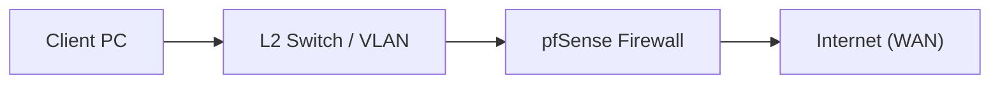

# 📝 Texnik Maqola Shablon (Article Template)

> **Eslatma:** Ushbu shablon 30 kunlik seriyaning har bir kuni uchun GitHub, Medium, Dev.to yoki LinkedIn maqolasi sifatida ishlatiladi. Strukturaga qat'iy amal qilish maqolangizni nufuzli xalqaro texnik bloglar darajasiga olib chiqadi.

---

```markdown
# [KUN-XX]: [Mavzu Nomi: Masalan, pfSense-da Multi-WAN Failover va Load Balancing]

**Muallif:** [Ismingiz]  
**Sana:** [YYYY-MM-DD]  
**Laboratoriya Muhiti:** Proxmox VE 8.x / VMware Workstation Pro 17  
**pfSense Versiyasi:** 2.7.2-RELEASE (Community Edition)  
**Qiyinlik Darajasi:** Boshlang'ich / O'rta / Yuqori (Advanced)

---

## 📌 1. Kirish va Muammo Tavsifi (The Problem Statement)
* Ushbu texnologiya nima uchun kerak?
* Real ishlab chiqarish (production) muhitida qanday biznes yoki texnik muammoni hal qiladi?
* Agar ushbu sozlama qilinmasa, tarmoqda qanday oqibatlar yuzaga keladi?

---

## 🗺️ 2. Arxitektura va Tarmoq Sxemasi (Network Diagram)



* **Interfeyslar:**
  * `WAN`: IP / Mask / Gateway
  * `LAN`: IP / Mask / DHCP Scope
  * `VLAN`: Teg raqami va maqsadi

---

## ⚙️ 3. Qadam-baqadam Sozlash (Step-by-Step Implementation)

### 3.1. [1-Qadam Nomi]
* WebGUI menyusi: `Menyu > Quyi bo'lim`
* Belgilanishi kerak bo'lgan parametrlar:
  * Parametr 1: `Qiymat`
  * Parametr 2: `Qiymat`
* *Skrinshot yoki konfiguratsiya rasmi (lozim bo'lsa)*

### 3.2. [2-Qadam Nomi]
* ...

---

## 🔍 4. Verifikatsiya va CLI Tekshiruvi (Testing & Verification)

Haqiqiy muhandis faqat GUI ga ishonmaydi, terminal orqali tekshiradi!

```bash
# pfSense FreeBSD konsolida yoki SSH orqali:
pfctl -sr | grep ...
netstat -rn
sockstat -4 -l
```

Sinov kompyuteridan tekshirish:
```bash
ping -c 4 1.1.1.1
traceroute 8.8.8.8
curl -Iv https://example.com
```

Natijalar tahlili va kutilgan javoblar.

---

## ⚠️ 5. Keng Tarqalgan Xatolar va Yechimlar (Troubleshooting & Gotchas)

1. **Xato 1:** ...
   * *Sababi:* ...
   * *Yechimi:* ...
2. **Xato 2:** ...
   * *Sababi:* ...
   * *Yechimi:* ...

---

## 🛡️ 6. Production Best Practices (Xavfsizlik Tavsiyalari)

* Ushbu sozlamani tirik korxona tarmog'iga tatbiq etishda nimalarni hisobga olish kerak?
* Zaxira nusxa (Backup), xavfsizlik cheklovlari va resurslar monitoringi.

---

## 📚 7. Foydali Havolalar va Manbalar
* [Netgate Rasmiy Hujjatlari](https://docs.netgate.com/)
* [FreeBSD Handbook](https://freebsd.org/handbook/)
```
