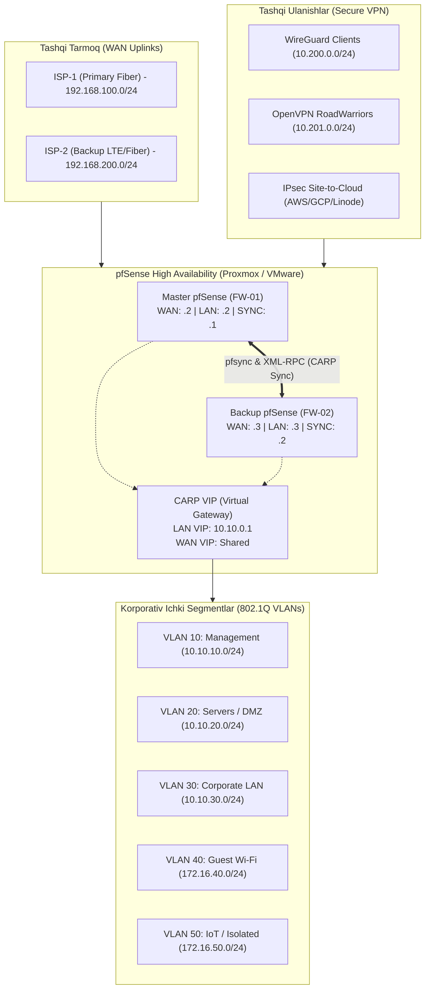

# 🛡️ pfSense 30-Day Production Mastery & Cloud Bootcamp
> **"Zero to Hero" — Laboratoriyadan Real Cloud (AWS / GCP / Linode) Production darajasigacha**

Ushbu repozitoriy pfSense xavfsizlik devori (firewall), marshrutizator (router) va korxona darajasidagi UTM (Unified Threat Management) tizimini noldan boshlab **Proxmox VE**, **VMware Workstation Pro** va **Real Cloud (AWS / GCP / Linode)** infratuzilmasida chuqur o'rganish, sinash va 30 kunlik professional texnik maqolalar to'plamini shakllantirish uchun mo'ljallangan.

---

## 📑 Mundarija
1. [Loyiha Maqsadi va Metodologiya](#-loyiha-maqsadi-va-metodologiya)
2. [Laboratoriya Topologiyasi va IP Sxemasi](#-laboratoriya-topologiyasi-va-ip-sxemasi)
3. [30 Kunlik Bosqichma-Bosqich O'quv Rejasi](#-30-kunlik-bosqichma-bosqich-oquv-rejasi)
4. [Tizim Talablari (Hardware & Software)](#-tizim-talablari)
5. [GitHub uchun Maqola Standarti](#-github-uchun-maqola-standarti)
6. [30-Kuni: Real Cloud (AWS/GCP/Linode) Deploy Plan](#-30-kuni-real-cloud-rejalashtirish)

---

## 🎯 Loyiha Maqsadi va Metodologiya

* **Chuqur Nazariya & Amaliyot:** Faqat WebGUI tugmalarini bosish emas, balki FreeBSD yadrosi, `pf` (packet filter) mexanizmi, L2/L3 tarmoq qatlamlari, kriptografiya va tarmoq xavfsizligi tahlili.
* **Dual Virtualizatsiya:** Bir vaqtning o'zida ham VMware Workstation Pro (mobil/local testlar), ham Proxmox VE (klaster, VLAN trunking, Linux Bridge) da parallel tekshiruv.
* **Production-Grade:** Kichik ofisdan tortib, minglab foydalanuvchiga ega korxonalar uchun mos keluvchi CARP (HA klaster), Multi-WAN, BGP/OSPF, 10G Traffic Shaping, Zero-Trust VPN.
* **30 Kunlik Ochiq Maqola (Open-Source Portfolio):** Har bir o'tilgan mavzu bo'yicha GitHub/LinkedIn/Habr/Medium uchun professional texnik maqola tayyorlash.

---

## 🗺️ Laboratoriya Topologiyasi va IP Sxemasi

### 📋 VLAN va Subnet Rejasi

| VLAN ID | Interface Nomi | Subnet CIDR | Gateway (CARP VIP) | Vazifasi / Maqsadi |
|---|---|---|---|---|
| **VLAN 10** | `MGMT` | `10.10.10.0/24` | `10.10.10.1` | Proxmox, VMware, Switch va pfSense boshqaruv interfeyslari |
| **VLAN 20** | `DMZ_SRV` | `10.10.20.0/24` | `10.10.20.1` | Web serverlar, DB, HAProxy orqasida joylashgan ommaviy servislar |
| **VLAN 30** | `CORP_LAN` | `10.10.30.0/24` | `10.10.30.1` | Korporativ ishchi xodimlar kompyuterlari |
| **VLAN 40** | `GUEST` | `172.16.40.0/24` | `172.16.40.1` | Mehmonlar uchun faqat internet (LAN ga ruxsat yo'q, izolyatsiya) |
| **VLAN 50** | `IOT` | `172.16.50.0/24` | `172.16.50.1` | Kameralar, aqlli qurilmalar (Internet cheklangan, LAN ga yo'l yopiq) |
| **VLAN 99** | `PFSYNC` | `192.168.99.0/24` | No VIP (Point-to-Point) | CARP va xmlrpc holat sinxronizatsiyasi uchun alohida L2 havola |

---

## 📅 30 Kunlik Bosqichma-Bosqich O'quv Rejasi

### 🔹 1-Hafta: Baza, Virtualizatsiya va Asosiy Tarmoq Qurilishi (Days 1–7)
* **1-Kun: pfSense va FreeBSD Arxitekturasi**
  * pfSense tarixi, FreeBSD arxitekturasi, monolit kernel va `pf` (Packet Filter).
  * VMware Workstation Pro (Virtual Network Editor, Host-Only, NAT, Bridged) va Proxmox VE (Linux Bridge `vmbr`, VLAN-aware bridge) sozlash.
* **2-Kun: O'rnatish va Dastlabki Hardening**
  * ZFS vs UFS fayl tizimlari, disk partitioning, konsol menyusi (IP belgilash).
  * WebGUI xavfsizligi: default `admin` nomini almashtirish, kuchli parollar, HTTP -> HTTPS, SSH portini o'zgartirish va faqat Public Key autentifikatsiya.
* **3-Kun: DHCP Server, Static Mappings va DHCP Relay**
  * DHCP pool tuzilishi, MAC orqali statik IP berish (Static Leases).
  * DHCP Options (Option 66/67 PXE Boot, Option 43/60 Wi-Fi AP provisioning, NTP server uzatish), DHCP Relay sozlash.
* **4-Kun: DNS chuqur tahlili (Unbound DNS Resolver & Forwarder)**
  * Unbound DNS arxitekturasi: Iterative root queries vs Forwarding mode.
  * DNSSEC faollashtirish, DNS over TLS (DoT - Cloudflare/Quad9 ga shifrlangan DNS), Host/Domain Overrides va Private Reverse DNS (`PTR`).
* **5-Kun: VLANlar (802.1Q) va Inter-VLAN Marshrutlash**
  * Virtual LAN tushunchasi, Tagged/Untagged freymlar, 802.1Q sarlavhasi.
  * Proxmox va VMware'da Trunk port yaratish, pfSense'da VLAN interfeyslar, MTU sozlamalari va Router-on-a-Stick sxemasi.
* **6-Kun: Firewall Qoidalari va Aliaslar (Aliasing Engine)**
  * pf qoidalar mantig'i: Yuqoridan pastga (Top-Down), birinchi moslik (First-Match), State Table qanday ishlaydi.
  * Inbound vs Outbound, Floating Rules (Quick flag, Match vs Pass).
  * Aliaslar: IP, Subnet, Port guruhlari, URL Tables (avtomatik yangilanuvchi ro'yxatlar).
* **7-Kun: NAT (Network Address Translation) Chuqurlashtirilgan**
  * Outbound NAT rejimlari: Automatic, Hybrid, Manual (qachon qaysi biri ishlatiladi?).
  * Port Forwarding (Destination NAT), 1:1 NAT (Public IP larni to'g'ridan-to'g'ri DMZ ga bog'lash).
  * NAT Reflection (NAT Loopback) — Pure NAT vs NAT+Proxy tahlili.

---

### 🔹 2-Hafta: Marshrutlash, Multi-WAN va VPN Texnologiyalari (Days 8–15)
* **8-Kun: Multi-WAN: Failover va Load Balancing**
  * 2 ta provayderni (ISP1 va ISP2) ulash, Gateway Monitoring (Monitor IP, Packet loss, Latency triggerlari).
  * Gateway Groups: Tier 1 + Tier 2 (Failover), Tier 1 + Tier 1 (Load Balance / Round Robin).
  * Sticky Connections (HTTPS sessiyalar uzilib qolmasligi uchun).
* **9-Kun: Dinamik Marshrutlash (FRR: OSPF va BGP)**
  * pfSense'ga FRRouting paketini o'rnatish.
  * OSPF Single Area va Multi-Area, Route Redistribution, pfSense bilan Linux/Cisco/Mikrotik o'rtasida dinamik marshrut almashish.
* **10-Kun: OpenVPN Remote Access (Road Warrior)**
  * Certificate Authority (CA) yaratish, Server Certificate, Client Certificate chiqarish.
  * OpenVPN Server sozlash (TUN mode, AES-256-GCM, TLS Authentication / Crypt).
  * Client Export Utility yordamida Windows, Android, iOS uchun avtomatik `.ovpn` konfiguratsiya tayyorlash.
* **11-Kun: OpenVPN Site-to-Site Tunneling**
  * Ikki pfSense o'rtasida shifrlangan aloqa (SSL/TLS vs Shared Key).
  * Client Specific Overrides (CSO) orqali har xil filiallar uchun marshrutlar belgilash.
  * Routing LAN-to-LAN va xavfsizlik devori orqali trafikni filtratsiyalash.
* **12-Kun: WireGuard on pfSense (Zamonaviy Yuqori Tezlikdagi VPN)**
  * WireGuard arxitekturasi: ChaCha20-Poly1305, Curve25519 kalit almashinuvi.
  * pfSense'da WireGuard Tun/Peers sozlash, AllowedIPs mantiqini o'zlashtirish.
  * OpenVPN va WireGuard o'rtasida `iperf3` orqali tezlik, CPU yuklamasi va ping solishtirish.
* **13-Kun: IPsec IKEv2 Site-to-Site Enterprise Tunnel**
  * Korxona darajasidagi IPsec: Phase 1 (IKE SA) va Phase 2 (Child SA).
  * DH Groups, AES-GCM shifrlash, Dead Peer Detection (DPD), Rekeying.
  * VTI (Virtual Tunnel Interface) orqali Routed IPsec o'rnatish va BGP/OSPF ni IPsec ustidan yurgizish.
* **14-Kun: IPsec IKEv2 Mobile Client (Native VPN)**
  * Windows, macOS, iOS qurilmalarga qo'shimcha ilovasiz, tizimning o'zida IKEv2 EAP / MSCHAPv2 orqali VPN ulash.
  * SAN (Subject Alternative Name) sertifikatlari va FQDN talablari.
* **15-Kun: Zero-Trust va Overlay Network (Tailscale)**
  * pfSense'da Tailscale paketini ulash, Subnet Router funksiyasini yoqish.
  * NAT Traversalsiz, CGNAT ortidagi tarmoqlarni yagona global meshga ulash.

---

### 🔹 3-Hafta: Kiberxavfsizlik, UTM, QoS va High Availability (Days 16–23)
* **16-Kun: pfBlockerNG-devel (DNSBL, GeoIP & IP Feeds)**
  * pfBlockerNG arxitekturasi: MaxMind GeoIP litsenziyasini ulash, butun boshli davlatlarni (masalan: Rossiya, Xitoy, AQSh yoki noaniq davlatlar) bloklash yoki faqat o'z davlatiga ruxsat berish.
  * DNSBL orqali butun tarmoq bo'ylab reklama (AdBlock), zararli dasturlar (Malware, Phishing) domenlarini so'rov bosqichidayoq to'xtatish.
  * Threat Intelligence feedlarini qo'shish (Spamhaus, FireHOL, Abuse.ch).
* **17-Kun: IDS / IPS (Suricata / Snort chuqur tahlili)**
  * Snort vs Suricata: Multi-threading afzalliklari.
  * Inline Mode (Netmap) vs Legacy Mode: Paketlarni faqat ogohlantirish (IDS) yoki real vaqtda yo'q qilish (IPS).
  * Emerging Threats (ET) Open qoidalar to'plamini yuklash, False Positive'larni tahlil qilish va `Suppress` ro'yxatini tuzish.
* **18-Kun: Traffic Shaping va QoS (Bufferbloat yo'qotish)**
  * Internet tezligi yuqori bo'lsa-da, ping sakrab ketishi sababi (Bufferbloat muammosi).
  * Limiter (dummynet) va FQ-CoDel / CAKE algoritmlari.
  * Bandwidth throttling (Mehmonlar uchun 5 Mbps limit, VoIP/Zoom uchun kafolatlangan trafik).
* **19-Kun: Yuqori Barqarorlik (CARP) Klasteri — 1-Qism**
  * CARP (Common Address Redundancy Protocol) va VRRP farqlari.
  * Proxmox va VMware'da Promiscuous Mode va MAC Address Spoofing'ga ruxsat berish (kritik qadam!).
  * Ikkita pfSense o'rtasida Dedicated `PFSYNC` L2 kabel / interfeys yaratish.
* **20-Kun: Yuqori Barqarorlik (CARP) Klasteri — 2-Qism**
  * XML-RPC Config Synchronization (barcha qoidalar avtomatik sinxron bo'lishi).
  * `pfsync` orqali State Table sinxronizatsiyasi: Master o'chirilganda, barcha ulanishlar (Zoom, SSH, yuklamalar) UZILMASDAN zaxiraga o'tishini test qilish (Zero-Downtime Failover).
* **21-Kun: HAProxy Reverse Proxy & Load Balancer**
  * pfSense ichida HAProxy paketi orqali Web-saytlarni himoyalash.
  * Frontend va Backend sozlamalari, SSL Offloading, Round Robin / Least Connections taqsimoti, Health Checks.
* **22-Kun: ACME (Let's Encrypt) Avtomatizatsiyasi**
  * Bepul Wildcard (`*.domain.com`) SSL sertifikatlari olish.
  * Cloudflare API orqali DNS-01 Challenge sozlash, sertifikatlarni avtomatik yangilash va ularni WebGUI hamda HAProxy'ga avtomat bog'lash.
* **23-Kun: Squid Proxy va Kesh Masalalari**
  * Forward Proxy, Transparent Caching va uning zamonaviy TLS 1.3 dunyosidagi o'rni.
  * ClamAV antivirus integratsiyasi, URL filtering (SquidGuard) — foydasi va kamchiliklari tahlili.

---

### 🔹 4-Hafta: Monitoring, Hardening va Real Cloud Deploy (Days 24–30)
* **24-Kun: Centralized Logging (Syslog, Graylog / ELK / Loki)**
  * pfSense `filterlog` formatini o'rganish.
  * Barcha xavfsizlik devori, VPN va Suricata loglarini markaziy Graylog/ELK tizimiga yuborish, tahlil qilish va qidiruv.
* **25-Kun: Metrikalar va Dashboardlar (Telegraf + InfluxDB + Grafana)**
  * pfSense'ga Telegraf o'rnatish, interfeyslar o'tkazuvchanligi, CPU harorati, xotira, paket yo'qotishlarini InfluxDB ga oqizish.
  * Grafana orqali NOC (Network Operations Center) darajasidagi qorong'u rejimli chiroyli monitoring ekranini yig'ish.
* **26-Kun: Korxona Autentifikatsiyasi (Active Directory / LDAP / RADIUS)**
  * pfSense'ni Windows Server Active Directory yoki FreeIPA/Samba4 ga ulash.
  * Administratorlar uchun AD guruhlari orqali WebGUI huquqlari, VPN foydalanuvchilarini korporativ domen orqali tekshirish.
* **27-Kun: Avtomatlashtirish, Zaxira Nusxalash va Falokatdan Tiklash (Disaster Recovery)**
  * AutoConfigBackup (ACB) shifrlangan bulutli zaxiralash.
  * Shell va REST API / XML orqali avtomatik zaxira olish skriptlari, qutidan chiqqan yangi pfSense'ni 5 daqiqada noldan tiklash mashqi (Disaster Recovery Drill).
* **28-Kun: Cloud Muhitlar Arxitekturasi (AWS, GCP, Linode farqlari)**
  * Nega bulutda CARP ishlamaydi? (Broadcast va Multicast cheklovlari).
  * Cloud tarmoqlarda Single NIC vs Dual NIC/Multi-NIC arxitekturasi, VPC Route Tables va Elastic IP tushunchasi.
* **29-Kun: pfSense / Netgate Cloud Deployment (AWS / GCP / Linode)**
  * Tanlangan bulutda (AWS Marketplace pfSense Plus yoki Linode / GCP Custom FreeBSD ISO) instansiya ko'tarish.
  * VPC/Subnet sozlash, Internet Gateway, Security Groups va Cloud Routing jadvallarini pfSense ga yo'naltirish.
* **30-Kun: Katta Final — Hybrid Cloud Production Project**
  * Mahalliy Proxmox/VMware laboratoriyasi bilan Cloud (AWS/GCP/Linode) pfSense o'rtasida mustahkam IPsec VTI yoki WireGuard Site-to-Cloud tünel qurish.
  * Korxona LAN-dan Cloud VPC dagi serverlarga to'g'ridan-to'g'ri xavfsiz marshrutlash.
  * Butun 30 kunlik maqolalar, diagrammalar va laboratoriya xulosalarini yakuniy GitHub Portfolio formatida e'lon qilish.

---

## 💻 Tizim Talablari

### 1. Dasturiy ta'minot (Software)
* **pfSense CE (Community Edition) 2.7.2+** yoki **pfSense Plus** ISO tasviri.
* **VMware Workstation Pro 17+** (yoki Fusion / Player).
* **Proxmox VE 8.x** (Lokal xost yoki ajratilgan mini PC/server).
* Sinov mijozlari (Clients):
  * 1x Ubuntu Server (DNS/Web/Syslog/Monitoring uchun).
  * 1x Windows 10/11 VM yoki Alpine Linux (yengil ish stansiyalari uchun).

### 2. Uskuna (Hardware) tavsiyasi
* **RAM:** Kamida 16 GB (Har bir pfSense VM ga 2 GB, sinov mijozlariga 2-4 GB). 32 GB tavsiya etiladi.
* **Disk:** Kamida 100 GB SSD (NVMe tavsiya etiladi).
* **CPU:** 4 yadro / 8 oqim (Intel VT-x / AMD-V faol bo'lishi shart).

---

## 📝 GitHub uchun Maqola Standarti

Har bir kun alohida maqola sifatida yoziladi. Standart shablon [ARTICLE_TEMPLATE.md](ARTICLE_TEMPLATE.md) faylida keltirilgan:
1. **Muammo / Maqsad:** Bu sozlama nima uchun kerak?
2. **Arxitektura va Tarmoq Sxemasi:** ASCII yoki Mermaid diagrammasi.
3. **Qadam-baqadam Sozlash (Step-by-Step):** Skrinshotlar yoki WebGUI / CLI buyruqlari.
4. **Verifikatsiya va Test (CLI):** Ping, curl, tcpdump, nmap orqali tekshirish.
5. **Keng tarqalgan xatolar va Troubleshooting:** Qanday muammolar chiqishi mumkin va yechimi.
6. **Production Xavfsizlik Eslatmasi (Checklist):** Jonli tarmoqda nimalarga e'tibor berish shart.

---

## 🚀 Bugun Nimadan Boshlaymiz?

1. Ushbu repozitoriy klonlangan yoki yaratilgan papkani oching: `c:\Users\user\Documents\pfsense30`
2. [PROGRESS_SHEET.md](PROGRESS_SHEET.md) orqali har kunlik natijalarni belgilab boring.
3. 1-Kunga oid [docs/01-architecture-and-lab-setup.md](docs/01-architecture-and-lab-setup.md) qo'llanmasiga o'tib, Proxmox va VMware virtual tarmoqlarini sozlashni boshlang!
