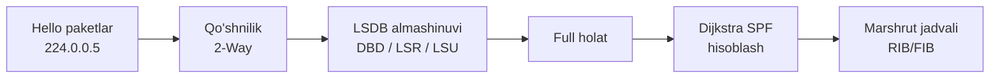

# OSPF — link-state marshrutlash

## 1. Nega dinamik marshrutlash?

10 ta filial, har birida 5 ta subnet → qo'lda yuzlab statik marshrut. Bitta link uzilsa — qo'lda tuzatish.
**OSPF** buni avtomatlashtiradi: routerlar topologiyani o'zaro almashadi va har biri eng yaxshi yo'lni o'zi hisoblaydi.

## 2. Qanday ishlaydi



1. **Hello** (har 10s) — qo'shnilarni topish. Dead interval 40s.
2. **LSA** (Link-State Advertisement) — "mening linklarim va ularning narxi".
3. Hamma routerda bir xil **LSDB** (link-state database) — butun area xaritasi.
4. Har bir router **Dijkstra** bilan o'zidan eng qisqa daraxtni quradi.

## 3. Qo'shnilik holatlari

`Down → Init → 2-Way → ExStart → Exchange → Loading → Full`

Eng ko'p uchraydigan muammolar:

| Belgi | Sabab |
|---|---|
| Qo'shni umuman yo'q | Hello yetib bormayapti (firewall, passive-interface, noto'g'ri subnet) |
| `Init` da qotib qolish | Bir tomonlama aloqa yoki ACL |
| `ExStart/Exchange` da qotish | **MTU mos emas** (klassik!) |
| Qo'shni bor, marshrut yo'q | `network` buyrug'i noto'g'ri, area mos emas |

## 4. Narx (cost)

`cost = reference-bandwidth / interfeys tezligi`. Standart reference 100 Mbit/s — 1G va 10G bir xil cost=1 oladi!
Production da: `auto-cost reference-bandwidth 100000` (100G).

## 5. FRRouting konfiguratsiyasi

```
router ospf
 ospf router-id 1.1.1.1
 auto-cost reference-bandwidth 100000
 passive-interface default
 no passive-interface eth1
 no passive-interface eth2
 network 10.0.0.0/16 area 0
 network 1.1.1.1/32 area 0
```

Diagnostika:

```
show ip ospf neighbor
show ip ospf interface eth1
show ip ospf database
show ip route ospf
```

## 6. Amaliyot

Labda uchta routerdan iborat uchburchak ko'tariladi. OSPF ni yoqib, loopbacklar orasida to'liq bog'lanish quring,
so'ng link narxini o'zgartirib trafik yo'lini boshqaring.
