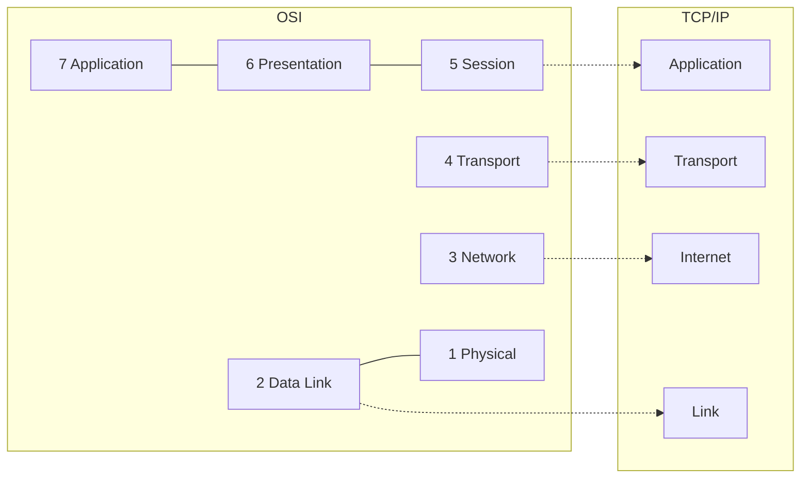

# OSI va TCP/IP modellari — paket safari

Brauzerda `https://example.uz` ni ochganingizda nima sodir bo'ladi? Bitta bosish ortida o'nlab protokollar
ketma-ket ishlaydi. Modellar — bu murakkablikni **qatlamlarga** bo'lib, har birini alohida tushunish usuli.

## 1. Nega qatlamlar kerak?

* **Mustaqillik:** Wi-Fi o'rniga optik tola qo'yilsa ham, brauzer o'zgarmaydi.
* **Nosozlikni topish:** "Kabel ulanganmi (L1)? IP bormi (L3)? Port ochiqmi (L4)?" — pastdan yuqoriga tekshirish.
* **Umumiy til:** "Bu L2 muammo" desangiz, har qanday muhandis tushunadi.

## 2. OSI modelining 7 qatlami

| # | Qatlam | Ma'lumot birligi | Misollar | Qurilma |
|---|---|---|---|---|
| 7 | Application (Ilova) | Data | HTTP, DNS, SSH, SMTP | — |
| 6 | Presentation | Data | TLS, JPEG, UTF-8 | — |
| 5 | Session | Data | RPC, NetBIOS | — |
| 4 | Transport | Segment / Datagram | TCP, UDP | Firewall (L4) |
| 3 | Network (Tarmoq) | Paket | IPv4, IPv6, ICMP, OSPF | Router |
| 2 | Data Link (Kanal) | Kadr (frame) | Ethernet, 802.1Q, ARP, PPP | Switch |
| 1 | Physical (Fizik) | Bit | UTP, optika, radio | Hub, media-konverter |

> 💡 Eslab qolish uchun (pastdan yuqoriga): **P**lease **D**o **N**ot **T**hrow **S**ausage **P**izza **A**way.

## 3. TCP/IP modeli — amaliyotdagi model



Internet aslida TCP/IP asosida qurilgan. OSI esa **tushuntirish va diagnostika** uchun ishlatiladi.

## 4. Inkapsulyatsiya: paket qanday "kiyinadi"

Brauzer HTTP so'rov yuboradi:

```
[ HTTP GET / ]                                   ← L7: data
[ TCP hdr | src port 51514 → dst 443 | data ]     ← L4: segment
[ IP hdr | 10.0.0.5 → 93.184.216.34 | segment ]   ← L3: paket
[ Eth hdr | MAC src → MAC gw | paket | FCS ]      ← L2: kadr
0101100101...                                     ← L1: bitlar
```

Qabul qiluvchi tomonda teskari jarayon — **dekapsulyatsiya**: har bir qatlam o'z sarlavhasini olib tashlab, yuqoriga uzatadi.

## 5. Muhim kuzatuv: kim nimani o'zgartiradi?

Paket yo'lda ko'plab routerlardan o'tadi:

* **MAC manzillar** har bir "hop" da o'zgaradi (har bir L2 segment alohida).
* **IP manzillar** odatda o'zgarmaydi (NAT bundan istisno).
* **TTL** har bir routerda 1 ga kamayadi; 0 bo'lsa — paket tashlanadi va ICMP *Time Exceeded* qaytadi (`traceroute` aynan shundan foydalanadi).

## 6. Diagnostika: pastdan yuqoriga

| Qatlam | Savol | Buyruq |
|---|---|---|
| L1 | Link bormi? | `ip link`, `ethtool eth0` |
| L2 | Qo'shni MAC ma'lummi? | `ip neigh` |
| L3 | IP va marshrut bormi? | `ip addr`, `ip route`, `ping` |
| L4 | Port ochiqmi? | `ss -tlnp`, `nc -vz host 443` |
| L7 | Xizmat javob beradimi? | `curl -v https://...`, `dig` |

## 7. Xulosa

Modellar — xarita. Keyingi darslarda biz har bir qatlamni **jonli laboratoriyada** ochib ko'ramiz:
L2 da Ethernet va ARP, L3 da IP va marshrutlash, L4 da TCP/UDP.
