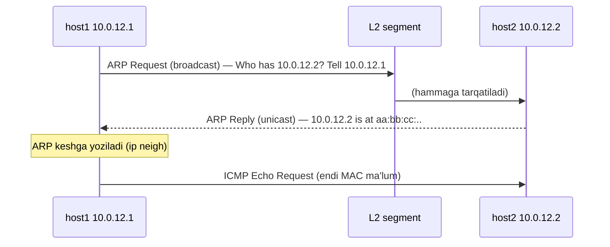

# Ethernet, MAC va ARP

## 1. Ethernet kadri

```
| Preamble | Dst MAC (6B) | Src MAC (6B) | EtherType (2B) | Payload 46–1500B | FCS (4B) |
```

* **EtherType** — ichida nima borligini bildiradi: `0x0800` IPv4, `0x86DD` IPv6, `0x0806` ARP, `0x8100` VLAN tegi.
* **MTU 1500** — standart Ethernet payload chegarasi. PPPoE da u **1492** gacha kamayadi (8 bayt PPPoE sarlavhasi) — uydagi PPPoE internetingizda MSS/MTU muammolari shu sababli bo'ladi.

## 2. MAC manzil

48 bit, masalan `52:54:00:ab:cd:ef`. Birinchi 24 bit — **OUI** (ishlab chiqaruvchi). Maxsus manzillar:

* `ff:ff:ff:ff:ff:ff` — broadcast
* birinchi baytning eng kichik biti `1` — multicast (`01:00:5e:...` IPv4 multicast)

## 3. ARP — "Bu IP kimniki?"



Holatlar (`ip neigh`): `REACHABLE`, `STALE`, `DELAY`, `PROBE`, `FAILED`, `INCOMPLETE`.

## 4. Gateway mantig'i

Xost paket yuborishdan oldin o'zidan so'raydi: *"manzil mening subnetimdami?"*

* **Ha** → manzilning o'zining MAC ini ARP orqali topadi.
* **Yo'q** → **default gateway** ning MAC ini topadi va kadrni unga yuboradi.

## 5. Xavfsizlik eslatmasi

ARP autentifikatsiyasiz ishlaydi — shuning uchun **ARP spoofing** (soxta javob) mumkin. Himoya: Dynamic ARP Inspection,
statik yozuvlar, 802.1X, segmentatsiya. Bu haqida "Tarmoq xavfsizligi" kursida batafsil.

## 6. Amaliyot

Pastdagi labni ishga tushiring: ikki xostga IP bering, ping qiling va `tcpdump -ni eth1 arp` bilan ARP almashinuvini o'z ko'zingiz bilan ko'ring.
