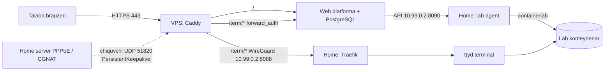

# CGNAT/PPPoE ortidagi serverni VPS orqali internetga chiqarish

Bu dars — **aynan shu platforma qanday qurilgani** haqida. Sizning ham uyingizda server va PPPoE internet bo'lsa,
quyidagi arxitekturani o'zingiz takrorlashingiz mumkin.

## 1. Muammo

* PPPoE internet ko'pincha **dinamik IP** beradi, ko'p hollarda **CGNAT** (100.64.0.0/10) ortida.
* Tashqaridan uyga port ochib bo'lmaydi, IP har kuni o'zgaradi.
* Lekin uyda kuchli server bor (ko'p RAM/CPU — laboratoriyalar uchun ideal), VPS esa kuchsiz, lekin **public IP** ga ega.

## 2. Yechim: teskari tunnel

1. Home server VPS ga **o'zi** WireGuard bilan ulanadi (chiquvchi UDP — CGNAT to'smaydi).
2. `PersistentKeepalive = 25` NAT yozuvini tirik saqlaydi.
3. VPS endi `10.99.0.2` orqali uydagi xizmatlarga yeta oladi; internetga faqat VPS ko'rinadi.
4. Uydagi xizmatlar (lab-agent, Traefik) **faqat WireGuard IP sida** tinglaydi.

## 3. Xavfsizlik qatlamlari

| Qatlam | Himoya |
|---|---|
| Internet → VPS | Faqat 22, 80, 443, 51820/udp ochiq (ufw) |
| VPS → Home | WireGuard (Curve25519), faqat 10.99.0.0/24 |
| Platforma → lab-agent | Bearer token, agent tarmoqdan buyruq qabul qilmaydi |
| Brauzer → terminal | Caddy `forward_auth`: sessiya + lab egasi tekshiruvi |
| Lab ↔ lab | Har bir talabaga alohida mgmt tarmog'i, CPU/RAM limit, TTL |
| Home LAN | Lablar alohida VM ichida (Proxmox) — uy tarmog'idan izolyatsiya |

## 4. Alternativalar

* **Cloudflare Tunnel / ngrok** — oson, lekin uchinchi tomonga bog'liq, WebSocket/UDP cheklovlari.
* **Tailscale/Headscale** — qulay mesh, lekin bizga bitta oddiy p2p tunnel yetarli.
* **Provayderdan statik IP** — eng sodda, lekin pullik va uy IP si ochiq bo'ladi.

To'liq o'rnatish qo'llanmasi: repozitoriydagi `docs/PLATFORM_DEPLOY.md`.
