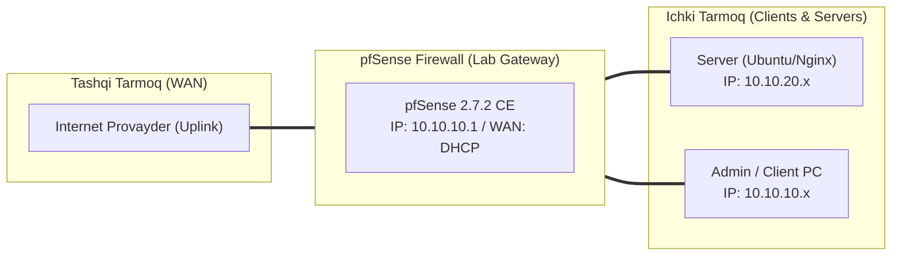

# 🛠️ [KUN-01] LAB QO'LLANMASI: pfSense va FreeBSD Arxitekturasi, Dual Lab (Hardware & Virtual) Muhitini Qurish

**Mavzu:** pfSense va FreeBSD Arxitekturasi, Dual Lab (Hardware & Virtual) Muhitini Qurish  
**Bosqich:** 1-Hafta: Baza va Virtualizatsiya  
**Nazariy Ma'ruza:** [Lecture darsini o'qish](lecture.md)

---

## 🎯 1. Real Korxona Muammosi (Business Problem Statement)

> **Real Muammo:** Korxonada xavfsizlik devori yo'qligi sababli tarmoq nazoratsiz, xavfsizlik zaif va izolyatsiya qilinmagan. Shuningdek, talabalar laboratoriya amaliyotini ham fizik mini-PC (hardware), ham virtual serverlar (Proxmox / VMware) da xatosiz o'rnatish poydevorini qurishi lozim.

Ushbu laboratoriya mashg'ulotida siz ushbu real muammoni to'liq hal qilasiz, tizimni xalqaro standartlar asosida xavfsiz va barqaror qilib sozlaysiz.

---

## 🗺️ 2. Laboratoriya Topologiyasi va IP Sxemasi



### 📋 Laboratoriya IP Jadvali

| Interfeys / Qurilma | Turi | IP Manzil / Subnet | Izoh |
|---|---|---|---|
| `WAN` | Tashqi | Provayder IP (DHCP / Static) | Internetga chiqish |
| `LAN` (MGMT) | Ichki | `10.10.10.1/24` | Boshqaruv va admin tarmog'i |
| `DMZ / SERVERS` | Segment | `10.10.20.1/24` | Korporativ serverlar |
| `Mijoz Mashinasi` | Test Client | `10.10.10.50` (DHCP) | Sinov o'tkazuvchi kompyuter |

---

## 🖥️ 3. Talabalar uchun Laboratoriya Muhiti (Ikkala Variant)

Talaba o'zida mavjud imkoniyatga qarab **Variant A** yoki **Variant B** dan birini tanlaydi:

### 🔹 VARIANT A: Real Jismoniy pfSense (Hardware Appliance / Mini-PC)
* **Qurilma:** 2 yoki undan ortiq tarmoq kartasiga ega x86-64 mini-PC yoki eski kompyuter (Intel i3/i5, kamida 4GB RAM, 64GB SSD).
* **Fizik ulanish:**
  * `WAN` porti (masalan, `igb0`): Internet provayder modemi yoki tashqi routerdan kelgan kabel.
  * `LAN` porti (masalan, `igb1`): Boshqaruv noutbuki yoki jismoniy switch (Cisco, TP-Link, MikroTik) ga RJ45 patch-cord orqali.
* **Konsol ulanishi:** Agar monitor/klaviatura ulasangiz HDMI/VGA; agar headless bo'lsa RS-232 COM / RJ45-to-USB konsol kabel (Baud rate: `115200`, 8N1).
* **BIOS Sozlamalari:** Intel VT-x faol, 'Restore on AC Power Loss' -> Last State yoki Power On, CSM Legacy yoki UEFI native boot.

### 🔹 VARIANT B: Virtual Server pfSense (Proxmox VE / VMware Workstation)
* **Proxmox VE:**
  * `vmbr0` (WAN): Tashqi internetga chiquvchi Bridge (Gateway bilan).
  * `vmbr1` (LAN): Alohida ichki Linux Bridge (VLAN-aware yoqilgan, IP berilmagan).
  * pfSense VM: 2 vCPU (Host type), 2-4GB RAM, 32GB VirtIO SCSI disk, 2x VirtIO Network (`vmbr0` va `vmbr1`).
* **VMware Workstation Pro:**
  * `VMnet0` (Bridged) yoki `VMnet8` (NAT) -> WAN uchun.
  * `VMnet1` / `VMnet2` (Host-Only) -> LAN ichki izolyatsiyalangan tarmoq uchun.
  * Network Adapter 1: WAN, Network Adapter 2: LAN.

---

## ⚙️ 4. Bosqichma-bosqich Amaliy Sozlash Qo'llanmasi (Step-by-Step)

1. **Qadam:** pfSense Community Edition (CE) 2.7.2 x86-64 DVD ISO tasvirini yuklab olish va tekshirish (SHA256).
2. **Qadam:** Hardware foydalanuvchilari uchun Rufus yoki BalenaEtcher orqali Bootable USB tayyorlash; Virtual foydalanuvchilar uchun ISO ni Proxmox `local` storage ga yoki VMware ga yuklash.
3. **Qadam:** Tizimni ZFS (Auto ZFS, stripe, pool name: `pfSense`, swap: 2GB) bilan o'rnatish.
4. **Qadam:** Konsolda interfeyslarni aniqlash: WAN (`igb0` yoki `vtnet0`), LAN (`igb1` yoki `vtnet1`), VLAN hozircha talab qilinmaydi (`N`).
5. **Qadam:** LAN interfeysiga `10.10.10.1/24` (yoki standart `192.168.1.1/24`) IP tayinlash va DHCP serverni yoqish.
6. **Qadam:** Mijoz kompyuterni LAN ga ulab, brauzer orqali `https://10.10.10.1` ga kirish (Standard login: `admin` / `pfsense`).


---

## 🧪 5. Verifikatsiya va Tekshirish (Testing & CLI)

Har bir amaliyot tugagach, quyidagi buyruqlar yordamida natijani qat'iy tekshiring:

**Mijoz kompyuterdan pfSense LAN shlyuziga:**
```bash
ping 10.10.10.1
```

**FreeBSD konsolida pf holati va ish vaqtini tekshirish:**
```bash
pfctl -s info
```

**active/no carrier) va IP manzillarini ko'rish:**
```bash
ifconfig -a (Interfeyslar MTU, media status
```

**WebGUI HTTPS javobini tekshirish:**
```bash
curl -k https://10.10.10.1
```


---

## 🚨 6. Eng Ko'p Uchraydigan Xatolar va Troubleshooting

* ⚠️ **Muammo: LAN mijoz IP olmayapti. Yechim: Jismoniy kabel ulangan portni tekshiring (Link LED yonishi kerak), Proxmoxda esa vmbr1 to'g'ri biriktirilganini va VM tarmoq adapteri 'Connected' holatdaligini tasdiqlang.**
* ⚠️ **Muammo: WebGUI ochilmayapti. Yechim: pfSense konsolida 16-band (Restart PHP-FPM) yoki 11-band (Restart webConfigurator) ni tanlang.**
* ⚠️ **Muammo: Realtek kartalarida tarmoq uzilib qolmoqda. Yechim: System > Advanced > Networking bo'limida Hardware Checksum Offload, Hardware TCP Segmentation Offloading (TSO) va Hardware Large Receive Offloading (LRO) larni 'Disable' qilib qo'ying.**


---

## 🏆 7. Mustaqil Amaliy Topshiriq (Student Challenge / Homework)

> 📝 **Vazifa:** pfSense konsoli orqali ping va traceroute buyruqlarini ishlatib, 8.8.8.8 va google.com ga yo'lni tekshiring. ZFS pool holatini konsolda `zpool status` buyrug'i orqali ko'rib, xotira tuzilishini tahlil qiling.
