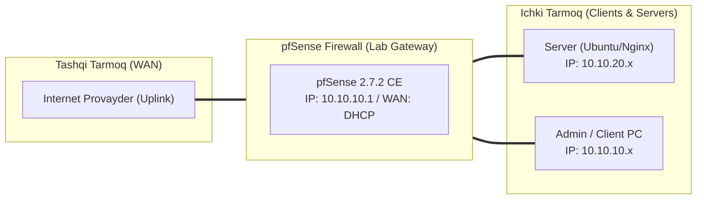

# 🛠️ [KUN-02] LAB QO'LLANMASI: O'rnatish, ZFS Fayl Tizimi, Konsol Menyusi va Production Hardening

**Mavzu:** O'rnatish, ZFS Fayl Tizimi, Konsol Menyusi va Production Hardening  
**Bosqich:** 1-Hafta: Baza va Virtualizatsiya  
**Nazariy Ma'ruza:** [Lecture darsini o'qish](lecture.md)

---

## 🎯 1. Real Korxona Muammosi (Business Problem Statement)

> **Real Muammo:** Standart sozlamalardagi pfSense da `admin:pfsense` default paroli, ochiq HTTP porti, standart 22-portdagi SSH va konsolga cheklovlarsiz kirish imkoniyati mavjud. Hujumchi birinchi urinishdayoq shlyuzni egallab olishi mumkin.

Ushbu laboratoriya mashg'ulotida siz ushbu real muammoni to'liq hal qilasiz, tizimni xalqaro standartlar asosida xavfsiz va barqaror qilib sozlaysiz.

---

## 🗺️ 2. Laboratoriya Topologiyasi va IP Sxemasi



### 📋 Laboratoriya IP Jadvali

| Interfeys / Qurilma | Turi | IP Manzil / Subnet | Izoh |
|---|---|---|---|
| `WAN` | Tashqi | Provayder IP (DHCP / Static) | Internetga chiqish |
| `LAN` (MGMT) | Ichki | `10.10.10.1/24` | Boshqaruv va admin tarmog'i |
| `DMZ / SERVERS` | Segment | `10.10.20.1/24` | Korporativ serverlar |
| `Mijoz Mashinasi` | Test Client | `10.10.10.50` (DHCP) | Sinov o'tkazuvchi kompyuter |

---

## 🖥️ 3. Talabalar uchun Laboratoriya Muhiti (Ikkala Variant)

Talaba o'zida mavjud imkoniyatga qarab **Variant A** yoki **Variant B** dan birini tanlaydi:

### 🔹 VARIANT A: Real Jismoniy pfSense (Hardware Appliance / Mini-PC)
* **Hardware:** Fizik serverda BIOS paroli o'rnatilgan bo'lishi lozim (begonalar USB orqali yuklanmasligi uchun).
* **Konsol:** Serial konsol (COM port) orqali ulanganda ham konsol menyusi parol so'rashi shart.
* **Elektr:** UPS (uzluksiz quvvat manbai) ga ulangan bo'lsa, pfSense ga `nut` yoki `apcupsd` paketini qo'shish rejalashtiriladi.

### 🔹 VARIANT B: Virtual Server pfSense (Proxmox VE / VMware Workstation)
* **Proxmox / VMware:** Virtual Machine Console (noVNC / Remote Console) ga cheklov o'rnatish.
* **ZFS Snapshot:** Proxmox darajasidagi backupdan tashqari, pfSense ichida ham ZFS snapshot olish imkoniyatini sinash.

---

## ⚙️ 4. Bosqichma-bosqich Amaliy Sozlash Qo'llanmasi (Step-by-Step)

1. **Qadam:** WebGUI ga kirish: `System` -> `User Manager` bo'limida yangi `secadmin` nomli superuser foydalanuvchisini yaratish va o'ta kuchli (16+ belgili) parol berish.
2. **Qadam:** `admin` standart foydalanuvchisini o'chirib qo'yish (Disable).
3. **Qadam:** `System` -> `Advanced` -> `Admin Access`: Protocol -> `HTTPS`, TCP Port -> `8443` deb belgilash.
4. **Qadam:** `Secure Shell` (SSH) ni yoqish, portni `2222` ga o'zgartirish, `Password Authentication` ni o'chirib, foydalanuvchiga SSH Ed25519 Public Key yuklash.
5. **Qadam:** `Password protect the console menu` bandini yoqish (konsolga kirganda ham login/parol so'rashi uchun).
6. **Qadam:** `System` -> `Advanced` -> `Firewall & NAT`: Maximum table entries sonini 400000 ga ko'tarish.


---

## 🧪 5. Verifikatsiya va Tekshirish (Testing & CLI)

Har bir amaliyot tugagach, quyidagi buyruqlar yordamida natijani qat'iy tekshiring:

**Faqat kalit bilan kirishni tekshirish:**
```bash
ssh -p 2222 -i id_ed25519 secadmin@10.10.10.1
```

**Admin foydalanuvchisi rad etilishini tekshirish:**
```bash
ssh -p 2222 admin@10.10.10.1
```

**HTTP avtomatik 8443 HTTPS ga yo'naltirilishini tekshirish:**
```bash
curl -I http://10.10.10.1
```

```bash
pfSense konsoliga ulanib, menyu chiqishidan oldin login/parol so'ralayotganini ko'rish
```


---

## 🚨 6. Eng Ko'p Uchraydigan Xatolar va Troubleshooting

* ⚠️ **Muammo: Port 8443 ga o'tgach WebGUI ga kirib bo'lmay qoldi. Yechim: Brauzerda https://10.10.10.1:8443 deb portni aniq yozing.**
* ⚠️ **Muammo: SSH kalit bilan ulanishda 'Permission denied (publickey)' xatosi. Yechim: Kalit huquqi mijozda `chmod 600 id_ed25519` ekanini va pfSense User Manager da kalit to'liq kiritilganini tekshiring.**


---

## 🏆 7. Mustaqil Amaliy Topshiriq (Student Challenge / Homework)

> 📝 **Vazifa:** pfSense konsoli orqali `zfs list` va `zfs snapshot pfSense/ROOT/default@day2_hardening` buyrug'i yordamida qo'lda snapshot oling va o'zgarishlarni tekshiring.
