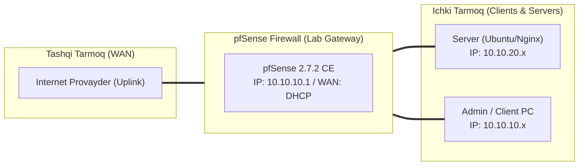

# 🛠️ [KUN-03] LAB QO'LLANMASI: DHCP Server, Static Mappings, DHCP Options (PXE/NTP) va DHCP Relay

**Mavzu:** DHCP Server, Static Mappings, DHCP Options (PXE/NTP) va DHCP Relay  
**Bosqich:** 1-Hafta: Baza va Virtualizatsiya  
**Nazariy Ma'ruza:** [Lecture darsini o'qish](lecture.md)

---

## 🎯 1. Real Korxona Muammosi (Business Problem Statement)

> **Real Muammo:** Korxonada yangi ulangan printerlar va serverlar IP manzili har rebootda o'zgarib ketmoqda, bu esa servislar to'xtashiga sabab bo'lmoqda. Shu bilan birga tarmoqda vaqt sinxronizatsiyasi (NTP) buzilgan va tarmoq orqali OS o'rnatish (PXE Boot) yo'lga qo'yilmagan.

Ushbu laboratoriya mashg'ulotida siz ushbu real muammoni to'liq hal qilasiz, tizimni xalqaro standartlar asosida xavfsiz va barqaror qilib sozlaysiz.

---

## 🗺️ 2. Laboratoriya Topologiyasi va IP Sxemasi



### 📋 Laboratoriya IP Jadvali

| Interfeys / Qurilma | Turi | IP Manzil / Subnet | Izoh |
|---|---|---|---|
| `WAN` | Tashqi | Provayder IP (DHCP / Static) | Internetga chiqish |
| `LAN` (MGMT) | Ichki | `10.10.10.1/24` | Boshqaruv va admin tarmog'i |
| `DMZ / SERVERS` | Segment | `10.10.20.1/24` | Korporativ serverlar |
| `Mijoz Mashinasi` | Test Client | `10.10.10.50` (DHCP) | Sinov o'tkazuvchi kompyuter |

---

## 🖥️ 3. Talabalar uchun Laboratoriya Muhiti (Ikkala Variant)

Talaba o'zida mavjud imkoniyatga qarab **Variant A** yoki **Variant B** dan birini tanlaydi:

### 🔹 VARIANT A: Real Jismoniy pfSense (Hardware Appliance / Mini-PC)
* **Hardware:** Fizik tarmoqda bir nechta qurilma (noutbuk, telefon, Wi-Fi AP) ni switchga ulang.
* Wi-Fi Access Point (masalan Ubiquiti UniFi yoki MikroTik) ulangan bo'lsa, pfSense DHCP Option 43 orqali AP ga kontrollerni avtomat taniting.

### 🔹 VARIANT B: Virtual Server pfSense (Proxmox VE / VMware Workstation)
* **Proxmox / VMware:** Ichki LAN (vmbr1 yoki VMnet1) da ikkita VM ishga tushiring: 1 ta Ubuntu Server, 1 ta Alpine Linux.
* Ularning MAC manzillarini virtual mashina sozlamalaridan aniqlab oling.

---

## ⚙️ 4. Bosqichma-bosqich Amaliy Sozlash Qo'llanmasi (Step-by-Step)

1. **Qadam:** `Services` -> `DHCP Server` -> `LAN` ga kirish. Subnet: `10.10.10.0/24`, Range: `10.10.10.100` dan `10.10.10.200` gacha belgilash.
2. **Qadam:** Gateway: `10.10.10.1`, DNS Server: `10.10.10.1` (pfSense o'zi).
3. **Qadam:** NTP Server maydoniga `10.10.10.1` manzilini kiritish (Option 42).
4. **Qadam:** `DHCP Static Mappings` bo'limida serveringiz MAC manzilini kiritib, unga qat'iy `10.10.10.20` IP sini va `srv-master.local` hostname berish.
5. **Qadam:** `Services` -> `NTP` sozlamalariga kirib, pfSense NTP serverini yoqish va tashqi hovuz sifatida `pool.ntp.org` ni belgilash.
6. **Qadam:** Mijoz VM yoki kompyuterda IP manzilni yangilash (`dhclient -v` yoki `ipconfig /renew`).


---

## 🧪 5. Verifikatsiya va Tekshirish (Testing & CLI)

Har bir amaliyot tugagach, quyidagi buyruqlar yordamida natijani qat'iy tekshiring:

**Aktiv ijaralarni va statik bog'lanishlarni ko'rish:**
```bash
Status -> DHCP Leases
```

**Mijoz kompyuterdan pfSense NTP serveri ishlayotganini tekshirish:**
```bash
ntpdate -q 10.10.10.1
```

**pfSense konsolida DORA jarayonini tutib ko'rish:**
```bash
tcpdump -i vtnet1 -n port 67 or port 68
```

**Statik xostnomi DNS orqali yechilayotganini tekshirish:**
```bash
ping srv-master.local
```


---

## 🚨 6. Eng Ko'p Uchraydigan Xatolar va Troubleshooting

* ⚠️ **Muammo: Mijoz boshqa IP olmoqda (masalan 192.168.x.x). Yechim: Tarmoqda 'Rogue DHCP' (ikkilamchi DHCP server, masalan uy routeri) bor-yo'qligini tekshiring.**
* ⚠️ **Muammo: Static mapping IP diapazon ichida bo'lsa xato beradi. Yechim: pfSense qoidasi bo'yicha Static IP diapazondan (100-200) tashqarida bo'lishi kerak (masalan 10.10.10.20).**


---

## 🏆 7. Mustaqil Amaliy Topshiriq (Student Challenge / Homework)

> 📝 **Vazifa:** DHCP Option 66 (TFTP Server: 10.10.10.50) va Option 67 (Bootfile: pxelinux.0) parametrlarini sozlang va Wireshark orqali DHCP Offer paketida ushbu optionlar kelganini tekshiring.
