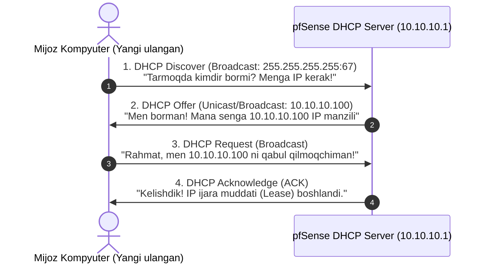

# 📚 [KUN-03] LECTURE: DHCP Server, Static Mappings, DHCP Options (PXE/NTP) va pfSense ni Markaziy NTP Server Qilish

**Kategoriya:** 1-Hafta: Baza va Virtualizatsiya  
**Maqsad:** Korxonada dinamik IP boshqaruvi (DORA), MAC manzillar orqali statik biriktirish (Static Mappings), DHCP Options (Option 42 NTP, Option 66/67 PXE, Option 43 Wi-Fi), DHCP Relay arxitekturasi hamda **pfSense ni qo'shimcha servis o'rnatmasdan markaziy NTP Server sifatida to'liq sozlash** va foydalanuvchilarga tanitishni o'rganish.

---

## 🧭 Mundarija
1. [DHCP Protokoli va DORA Mexanizmi](#1-dhcp-protokoli-va-dora-mexanizmi)
2. [Statik IP vs DHCP Reservation (MAC Mappings)](#2-statik-ip-vs-dhcp-reservation)
3. [DHCP Options Kuchi (PXE, Wi-Fi AP va NTP)](#3-dhcp-options-kuchi)
4. [pfSense ni Markaziy NTP Server Qilish (Qo'shimcha Paket Shartmi?)](#4-pfsense-ni-markaziy-ntp-server-qilish)
5. [Nega Tarmoqda Vaqt Sinxronligi Hayotiy Muhim? (Kerberos, SSL, Loglar)](#5-nega-vaqt-sinxronligi-hayotiy-muhim)
6. [NTP Hijacking: Majburiy NTP Redirect NAT](#6-ntp-hijacking-majburiy-ntp-redirect-nat)
7. [DHCP Relay Agent (RFC 3046) Qachon Kerak?](#7-dhcp-relay-agent)
8. [Xulosa va O'z-o'zini Tekshirish](#8-xulosa)

---

## 1. DHCP Protokoli va DORA Mexanizmi

DHCP (Dynamic Host Configuration Protocol - RFC 2131) tarmoqdagi mijozlarga avtomatik tarzda IP manzil, tarmoq niqobi (Subnet Mask), standart shlyuz (Default Gateway) va DNS serverlarini taqsimlaydi.

Bu jarayon UDP 67 (Server) va UDP 68 (Client) portlarida **4 ta bosqichda (DORA)** amalga oshiriladi:

---

## 2. Statik IP vs DHCP Reservation (MAC Mappings)

Ko'plab boshlovchi muhandislar serverlar, printerlar va tarmoq uskunalariga kompyuterning o'zidan qo'lda statik IP kiritib chiqishadi. Bu usul kelajakda katta muammolarga olib keladi:
* DNS server yoki Gateway o'zgarsa, 50 ta serverga birma-bir kirib IP sozlamasini o'zgartirish kerak bo'ladi.
* IP konfliktlar (ikki kishiga bitta IP tushib qolishi) ko'payadi.

**To'g'ri Korporativ Yondashuv: Static DHCP Mappings (MAC Reservation):**
* Serverning o'zi DHCP rejimida turadi.
* pfSense DHCP serverida uning MAC manzili (`00:1a:2b:3c:4d:5e`) qat'iy `10.10.20.50` manziliga bog'lab qo'yiladi.
* Shlyuz yoki DNS o'zgarsa, pfSense da 1 ta sozlama o'zgartiriladi va barcha serverlar avtomat yangi konfiguratsiyani oladi!

---

## 3. DHCP Options Kuchi

DHCP mijozga faqat IP va Gateway bermaydi. RFC 2132 bo'yicha yuzlab maxsus parametrlar (Options) mavjud:
* **Option 42 (NTP Servers):** Tarmoqdagi kompyuterlarga qaysi vaqt serveridan sinxronlanishni avtomat bildiradi.
* **Option 66 va 67 (PXE Boot):** Tarmoq orqali Windows/Linux o'rnatish uchun TFTP Server IP si (Option 66) va yuklanuvchi fayl nomi (`pxelinux.0` yoki `bootx64.efi` - Option 67).
* **Option 43 (Vendor Specific):** UniFi yoki Aruba Wi-Fi Access Point larga controller IP manzilini tanitish.

---

## 4. pfSense ni Markaziy NTP Server Qilish (Qo'shimcha Paket Shartmi?)

> [!IMPORTANT]
> **Foydalanuvchi Savoli 1:** NTP server sifatida pfSense ni foydalanuvchilarga tanitsa bo'ladimi?  
> **Javob:** **HA, ALBATTA!** pfSense ni butun korxona (xodimlar kompyuterlari, serverlar, IP kameralar, domofonlar, printerlar) uchun yagona ishonchli markaziy NTP server sifatida tanitish nafaqat mumkin, balki xavfsizlik va barqarorlik uchun **ENG TO'G'RI STANDARTDIR!**

> [!IMPORTANT]
> **Foydalanuvchi Savoli 2:** pfSense da biror qo'shimcha servis (package) o'rnatish shartmi?  
> **Javob:** **YO'Q, MUTLAQO SHART EMAS!**  
> pfSense FreeBSD ning rasmiy **`OpenNTPD` / `ntpd`** servisi bilan tizim ichiga to'liq integratsiya qilingan holda keladi (`Services -> NTP`). Hech qanday "Package Manager" dan paket yuklab o'rnatish talab etilmaydi!

### pfSense NTP qanday ishlaydi?
1. pfSense o'zi tashqi global atomik soatlarga (masalan `0.pfsense.pool.ntp.org`, `time.cloudflare.com`) bog'lanadi (Stratum 2).
2. O'zining ichki vaqtini millisoniyalargacha aniq qilib oladi.
3. Ichki tarmoqdagi barcha mijozlarga o'zi **Stratum 3 NTP Server** sifatida UDP port 123 orqali vaqt tarqatadi.

---

## 5. Nega Tarmoqda Vaqt Sinxronligi Hayotiy Muhim?

Tarmoqda vaqtning bir xil bo'lmasligi quyidagi jiddiy avariyalarga sabab bo'ladi:
1. **Microsoft Active Directory & Kerberos:** Windows da xodim kompyuteri va Domain Controller o'rtasida vaqt farqi **5 daqiqadan (300 soniya)** oshsa, Kerberos chiptasi avtomat bekor qilinadi. Xodim o'z kompyuteriga kira olmay qoladi!
2. **TLS / HTTPS va SSL Sertifikatlar:** Sertifikatlar boshlanish va tugash vaqtiga ega. Agar kompyuterda soat 1 kunga orqada bo'lsa, xodim barcha saytlarda "Sertifikat muddati o'tgan" xatosini ko'radi.
3. **Kiberxavfsizlik va Loglar (Incident Response):** Tarmoqda kiberhujum yuz berganda, firewall logi, switch logi va server logi millisoniyagacha bir xil vaqtda bo'lmasa, hujumchi qachon qayerga kirganini tergov qilib bo'lmaydi.
4. **VPN Ulanishlari:** IPsec IKEv2 va OpenVPN sertifikatlari vaqtga o'ta sezgirdir.

---

## 6. NTP Hijacking: Majburiy NTP Redirect NAT

Ko'plab IoT qurilmalar (kameralar, aqlli televizorlar) yoki ba'zi operatsion tizimlar DHCP Option 42 ni e'tiborsiz qoldirib, o'zining ichiga qotirilgan tashqi serveriga (`time.windows.com` yoki `pool.ntp.org`) chiqishga urinadi.

**Professional Yechim (NTP Redirect Port Forward):**
pfSense da shunday NAT Port Forward qoidasi yoziladiki:
* *Har qanday ichki IP dan tashqaridagi har qanday IP ning UDP 123 portiga ketayotgan so'rov tutib olinadi va pfSense ning o'ziga (`127.0.0.1`) majburiy yo'naltiriladi!*
Natijada barcha qurilmalar o'zlari bilmagan holda pfSense dan vaqt olishga majbur bo'ladi.

---

## 7. DHCP Relay Agent (RFC 3046) Qachon Kerak?

Agar kompaniyada 10 ta alohida bino bo'lsa va har bir binoda alohida L3 router tursa:
* DHCP Discover paketlari L2 Broadcast bo'lgani uchun boshqa tarmoqqa o'ta olmaydi.
* Har bir binoga yangi DHCP server qo'ymaslik uchun, o'sha binodagi routerda **DHCP Relay** yoqiladi.
* Relay agent broadcast paketni ushlab, uni Unicast qilib bosh pfSense DHCP serveriga (`10.10.10.1`) yetkazadi.

---

## 8. Xulosa
pfSense DHCP va NTP xizmatlari hech qanday ortiqcha dastur o'rnatmasdan turib butun korporativ tarmoqning vaqt, IP va provisioning poydevorini to'liq ta'minlay oladi.
