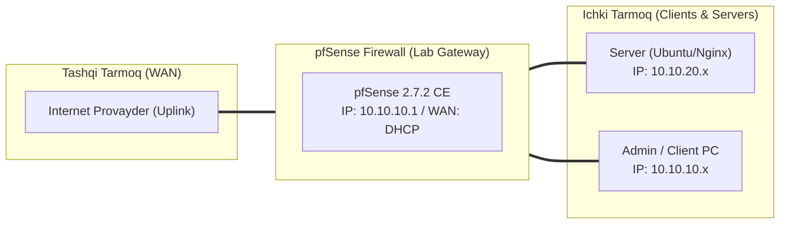

# 🛠️ [KUN-04] LAB QO'LLANMASI: Unbound DNS chuqur tahlili, DNSSEC, DoT (DNS over TLS) va Split-Horizon DNS

**Mavzu:** Unbound DNS chuqur tahlili, DNSSEC, DoT (DNS over TLS) va Split-Horizon DNS  
**Bosqich:** 1-Hafta: Baza va Virtualizatsiya  
**Nazariy Ma'ruza:** [Lecture darsini o'qish](lecture.md)

---

## 🎯 1. Real Korxona Muammosi (Business Problem Statement)

> **Real Muammo:** Internet provayder (ISP) foydalanuvchilar qaysi saytlarga kirayotganini shifrlanmagan DNS port 53 orqali kuzatmoqda (DNS Snooping), soxta javoblar qaytarish (DNS Spoofing) xavfi mavjud, va korxonaning ichki `crm.corp.local` servislari tashqi dunyoga ochilmasdan xavfsiz ichki DNS orqali yechilishi lozim.

Ushbu laboratoriya mashg'ulotida siz ushbu real muammoni to'liq hal qilasiz, tizimni xalqaro standartlar asosida xavfsiz va barqaror qilib sozlaysiz.

---

## 🗺️ 2. Laboratoriya Topologiyasi va IP Sxemasi



### 📋 Laboratoriya IP Jadvali

| Interfeys / Qurilma | Turi | IP Manzil / Subnet | Izoh |
|---|---|---|---|
| `WAN` | Tashqi | Provayder IP (DHCP / Static) | Internetga chiqish |
| `LAN` (MGMT) | Ichki | `10.10.10.1/24` | Boshqaruv va admin tarmog'i |
| `DMZ / SERVERS` | Segment | `10.10.20.1/24` | Korporativ serverlar |
| `Mijoz Mashinasi` | Test Client | `10.10.10.50` (DHCP) | Sinov o'tkazuvchi kompyuter |

---

## 🖥️ 3. Talabalar uchun Laboratoriya Muhiti (Ikkala Variant)

Talaba o'zida mavjud imkoniyatga qarab **Variant A** yoki **Variant B** dan birini tanlaydi:

### 🔹 VARIANT A: Real Jismoniy pfSense (Hardware Appliance / Mini-PC)
* **Hardware:** WAN porti internetga to'g'ri ulanganini va provayder DNS port 853 ni bloklamaganini tekshiring.
* Agar ichki xususiy Active Directory DNS server bo'lsa, 'Domain Overrides' orqali `.corp` so'rovlarini AD ga yo'naltirish sozlanadi.

### 🔹 VARIANT B: Virtual Server pfSense (Proxmox VE / VMware Workstation)
* **Proxmox / VMware:** pfSense VM orqali chiquvchi TCP port 853 ruxsat berilgan bo'lishi kerak.
* Test mijoz VM (Ubuntu) da `systemd-resolved` o'rniga DNS sifatida to'g'ridan-to'g'ri pfSense IP sini ko'rsating.

---

## ⚙️ 4. Bosqichma-bosqich Amaliy Sozlash Qo'llanmasi (Step-by-Step)

1. **Qadam:** `Services` -> `DNS Resolver` -> `General Settings` ga kirish. Port: `53`, Network Interfaces: `ALL` (yoki LAN/Localhost), Outgoing: `WAN`.
2. **Qadam:** `Enable DNSSEC Support` katakchasini yoqish.
3. **Qadam:** `DNS Query Forwarding`: 'Enable Forwarding Mode' va 'Use SSL/TLS for outgoing queries' ni faollashtirish.
4. **Qadam:** `System` -> `General Setup`: DNS Serverlar ro'yxatiga `1.1.1.1` (Hostname: `cloudflare-dns.com`) va `9.9.9.9` (Hostname: `dns.quad9.net`) ni kiritish.
5. **Qadam:** `Services` -> `DNS Resolver`: Eng pastida `Host Overrides` ga kirish. Yangi yozuv: Host: `crm`, Domain: `corp.lan`, IP: `10.10.20.50` kiritish.
6. **Qadam:** Ichki mijozlardan DNS so'rovlar faqat pfSense ga borishi uchun port 53 ni NAT Port Forward orqali pfSense ga majburiy tutib qolish (Redirect DNS).


---

## 🧪 5. Verifikatsiya va Tekshirish (Testing & CLI)

Har bir amaliyot tugagach, quyidagi buyruqlar yordamida natijani qat'iy tekshiring:

**DNSSEC to'g'ri ishlashini tasdiqlash: rrsig bayrog'i bo'lishi kerak:**
```bash
drill -D sigok.verteiltesysteme.net @10.10.10.1
```

**DNSSEC xato domenini Unbound SERVFAIL qaytarib bloklashi kerak:**
```bash
drill -D sigfail.verteiltesysteme.net @10.10.10.1
```

**Tashqi interfeysda barcha DNS so'rovlar TLS orqali shifrlanganini ko'rish:**
```bash
tcpdump -i vtnet0 -n port 853
```

**Host override natijasi 10.10.20.50 chiqishi kerak:**
```bash
nslookup crm.corp.lan 10.10.10.1
```


---

## 🚨 6. Eng Ko'p Uchraydigan Xatolar va Troubleshooting

* ⚠️ **Muammo: DoT yoqilgach internetda saytlar ochilmay qoldi. Yechim: System > General Setup da Cloudflare IP si yonidagi 'Hostname' (cloudflare-dns.com) to'g'ri yozilganini tekshiring, TLS sertifikat tekshiruvida hostname shart.**
* ⚠️ **Muammo: Ba'zi mijozlar Google DNS (8.8.8.8) ni qo'lda kiritib qoidani chetlab o'tyapti. Yechim: Port Forward NAT qoidasi tuzib, har qanday tashqi port 53/853 ga boruvchi so'rovni pfSense (127.0.0.1) ga burib qo'ying.**


---

## 🏆 7. Mustaqil Amaliy Topshiriq (Student Challenge / Homework)

> 📝 **Vazifa:** Domain Overrides bo'limidan foydalanib, barcha `.internal` so'rovlarini maxsus ichki serverga (10.10.10.250) yo'naltiruvchi qoida yarating va test qiling.
