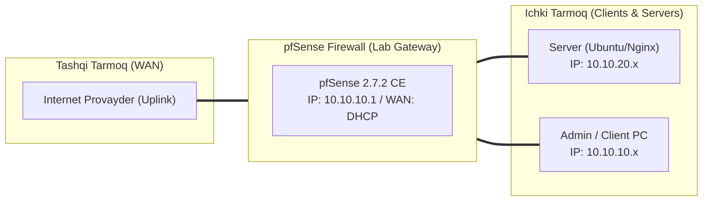

# 🛠️ [KUN-05] LAB QO'LLANMASI: 802.1Q VLANlar va Inter-VLAN Marshrutlash (Router-on-a-Stick)

**Mavzu:** 802.1Q VLANlar va Inter-VLAN Marshrutlash (Router-on-a-Stick)  
**Bosqich:** 1-Hafta: Baza va Virtualizatsiya  
**Nazariy Ma'ruza:** [Lecture darsini o'qish](lecture.md)

---

## 🎯 1. Real Korxona Muammosi (Business Problem Statement)

> **Real Muammo:** Korxonada buxgalteriya kompyuterlari, umumiy xodimlar, mehmonlar va IoT kameralari bitta umumiy tarmoqda (flat network) joylashgan. Mehmonlar yoki zararlangan kamera orqali buxgalteriya fayllariga va serverlarga to'g'ridan-to'g'ri kirish xavfi mavjud.

Ushbu laboratoriya mashg'ulotida siz ushbu real muammoni to'liq hal qilasiz, tizimni xalqaro standartlar asosida xavfsiz va barqaror qilib sozlaysiz.

---

## 🗺️ 2. Laboratoriya Topologiyasi va IP Sxemasi



### 📋 Laboratoriya IP Jadvali

| Interfeys / Qurilma | Turi | IP Manzil / Subnet | Izoh |
|---|---|---|---|
| `WAN` | Tashqi | Provayder IP (DHCP / Static) | Internetga chiqish |
| `LAN` (MGMT) | Ichki | `10.10.10.1/24` | Boshqaruv va admin tarmog'i |
| `DMZ / SERVERS` | Segment | `10.10.20.1/24` | Korporativ serverlar |
| `Mijoz Mashinasi` | Test Client | `10.10.10.50` (DHCP) | Sinov o'tkazuvchi kompyuter |

---

## 🖥️ 3. Talabalar uchun Laboratoriya Muhiti (Ikkala Variant)

Talaba o'zida mavjud imkoniyatga qarab **Variant A** yoki **Variant B** dan birini tanlaydi:

### 🔹 VARIANT A: Real Jismoniy pfSense (Hardware Appliance / Mini-PC)
* **Hardware:** pfSense ning LAN portidan (`igb1`) boshqariladigan L2/L3 switchga (Managed Switch) bitta patch-cord torting.
* **Switch sozlamasi:** pfSense ulangan switch portini `Trunk` (802.1Q Tagged: VLAN 10, 20, 30, 40) qilib sozlang.
* Switchning boshqa portlarini `Access` (Untagged) qilib tegishli VLAN larga ajrating (Port 2-5: VLAN 30 Corp, Port 6-8: VLAN 40 Guest).

### 🔹 VARIANT B: Virtual Server pfSense (Proxmox VE / VMware Workstation)
* **Proxmox VE:**
  * `vmbr1` da 'VLAN aware' katakchasini yoqing.
  * pfSense VM ga bitta `vmbr1` interfeysi yetarli.
  * Sinov VM (Ubuntu) tarmoq kartasida 'VLAN Tag' maydoniga `30` yoki `40` yozasiz.
* **VMware Workstation Pro:**
  * Har bir VLAN uchun alohida VMnet adapter ochish yoki Virtual Distributed Switch (ESXi da 4095 VGT Trunk) sozlash.

---

## ⚙️ 4. Bosqichma-bosqich Amaliy Sozlash Qo'llanmasi (Step-by-Step)

1. **Qadam:** `Interfaces` -> `Assignments` -> `VLANs` yorlig'iga o'tish.
2. **Qadam:** Parent Interface: `LAN` (`igb1` yoki `vtnet1`), VLAN Tag: `10` (Description: `MGMT`) qo'shish.
3. **Qadam:** Xuddi shu tarzda VLAN `20` (`DMZ`), VLAN `30` (`CORP`), VLAN `40` (`GUEST`) larni yaratish.
4. **Qadam:** `Interface Assignments` bo'limida har bir yangi VLAN ni interfeys sifatida qabul qilish va nomlarini berish.
5. **Qadam:** Har bir VLAN interfeysini yoqish (Enable), IPv4 Static IP berish: MGMT (`10.10.10.1/24`), DMZ (`10.10.20.1/24`), CORP (`10.10.30.1/24`), GUEST (`172.16.40.1/24`).
6. **Qadam:** Har bir VLAN uchun DHCP serverni faollashtirish.
7. **Qadam:** Mehmonlar (GUEST) uchun firewall qoidasi yozish: Faqat Internetga ruxsat, lekin CORP va DMZ subnetlariga kirish bloklangan (RFC 1918 Private Subnets block rule).


---

## 🧪 5. Verifikatsiya va Tekshirish (Testing & CLI)

Har bir amaliyot tugagach, quyidagi buyruqlar yordamida natijani qat'iy tekshiring:

**pfSense konsolida vlan10, vlan20, vlan30 interfeyslari paydo bo'lganini ko'rish:**
```bash
ifconfig -a
```

**Internet ishlashi kerak:**
```bash
GUEST VLAN dagi mijozdan ping 8.8.8.8
```

**Muvaffaqiyatsiz bo'lishi, firewall bloklashi kerak:**
```bash
GUEST VLAN dagi mijozdan ping 10.10.30.1 yoki CORP dagi PC ga ping
```

```bash
CORP VLAN dan GUEST VLAN ga ulanishni tekshirish
```


---

## 🚨 6. Eng Ko'p Uchraydigan Xatolar va Troubleshooting

* ⚠️ **Muammo: VLAN mijozlari IP olmayapti. Yechim: Proxmoxda vmbr1 'VLAN aware' yoqilganini, jismoniy switchda esa port Trunk rejimdaligini va VLAN ruxsat berilganini (allowed vlan) tekshiring.**
* ⚠️ **Muammo: pfSense da tag o'tmayapti. Yechim: Ba'zi eski tarmoq kartalari VLAN sarlavhasini avtomat olib tashlaydi (Hardware VLAN stripping), buni ifconfig orqali tekshirish kerak.**


---

## 🏆 7. Mustaqil Amaliy Topshiriq (Student Challenge / Homework)

> 📝 **Vazifa:** VLAN 50 (IoT kameralar) segmentini yarating va shunday qoida yozingki, kameralar internetga ham, ichki tarmoqqa ham chiqa olmasin, faqat DMZ dagi NVR server (10.10.20.15) ga ulanish huquqiga ega bo'lsin.
