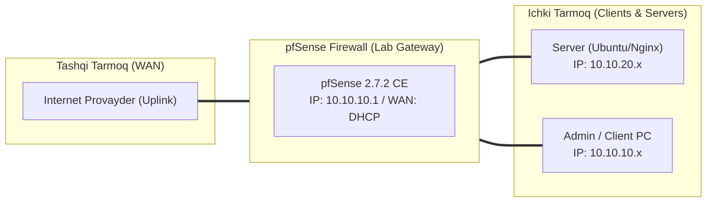

# 🛠️ [KUN-06] LAB QO'LLANMASI: Firewall Qoidalari, State Table Internals, Floating Rules va Aliases

**Mavzu:** Firewall Qoidalari, State Table Internals, Floating Rules va Aliases  
**Bosqich:** 1-Hafta: Baza va Virtualizatsiya  
**Nazariy Ma'ruza:** [Lecture darsini o'qish](lecture.md)

---

## 🎯 1. Real Korxona Muammosi (Business Problem Statement)

> **Real Muammo:** Korxonada firewall qoidalari pala-partish yozilgan, qoidalar soni 100 dan oshib ketgan, kimga nima ruxsat berilgani noaniq. Noqonuniy ulanishlar davom etmoqda va ma'murlar qaysi ulanishlar ochiq qolganini ko'ra olmayapti.

Ushbu laboratoriya mashg'ulotida siz ushbu real muammoni to'liq hal qilasiz, tizimni xalqaro standartlar asosida xavfsiz va barqaror qilib sozlaysiz.

---

## 🗺️ 2. Laboratoriya Topologiyasi va IP Sxemasi



### 📋 Laboratoriya IP Jadvali

| Interfeys / Qurilma | Turi | IP Manzil / Subnet | Izoh |
|---|---|---|---|
| `WAN` | Tashqi | Provayder IP (DHCP / Static) | Internetga chiqish |
| `LAN` (MGMT) | Ichki | `10.10.10.1/24` | Boshqaruv va admin tarmog'i |
| `DMZ / SERVERS` | Segment | `10.10.20.1/24` | Korporativ serverlar |
| `Mijoz Mashinasi` | Test Client | `10.10.10.50` (DHCP) | Sinov o'tkazuvchi kompyuter |

---

## 🖥️ 3. Talabalar uchun Laboratoriya Muhiti (Ikkala Variant)

Talaba o'zida mavjud imkoniyatga qarab **Variant A** yoki **Variant B** dan birini tanlaydi:

### 🔹 VARIANT A: Real Jismoniy pfSense (Hardware Appliance / Mini-PC)
* **Hardware:** Kuchli protsessor bo'lsa ham, qoidalarni Alias yordamida optimallashtirish CPU yuklamasini keskin pasaytiradi.
* Serial konsolda yoki SSH da `pfctl` buyruqlari real apparat holatini monitoring qilishda asosiy vositadir.

### 🔹 VARIANT B: Virtual Server pfSense (Proxmox VE / VMware Workstation)
* **Proxmox / VMware:** Proxmox xostida 'Firewall' moduli o'chirilgan (disabled) bo'lishi maqsadga muvofiq, aks holda Proxmox pve-firewall pfSense paketlarini filtrlab chalkashlik keltirib chiqarishi mumkin.

---

## ⚙️ 4. Bosqichma-bosqich Amaliy Sozlash Qo'llanmasi (Step-by-Step)

1. **Qadam:** `Firewall` -> `Aliases` ga kirish. Yangi Alias yaratish: Name: `RFC1918_Subnets`, Type: `Networks`, Qiymatlar: `10.0.0.0/8`, `172.16.0.0/12`, `192.168.0.0/16`.
2. **Qadam:** Port Aliases yaratish: Name: `Admin_Ports`, Type: `Ports`, Qiymatlar: `2222, 8443, 443`.
3. **Qadam:** `Firewall` -> `Rules` -> `CORP` bo'limiga kirish.
4. **Qadam:** 1-Qoida: Bloklash: Destination: `Single host or alias` -> `RFC1918_Subnets` (Boshqa ichki tarmoqlarga kirish taqiqlansin).
5. **Qadam:** 2-Qoida: Ruxsat berish: Protocol: TCP/UDP, Destination: Any, Port: 53, 80, 443 (Faqat Internet va DNS ruxsat).
6. **Qadam:** `Diagnostics` -> `States` ga kirib, aktiv ulanishlarni, har bir sessiyaning paketlar soni va holatini (ESTABLISHED:ESTABLISHED) ko'rish.
7. **Qadam:** Sinov tariqasida bitta aktiv yuklab olish sessiyasini State Table dan 'Kill' tugmasi bilan uzib tashlash.


---

## 🧪 5. Verifikatsiya va Tekshirish (Testing & CLI)

Har bir amaliyot tugagach, quyidagi buyruqlar yordamida natijani qat'iy tekshiring:

**FreeBSD konsolida generatsiya qilingan xom qoidalar ro'yxatini ko'rish:**
```bash
pfctl -sr
```

**Aktiv state table sessiyalarini ko'rish:**
```bash
pfctl -ss
```

**Holat jadvali xotira hajmi va chegaralarini tekshirish:**
```bash
pfctl -s memory
```

**Bloklangan va ruxsat berilgan paketlar logini real vaqtda kuzatish:**
```bash
Status -> System Logs -> Firewall
```


---

## 🚨 6. Eng Ko'p Uchraydigan Xatolar va Troubleshooting

* ⚠️ **Muammo: Qoida qo'shildi, lekin eski sessiya hali ham internetdan ma'lumot olyapti. Yechim: Stateful firewall eski ochilgan ulanishlarni uzmaydi; qoida kuchga kirishi uchun Diagnostics > States orqali eski ulanishni kill qilish yoki kutish kerak.**
* ⚠️ **Muammo: Floating rule ishlamayapti. Yechim: Agar Floating Rule da 'Quick' katakchasi belgilanmasa, u interfeys darajasidagi boshqa qoidalar tomonidan bekor qilinishi mumkin.**


---

## 🏆 7. Mustaqil Amaliy Topshiriq (Student Challenge / Homework)

> 📝 **Vazifa:** URL Table Alias yarating va unga Internetdagi bepul ochiq xavfli IP lar ro'yxatini (masalan Abuse.ch SSLBL) bog'lang. Ushbu IP larga barcha interfeyslardan chiquvchi trafikni bloklovchi Floating Rule yozing.
