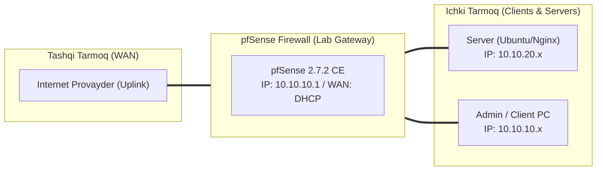

# 🛠️ [KUN-07] LAB QO'LLANMASI: NAT Masterclass: Port Forwarding, Outbound NAT, 1:1 NAT va NAT Reflection

**Mavzu:** NAT Masterclass: Port Forwarding, Outbound NAT, 1:1 NAT va NAT Reflection  
**Bosqich:** 1-Hafta: Baza va Virtualizatsiya  
**Nazariy Ma'ruza:** [Lecture darsini o'qish](lecture.md)

---

## 🎯 1. Real Korxona Muammosi (Business Problem Statement)

> **Real Muammo:** Kompaniyada ichki serverda web-sayt joylashgan. Tashqi foydalanuvchilar Public IP orqali unga kira olmayapti. Ichki ofis xodimlari esa tashqi domen nomi orqali saytni ochganda pfSense ning o'z WebGUI siga tushib qolmoqda (Hairpin NAT yo'qligi sababli).

Ushbu laboratoriya mashg'ulotida siz ushbu real muammoni to'liq hal qilasiz, tizimni xalqaro standartlar asosida xavfsiz va barqaror qilib sozlaysiz.

---

## 🗺️ 2. Laboratoriya Topologiyasi va IP Sxemasi



### 📋 Laboratoriya IP Jadvali

| Interfeys / Qurilma | Turi | IP Manzil / Subnet | Izoh |
|---|---|---|---|
| `WAN` | Tashqi | Provayder IP (DHCP / Static) | Internetga chiqish |
| `LAN` (MGMT) | Ichki | `10.10.10.1/24` | Boshqaruv va admin tarmog'i |
| `DMZ / SERVERS` | Segment | `10.10.20.1/24` | Korporativ serverlar |
| `Mijoz Mashinasi` | Test Client | `10.10.10.50` (DHCP) | Sinov o'tkazuvchi kompyuter |

---

## 🖥️ 3. Talabalar uchun Laboratoriya Muhiti (Ikkala Variant)

Talaba o'zida mavjud imkoniyatga qarab **Variant A** yoki **Variant B** dan birini tanlaydi:

### 🔹 VARIANT A: Real Jismoniy pfSense (Hardware Appliance / Mini-PC)
* **Hardware:** Agar provayder sizga statik Public IP (oq IP) bergan bo'lsa, WAN ga to'g'ridan-to'g'ri kiritiladi.
* Agar provayder modem ortida bo'lsangiz (Double NAT holati), modedan DMZ rejimini pfSense WAN IP siga yo'naltirib qo'yish kerak.

### 🔹 VARIANT B: Virtual Server pfSense (Proxmox VE / VMware Workstation)
* **Proxmox / VMware:** Virtual laboratoriyada VMware NAT (192.168.x.x) orqali simulyatsiya qilinadi.
* pfSense WAN IP si virtual laboratoriyaning 'Public IP' si vazifasini bajaradi.

---

## ⚙️ 4. Bosqichma-bosqich Amaliy Sozlash Qo'llanmasi (Step-by-Step)

1. **Qadam:** DMZ zonasida Nginx yoki Apache o'rnatilgan Web-server VM ishga tushirish (IP: `10.10.20.80`, Port: 80).
2. **Qadam:** `Firewall` -> `NAT` -> `Port Forward` bo'limiga kirish va 'Add' tugmasini bosish.
3. **Qadam:** Interface: `WAN`, Protocol: `TCP`, Destination: `WAN address`, Destination Port: `8080` (yoki 80), Redirect Target IP: `10.10.20.80`, Redirect Target Port: `80`.
4. **Qadam:** Filter rule association: `Pass` yoki `Add associated filter rule` (avtomat firewall ruxsat qoidasi yaratish).
5. **Qadam:** `System` -> `Advanced` -> `Firewall & NAT` bo'limiga o'tish.
6. **Qadam:** `NAT Reflection mode for port forwards` parametrini `Pure NAT` ga o'zgartirish va `Enable automatic outbound NAT for Reflection` katakchasini yoqish.
7. **Qadam:** `Firewall` -> `NAT` -> `Outbound` rejimini `Hybrid Outbound NAT rule generation` ga o'tkazish (korporativ standart).


---

## 🧪 5. Verifikatsiya va Tekshirish (Testing & CLI)

Har bir amaliyot tugagach, quyidagi buyruqlar yordamida natijani qat'iy tekshiring:

**Web-server sahifasi muvaffaqiyatli kelishi kerak:**
```bash
Tashqi kompyuterdan: curl http://<WAN_IP>:8080
```

**NAT Reflection orqali javob kelishi kerak:**
```bash
Ichki LAN kompyuterdan: curl http://<WAN_IP>:8080
```

**DMZ interfeysida kelayotgan va qaytayotgan paketlarni kuzatish:**
```bash
tcpdump -i vtnet1 -n host 10.10.20.80
```

**FreeBSD konsolida faol NAT qoidalarini tekshirish:**
```bash
pfctl -sn
```


---

## 🚨 6. Eng Ko'p Uchraydigan Xatolar va Troubleshooting

* ⚠️ **Muammo: Port Forward ishlamayapti. Yechim: pfSense WAN interfeysida 'Block private networks and loopback addresses' (RFC 1918) belgisi turgan bo'lishi mumkin. Agar laboratoriyada WAN 192.168.x.x bo'lsa, bu katakchani o'chirib qo'yish shart!**
* ⚠️ **Muammo: Ichkaridan tashqi IP ga ulanib bo'lmayapti. Yechim: NAT Reflection 'Pure NAT' rejimiga qo'yilganini va avtomatik outbound reflection yoqilganini tekshiring.**


---

## 🏆 7. Mustaqil Amaliy Topshiriq (Student Challenge / Homework)

> 📝 **Vazifa:** SSH portini tashqaridan xavfsiz qilish maqsadida, WAN dagi nostandart 50222 portini ichki serverning 22 portiga yo'naltiruvchi Port Forwarding qoidasini yarating va faqat ma'lum bir IP dan kirish cheklovini qo'ying.
