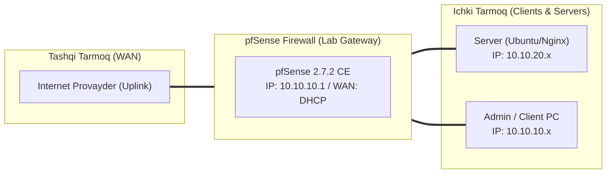

# 🛠️ [KUN-08] LAB QO'LLANMASI: Multi-WAN: Dual ISP Failover va Policy-Based Load Balancing

**Mavzu:** Multi-WAN: Dual ISP Failover va Policy-Based Load Balancing  
**Bosqich:** 2-Hafta: Marshrutlash, Multi-WAN va VPN  
**Nazariy Ma'ruza:** [Lecture darsini o'qish](lecture.md)

---

## 🎯 1. Real Korxona Muammosi (Business Problem Statement)

> **Real Muammo:** Korxonada optik tolali internet provayder (ISP1) kabeli uzilib qolsa, butun kompaniya ishi, savdo va to'lov terminallari to'xtab qolmoqda. Zaxiraga olingan 4G/LTE yoki ikkinchi optika provayderi (ISP2) esa qo'lda ulanguncha katta vaqt yo'qotilmoqda.

Ushbu laboratoriya mashg'ulotida siz ushbu real muammoni to'liq hal qilasiz, tizimni xalqaro standartlar asosida xavfsiz va barqaror qilib sozlaysiz.

---

## 🗺️ 2. Laboratoriya Topologiyasi va IP Sxemasi



### 📋 Laboratoriya IP Jadvali

| Interfeys / Qurilma | Turi | IP Manzil / Subnet | Izoh |
|---|---|---|---|
| `WAN` | Tashqi | Provayder IP (DHCP / Static) | Internetga chiqish |
| `LAN` (MGMT) | Ichki | `10.10.10.1/24` | Boshqaruv va admin tarmog'i |
| `DMZ / SERVERS` | Segment | `10.10.20.1/24` | Korporativ serverlar |
| `Mijoz Mashinasi` | Test Client | `10.10.10.50` (DHCP) | Sinov o'tkazuvchi kompyuter |

---

## 🖥️ 3. Talabalar uchun Laboratoriya Muhiti (Ikkala Variant)

Talaba o'zida mavjud imkoniyatga qarab **Variant A** yoki **Variant B** dan birini tanlaydi:

### 🔹 VARIANT A: Real Jismoniy pfSense (Hardware Appliance / Mini-PC)
* **Hardware:** pfSense da kamida 3 ta jismoniy port bo'lishi shart (`igb0` = ISP1, `igb1` = ISP2, `igb2` = LAN).
* ISP1 kabeli port 1 ga, ISP2 modem kabeli port 2 ga ulanadi.
* Har bir provayder o'zining alohida IP manziliga ega bo'lishi kerak (turli subnetlar).

### 🔹 VARIANT B: Virtual Server pfSense (Proxmox VE / VMware Workstation)
* **Proxmox / VMware:** pfSense VM ga 3 ta tarmoq kartasi beriladi:
  * Adapter 1 (WAN1): `vmbr0` (192.168.100.0/24)
  * Adapter 2 (WAN2): `vmbr2` (192.168.200.0/24)
  * Adapter 3 (LAN): `vmbr1` (10.10.10.0/24).

---

## ⚙️ 4. Bosqichma-bosqich Amaliy Sozlash Qo'llanmasi (Step-by-Step)

1. **Qadam:** `Interfaces` -> `Assignments` bo'limida ikkinchi WAN (OPT1) ni qo'shish va nomini `WAN2_BACKUP` deb qo'yish.
2. **Qadam:** `System` -> `Routing` -> `Gateways` ga kirish. WAN1 uchun Monitor IP: `1.1.1.1`, WAN2 uchun Monitor IP: `8.8.8.8` belgilash.
3. **Qadam:** `Gateway Groups` yorlig'iga o'tib, 'Add' tugmasini bosish. Group Name: `GW_FAILOVER`. WAN1: Tier 1, WAN2: Tier 2. Trigger: `Member Down`.
4. **Qadam:** Yana bir guruh yaratish: Group Name: `GW_LOADBALANCE`. WAN1: Tier 1, WAN2: Tier 1. Trigger: `Packet Loss or High Latency`.
5. **Qadam:** `System` -> `Advanced` -> `Miscellaneous`: `Use sticky connections` katakchasini yoqish.
6. **Qadam:** `Firewall` -> `Rules` -> `LAN`: Default Internetga ruxsat beruvchi qoidani tahrirlash -> `Display Advanced` -> `Gateway` maydonida `GW_FAILOVER` yoki `GW_LOADBALANCE` ni tanlash.


---

## 🧪 5. Verifikatsiya va Tekshirish (Testing & CLI)

Har bir amaliyot tugagach, quyidagi buyruqlar yordamida natijani qat'iy tekshiring:

**Ikkala shlyuz ham Online, ping va jitter yashil ekanini ko'rish:**
```bash
Status -> Gateways
```

**Hozirgi chiqish tashqi IP manzilini tekshirish:**
```bash
curl https://ifconfig.me
```

**yoki virtual adapter kabelini ajratish:**
```bash
pfSense WAN1 kabelini jismonan uzib tashlash
```

**ping davom etadi:**
```bash
5-10 soniya ichida Status > Gateways da WAN1 Offline bo'lib, trafik darhol WAN2 orqali uzluksiz o'tayotganini tekshirish
```


---

## 🚨 6. Eng Ko'p Uchraydigan Xatolar va Troubleshooting

* ⚠️ **Muammo: Gateway doim 'Pending' yoki 'Offline' ko'rsatmoqda. Yechim: Monitor IP sifatida provayder shlyuzini emas, ommaviy ishonchli IP larni (1.1.1.1, 8.8.8.8, 9.9.9.9) ko'rsating va WAN firewall qoidasida ushbu IP lardan ICMP Echo Reply ga ruxsat borligiga ishonch hosil qiling.**
* ⚠️ **Muammo: Failover ishlagandan so'ng WAN1 qaytsa ham trafik qaytmayapti. Yechim: 'State Killing on Gateway Failure' opsiyasi yoqilgan bo'lishi kerak.**


---

## 🏆 7. Mustaqil Amaliy Topshiriq (Student Challenge / Homework)

> 📝 **Vazifa:** Shunday PBR qoidasi yozingki, mehmonlar (GUEST VLAN) trafigi faqat va faqat arzon WAN2 (LTE) orqali chiqsin, asosiy qimmat WAN1 optikasi esa korporativ xodimlar (CORP VLAN) ga ajratilsin.
