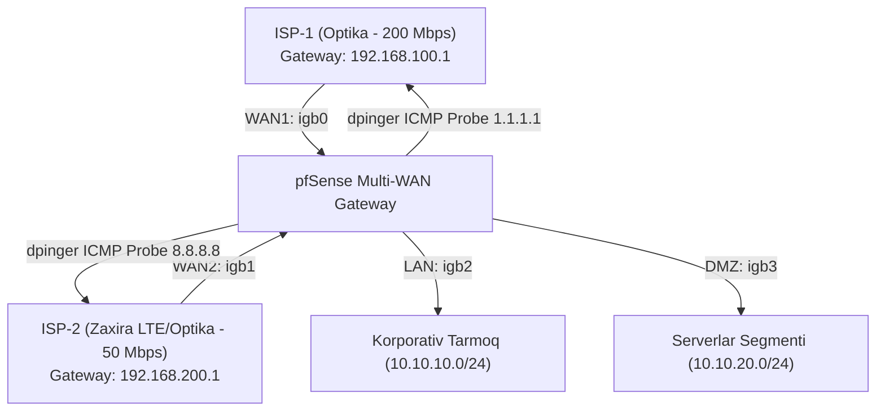

# 📚 [KUN-08] LECTURE: Multi-WAN Masterclass — Dual ISP Failover, Policy-Based Routing va Load Balancing

**Kategoriya:** 2-Hafta: Marshrutlash, Multi-WAN va VPN  
**Maqsad:** Korxonada internet uzilishlariga barham berish (99.99% Uptime), bir vaqtning o'zida ikkita turli texnologiyadagi provayderlarni (Optika + Zaxira LTE/Optika) ulash, trafikni aqlli taqsimlash (Load Balancing) va avtomatik zaxiraga o'tish (Failover) arxitekturasini o'rganish.

---

## 🧭 Mundarija
1. [Multi-WAN Arxitekturasi va Korxona Ehtiyoji](#1-multi-wan-arxitekturasi-va-korxona-ehtiyoji)
2. [dpinger va Gateway Monitoring Mexanizmi](#2-dpinger-va-gateway-monitoring-mexanizmi)
3. [Gateway Groups Mantiqi: Tiering va Triggers](#3-gateway-groups-mantiqi-tiering-va-triggers)
4. [Policy-Based Routing (PBR) va Qoidalar Tartibi](#4-policy-based-routing-pbr-va-qoidalar-tartibi)
5. [Sticky Connections va Sessiyalar Saqlanishi](#5-sticky-connections-va-sessiyalar-saqlanishi)
6. [CARP Klasterida Multi-WAN Qanday Tashkil Etiladi?](#6-carp-klasterida-multi-wan-qanday-tashkil-etiladi)
7. [Inbound Multi-WAN (DNS Round-Robin va Port Forward)](#7-inbound-multi-wan)
8. [Xulosa va O'z-o'zini Tekshirish](#8-xulosa)

---

## 1. Multi-WAN Arxitekturasi va Korxona Ehtiyoji

Zamonaviy biznesda 1 soatlik internet uzilishi (Downtime) kompaniyaga millionlab so'm zarar, to'xtab qolgan to'lov terminallari, yetib bormagan bank o'tkazmalari va qoniqarsiz mijozlarni anglatadi. Yagona internet provayderiga (SPOF - Single Point of Failure) bog'lanib qolish jiddiy xatodir.

Multi-WAN konsepsiyasi kamida ikkita mustaqil ISP kanalini pfSense ga ulashni nazarda tutadi:
* **Asosiy Provayder (ISP-1 / Primary):** Katta tezlikdagi optik tolali kanal (masalan, 200 Mbps).
* **Zaxira Provayder (ISP-2 / Secondary):** Mustaqil boshqa aloqa operatori (masalan, ikkinchi optika yoki 4G/5G LTE/Mikroto'lqinli radio-kanal).

---

## 2. dpinger va Gateway Monitoring Mexanizmi

pfSense har bir shlyuzning holatini FreeBSD ning maxsus `dpinger` servisi orqali har soniyada tekshirib turadi:
* **Monitor IP:** Shlyuzning o'zini emas, internetdagi global va ishonchli IP manzillarni tekshirish shart. Chunki provayder modemi ishlab turgan bo'lsa-da, tashqi magistral uzilgan bo'lishi mumkin.
  * WAN1 uchun: `1.1.1.1` (Cloudflare)
  * WAN2 uchun: `8.8.8.8` (Google)
* **Thresholds (Chegaralar):**
  * **Latency:** Standart holatda 500ms dan oshsa, kanal sekinlashgan deb hisoblanadi.
  * **Packet Loss:** 20% dan ortiq paket yo'qolsa, kanal yaroqsiz deb baholanadi.

---

## 3. Gateway Groups Mantiqi: Tiering va Triggers

pfSense shlyuzlarni guruhlash uchun `Gateway Groups` vositasidan foydalanadi:

| Rejim Nomi | WAN1 Tier | WAN2 Tier | Trigger | Ishlash Printsipi |
|---|:---:|:---:|---|---|
| **Failover (Active/Passive)** | **Tier 1** | **Tier 2** | `Member Down` | Barcha trafik WAN1 orqali ketadi. Faqat WAN1 o'chgandagina WAN2 ga o'tiladi. |
| **Load Balancing (Active/Active)** | **Tier 1** | **Tier 1** | `Packet Loss or High Latency` | Paketlar oqimi ikkala kanal bo'yicha teng (yoki og'irligiga qarab) taqsimlanadi. |
| **Degraded Failover** | **Tier 1** | **Tier 2** | `Packet Loss` | Agar WAN1 da paket yo'qotish 10% dan oshsa, avtomat WAN2 ga o'tiladi. |

---

## 4. Policy-Based Routing (PBR) va Qoidalar Tartibi

pfSense da standart holatda barcha trafik tizimning `Default Gateway` si orqali chiqadi. Shlyuz guruhlarini ishlatish uchun **Policy-Based Routing (PBR)** qoidalari yoziladi:

> [!WARNING]
> **Kritik Xato:** Agar LAN interfeysida eng yuqori qoidaga Gateway sifatida `GW_GROUP` qo'yilsa, ichki tarmoqlararo (Inter-VLAN) va pfSense ning o'ziga boruvchi (DNS) so'rovlar ham tashqi internetga yo'naltirilib uzilib qoladi!

### To'g'ri Qoidalar Tartibi:
1. **Pass Rule (Local Traffic):** Destination: `LAN Subnets / RFC1918_Subnets` -> Gateway: `Default` (Ichki trafik router ichida qolsin).
2. **Pass Rule (Local DNS):** Destination: `This Firewall (self)`, Port: `53` -> Gateway: `Default`.
3. **Pass Rule (Internet PBR):** Destination: `*` (Any), Gateway: `GW_FAILOVER` yoki `GW_LOADBALANCE`.

---

## 5. Sticky Connections va Sessiyalar Saqlanishi

Load Balancing (Round-Robin) rejimida ikkala provayder parallel ishlayotganda quyidagi muammo yuzaga keladi:
* Foydalanuvchi Bank saytiga yoki korporativ CRM ga kirganda, birinchi so'rov WAN1 (IP: `203.0.113.5`) orqali boradi.
* Keyingi sahifani yuklaganda PBR so'rovni WAN2 (IP: `198.51.100.14`) ga tashlaydi.
* Bank tizimi bitta sessiyada mijoz IP manzili birdaniga o'zgarib ketganini ko'rib, xavfsizlik vajidan sessiyani bekor qiladi (Logout).

**Yechim:** `System -> Advanced -> Miscellaneous` bo'limida **`Use sticky connections`** parametrini yoqish. pfSense mijozning IP manzilini xotiraga oladi va uning barcha tashqi sessiyalarini belgilangan vaqt davomida (masalan, 300 soniya) aynan bitta WAN kanali orqali jo'natadi.

---

## 6. CARP Klasterida Multi-WAN Qanday Tashkil Etiladi?

Yuqori barqarorlikdagi (CARP) ikkita firewall mavjud bo'lganda, har ikkala firewall ikkala provayderga ulanishi shart:
* **Arxitektura:** Provayder-1 kabeli kichik L2 switchga (yoki VLAN 100 ga) ulanadi. Switchdan ikkita kabel chiqib, FW-01 WAN1 ga va FW-02 WAN1 ga boradi.
* Provayder-2 ham alohida switchga (yoki VLAN 200 ga) ulanadi va FW-01 WAN2 hamda FW-02 WAN2 ga boradi.
* Har bir provayder segmentida **CARP VIP** olinadi (masalan, WAN1 CARP VIP va WAN2 CARP VIP).
* Barcha chiquvchi NAT qoidalari shaxsiy interfeys IP ga emas, aynan tegishli CARP VIP ga bog'lanadi.

---

## 7. Inbound Multi-WAN

Agar ichki DMZ da Web-server joylashgan bo'lsa va unga tashqaridan ikkala provayder orqali kirish kerak bo'lsa:
1. Har ikkala WAN da alohida Port Forward qoidasi yaratiladi.
2. Tashqi domenga (masalan `www.company.uz`) ikkita DNS `A` yozuvi biriktiriladi:
   * `A www.company.uz 203.0.113.5` (ISP1)
   * `A www.company.uz 198.51.100.14` (ISP2)
3. pfSense dagi `reply-to` mexanizmi tufayli: WAN1 dan kirib kelgan paketga javob majburiy ravishda WAN1 orqali, WAN2 dan kirgan so'rovga javob esa WAN2 orqali qaytariladi!

---

## 8. Xulosa
Multi-WAN — korxonaning uzluksiz ishlash kafolatidir. To'g'ri sozlangan dpinger, PBR va Sticky Connections tizimi foydalanuvchilarga sezdirmasdan avariya holatlarini yengib o'tish imkonini beradi.
