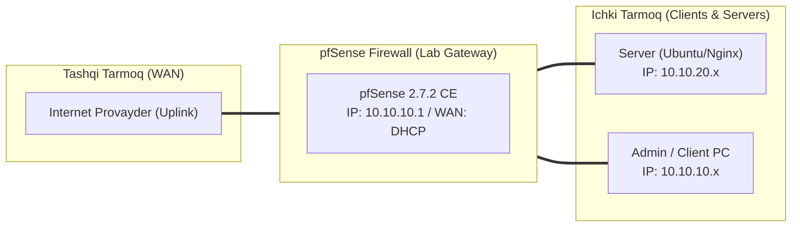

# 🛠️ [KUN-09] LAB QO'LLANMASI: Dinamik Marshrutlash: FRR (Free Range Routing) bilan OSPF va BGP

**Mavzu:** Dinamik Marshrutlash: FRR (Free Range Routing) bilan OSPF va BGP  
**Bosqich:** 2-Hafta: Marshrutlash, Multi-WAN va VPN  
**Nazariy Ma'ruza:** [Lecture darsini o'qish](lecture.md)

---

## 🎯 1. Real Korxona Muammosi (Business Problem Statement)

> **Real Muammo:** Korxona tarmog'i 5 ta alohida bino va routerlarga (Cisco, MikroTik, Linux) ega. Tarmoqqa yangi subnet qo'shilganda har bir routerga qo'lda Static Route yozish chalkashliklarga, yo'nalishlar sikliga (routing loop) va avariyaga olib kelmoqda.

Ushbu laboratoriya mashg'ulotida siz ushbu real muammoni to'liq hal qilasiz, tizimni xalqaro standartlar asosida xavfsiz va barqaror qilib sozlaysiz.

---

## 🗺️ 2. Laboratoriya Topologiyasi va IP Sxemasi



### 📋 Laboratoriya IP Jadvali

| Interfeys / Qurilma | Turi | IP Manzil / Subnet | Izoh |
|---|---|---|---|
| `WAN` | Tashqi | Provayder IP (DHCP / Static) | Internetga chiqish |
| `LAN` (MGMT) | Ichki | `10.10.10.1/24` | Boshqaruv va admin tarmog'i |
| `DMZ / SERVERS` | Segment | `10.10.20.1/24` | Korporativ serverlar |
| `Mijoz Mashinasi` | Test Client | `10.10.10.50` (DHCP) | Sinov o'tkazuvchi kompyuter |

---

## 🖥️ 3. Talabalar uchun Laboratoriya Muhiti (Ikkala Variant)

Talaba o'zida mavjud imkoniyatga qarab **Variant A** yoki **Variant B** dan birini tanlaydi:

### 🔹 VARIANT A: Real Jismoniy pfSense (Hardware Appliance / Mini-PC)
* **Hardware:** pfSense bitta porti orqali tashqi L3 switchga yoki Cisco/MikroTik routerga ulangan bo'lishi kerak.
* OSPF multicast (`224.0.0.5`, `224.0.0.6`) paketlari switch orqali o'tishi taqiqlanmagan bo'lishi shart.

### 🔹 VARIANT B: Virtual Server pfSense (Proxmox VE / VMware Workstation)
* **Proxmox / VMware:** pfSense yoniga ikkinchi router sifatida FRR o'rnatilgan Ubuntu Server yoki MikroTik CHR VM ishga tushiring.
* Ularni umumiy `vmbr3` (10.254.0.0/30) orqali ulang.

---

## ⚙️ 4. Bosqichma-bosqich Amaliy Sozlash Qo'llanmasi (Step-by-Step)

1. **Qadam:** `System` -> `Package Manager` -> `Available Packages` ga kirib, `frr` paketini topish va o'rnatish.
2. **Qadam:** `Services` -> `FRR Global/Zebra`: Global sozlamalarni yoqish, Router ID ga `10.10.10.1` berish.
3. **Qadam:** `Services` -> `FRR OSPF`: OSPF ni yoqish. Area ID: `0.0.0.0` (Backbone Area).
4. **Qadam:** `Interfaces` yorlig'ida qo'shni routerga qaragan interfeysni tanlash, Network Type: `Point-to-Point` yoki `Broadcast` deb belgilash.
5. **Qadam:** `Redistribute` bo'limida `Connected Networks` ni OSPF orqali boshqalarga tarqatishni yoqish.
6. **Qadam:** Qo'shni routerda (MikroTik yoki Linux FRR) ham OSPF Area 0 ni yoqish va pfSense bilan qo'shnichilik (Full Adjacency) o'rnatish.


---

## 🧪 5. Verifikatsiya va Tekshirish (Testing & CLI)

Har bir amaliyot tugagach, quyidagi buyruqlar yordamida natijani qat'iy tekshiring:

**pfSense konsolida qo'shnining FULL/DR yoki FULL/BDR holatdaligini ko'rish:**
```bash
vtysh -c 'show ip ospf neighbor'
```

**OSPF orqali o'rganilgan marshrutlar jadvalini ko'rish:**
```bash
vtysh -c 'show ip route ospf'
```

**WebGUI orqali holatni kuzatish:**
```bash
Status -> FRR -> OSPF
```

**qo'lda route yozmasdan aloqa borligini tekshirish:**
```bash
Qo'shni tarmoqdagi yangi serverga ping yuborish
```


---

## 🚨 6. Eng Ko'p Uchraydigan Xatolar va Troubleshooting

* ⚠️ **Muammo: OSPF 'Init' yoki '2-Way' holatida qotib qoldi, 'Full' bo'lmayapti. Yechim: Interfeyslardagi MTU hajmi bir xil bo'lishi kerak (yoki 'MTU Ignore' yoqiladi), shuningdek Hello/Dead taymerlari (10s/40s) mos kelishini tekshiring.**
* ⚠️ **Muammo: Qo'shnidan marshrut kelmayapti. Yechim: Firewall Rules bo'limida OSPF protokoli (IP Protocol 89) ruxsat berilganligini tasdiqlang.**


---

## 🏆 7. Mustaqil Amaliy Topshiriq (Student Challenge / Homework)

> 📝 **Vazifa:** OSPF MD5 kalit autentifikatsiyasini yoqing va shifrlanmagan Hello paketlar qabul qilinmasligini Wireshark/tcpdump orqali tekshiring.
