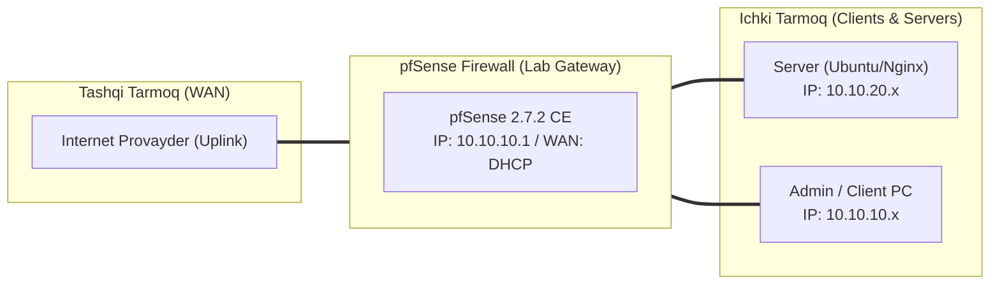

# 🛠️ [KUN-10] LAB QO'LLANMASI: OpenVPN Remote Access (Road Warrior), PKI/CA va Client Export

**Mavzu:** OpenVPN Remote Access (Road Warrior), PKI/CA va Client Export  
**Bosqich:** 2-Hafta: Marshrutlash, Multi-WAN va VPN  
**Nazariy Ma'ruza:** [Lecture darsini o'qish](lecture.md)

---

## 🎯 1. Real Korxona Muammosi (Business Problem Statement)

> **Real Muammo:** Karantin yoki masofaviy ish vaqtida 50 nafar xodim uyidan turib korporativ fayl-serverlar va CRM ga xavfsiz ulanishi kerak. Oddiy portlarni ochish xavfli, xodimlarning noutbuklariga VPN sozlamalarini qo'lda o'rnatib chiqish esa katta vaqt talab qiladi.

Ushbu laboratoriya mashg'ulotida siz ushbu real muammoni to'liq hal qilasiz, tizimni xalqaro standartlar asosida xavfsiz va barqaror qilib sozlaysiz.

---

## 🗺️ 2. Laboratoriya Topologiyasi va IP Sxemasi



### 📋 Laboratoriya IP Jadvali

| Interfeys / Qurilma | Turi | IP Manzil / Subnet | Izoh |
|---|---|---|---|
| `WAN` | Tashqi | Provayder IP (DHCP / Static) | Internetga chiqish |
| `LAN` (MGMT) | Ichki | `10.10.10.1/24` | Boshqaruv va admin tarmog'i |
| `DMZ / SERVERS` | Segment | `10.10.20.1/24` | Korporativ serverlar |
| `Mijoz Mashinasi` | Test Client | `10.10.10.50` (DHCP) | Sinov o'tkazuvchi kompyuter |

---

## 🖥️ 3. Talabalar uchun Laboratoriya Muhiti (Ikkala Variant)

Talaba o'zida mavjud imkoniyatga qarab **Variant A** yoki **Variant B** dan birini tanlaydi:

### 🔹 VARIANT A: Real Jismoniy pfSense (Hardware Appliance / Mini-PC)
* **Hardware:** pfSense protsessorida Intel AES-NI ko'rsatmasi faol bo'lsa, OpenVPN shifrlash tezligi 5-10 baravarga oshadi (`System > Advanced > Miscellaneous > Cryptographic Hardware`).
* WAN portida oq IP bo'lishi yoki yuqori routerdan UDP 1194 porti pfSense ga yo'naltirilgan bo'lishi lozim.

### 🔹 VARIANT B: Virtual Server pfSense (Proxmox VE / VMware Workstation)
* **Proxmox / VMware:** pfSense VM sozlamalarida CPU turini `host` deb tanlang (AES-NI ko'rsatmasi virtual mashinaga to'g'ridan-to'g'ri o'tishi uchun).

---

## ⚙️ 4. Bosqichma-bosqich Amaliy Sozlash Qo'llanmasi (Step-by-Step)

1. **Qadam:** `System` -> `Cert. Manager` -> `CAs` bo'limiga kirish. 'Add' -> Internal CA yaratish: Name: `Corp_Root_CA`, Key: 2048-bit RSA yoki ECDSA P-384.
2. **Qadam:** `Certificates` yorlig'ida yangi Server sertifikatini chiqarish: Name: `VPN_Server_Cert`, Type: `Server Certificate`.
3. **Qadam:** `VPN` -> `OpenVPN` -> `Wizards` yordamida tezkor sozlash ustasini ishga tushirish.
4. **Qadam:** Interface: `WAN`, Protocol: `UDP on IPv4`, Port: `1194`, Encryption: `AES-256-GCM`, Auth: `SHA256`, TLS-Crypt faollashtirish.
5. **Qadam:** Tunnel Network: `10.201.0.0/24`, Local Network: `10.10.10.0/24, 10.10.20.0/24`.
6. **Qadam:** System -> Package Manager dan `openvpn-client-export` paketini o'rnatish.
7. **Qadam:** `System` -> `User Manager` da yangi xodim `user1` yaratish va unga shaxsiy User Certificate berish.
8. **Qadam:** `VPN` -> `OpenVPN` -> `Client Export` bo'limiga o'tib, Windows yoki Android/iOS uchun tayyor `.ovpn` faylni yuklab olish.


---

## 🧪 5. Verifikatsiya va Tekshirish (Testing & CLI)

Har bir amaliyot tugagach, quyidagi buyruqlar yordamida natijani qat'iy tekshiring:

```bash
Mijoz qurilmasida OpenVPN Connect dasturini ishga tushirib, yuklab olingan profil bilan ulanish
```

**10.201.0.2) va uzatilgan baytlar sonini ko'rish:**
```bash
Status -> OpenVPN (WebGUI da mijozning real IP si, virtual IP si
```

**Ofis ichidagi DMZ serverga VPN orqali yetib borishni tekshirish:**
```bash
Mijozdan: ping 10.10.20.80
```

**Mijozning tashqi IP si o'zgarganini yoki split-tunnelda o'zgarishsiz qolganini tekshirish:**
```bash
curl ifconfig.me
```


---

## 🚨 6. Eng Ko'p Uchraydigan Xatolar va Troubleshooting

* ⚠️ **Muammo: TLS Error: TLS handshake failed. Yechim: WAN firewall qoidasida UDP 1194 porti ochilganini, vaqt (NTP) mijoz va serverda bir xilligini tekshiring (sertifikatlar vaqtga o'ta sezgir).**
* ⚠️ **Muammo: Ulandi, lekin ichki kompyuterlarga ping bormayapti. Yechim: 'Local Network' maydonida ofis subnetlari to'g'ri ko'rsatilganini va OpenVPN interfeysi qoidalarida ruxsat berilganini tekshiring.**


---

## 🏆 7. Mustaqil Amaliy Topshiriq (Student Challenge / Homework)

> 📝 **Vazifa:** Split-Tunnel rejimini sozlang (faqat 10.10.0.0/16 trafigi VPN orqali ketsin, YouTube/Google trafigi esa xodimning o'z uy interneti orqali o'tsin). Natijani mijozda `tracert` orqali tasdiqlang.
