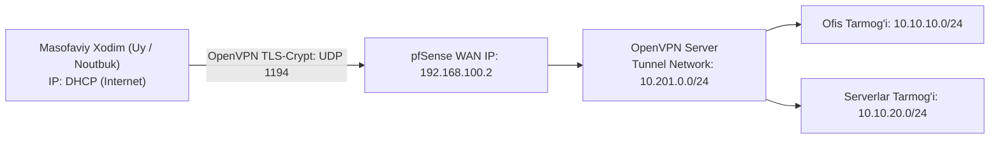

# 🛠️ [KUN-10] LAB: OpenVPN RoadWarrior, PKI va Avtomatlashtirilgan Client Export

**Mavzu:** Korxona xodimlari uchun xavfsiz masofaviy ulanish tizimini noldan qurish  
**Nazariya:** [Lecture darsini o'qish](lecture.md)

---

## 🎯 1. Real Korxona Muammosi

> **Biznes Muammo:** Kompaniyaning 30 nafar dasturchisi va buxgalteri masofadan (Remote) ishlamoqda. Dasturchilar serverlarga ulanishi uchun IT bo'limi server portlarini (SSH 22, RDP 3389) internetga to'g'ridan-to'g'ri ochib qo'ygan. Oqibatda serverlar har kuni xakerlik brute-force hujumlariga uchramoqda. Rahbariyat barcha tashqi portlarni darhol yopishni va faqat bitta yuqori darajada shifrlangan OpenVPN shlyuzi orqali 2-faktorli (Sertifikat + Parol) ulanishni joriy qilishni buyurdi.

---

## 🗺️ 2. Topologiya va IP Rejasi



---

## ⚙️ 3. Qadam-baqadam Sozlash

### 1-Qadam: Ichki Sertifikatlash Markazini (CA) Yaratish
1. `System -> Cert. Manager -> CAs` ga kiring.
2. **Add** tugmasini bosing:
   * Descriptive name: `Corp_Internal_CA`
   * Method: `Create an internal Certificate Authority`
   * Key type: `RSA`, Key length: `2048` (yoki ECDSA P-384)
   * Digest Algorithm: `SHA256`
   * Lifetime: `3650` kun
   * Common Name: `Corp Internal Root CA`
3. Save qiling.

### 2-Qadam: Server Sertifikatini Chiqarish
1. `Certificates` yorlig'iga o'ting, **Add** bosing:
   * Method: `Create an internal Certificate`
   * Descriptive name: `OpenVPN_Server_Cert`
   * Certificate authority: `Corp_Internal_CA`
   * Certificate Type: `Server Certificate`
   * Common Name: `vpn.corp.local`
2. Save qiling.

### 3-Qadam: OpenVPN Wizard Orqali Serverni Sozlash
1. `VPN -> OpenVPN -> Wizards` ga kiring.
2. Type of Server: `Local User Access` -> Next.
3. Certificate Authority: `Corp_Internal_CA` -> Next.
4. Server Certificate: `OpenVPN_Server_Cert` -> Next.
5. Server sozlamalari:
   * Interface: `WAN`
   * Protocol: `UDP on IPv4`
   * Local Port: `1194`
   * Description: `Corp Remote VPN`
   * Cryptographic Settings:
     * TLS Audio/Data: `TLS Encryption and Authentication` (TLS-Crypt yoqiladi)
     * Encryption Algorithm: `AES-256-GCM`
     * Auth Digest: `SHA256`
   * Tunnel Network: `10.201.0.0/24`
   * IPv4 Local Network: `10.10.10.0/24, 10.10.20.0/24` (Split-tunnel)
   * Concurrent Connections: `50`
   * DNS Server 1: `10.10.10.1`
6. Firewall Rule Configuration:
   * `Firewall Rule (traffic from clients)` -> Katakchani yoqing.
   * `OpenVPN rule (allow traffic through tunnel)` -> Katakchani yoqing.
7. Finish tugmasini bosing.

### 4-Qadam: Client Export Paketini O'rnatish
1. `System -> Package Manager -> Available Packages` ga kiring.
2. `openvpn-client-export` paketini qidiring va o'rnating.

### 5-Qadam: Foydalanuvchi va Mijoz Sertifikatini Yaratish
1. `System -> User Manager -> Users` ga kiring, **Add** bosing.
2. Username: `devuser1`, Password: `StrongUserPassword123!`.
3. `Certificate` bo'limida: **Click to create a user certificate** katakchasini yoqing.
4. Certificate authority: `Corp_Internal_CA`, Key length: `2048`. Save qiling.

### 6-Qadam: Mijoz Konfiguratsiyasini Yuklab Olish
1. `VPN -> OpenVPN -> Client Export` bo'limiga kiring.
2. Remote Access Server: `Corp Remote VPN` tanlanganini tekshiring.
3. Host Name Resolution: `Interface IP Address` (yoki tashqi FQDN domen).
4. Sahifa pastida `devuser1` foydalanuvchisini toping:
   * Windows uchun: `Most Clients (Inline Configurations)` yoki `Windows Installer`.
   * Android / iOS / macOS uchun: `OpenVPN Connect (.ovpn)` profilini yuklab oling.

---

## 🧪 4. Verifikatsiya va Tekshirish

1. Mijoz kompyuteriga (noutbuk yoki telefon) rasmiy **OpenVPN Connect** dasturini o'rnating va yuklab olingan `.ovpn` faylni import qiling.
2. `Connect` tugmasini bosing va parolni kiriting.
3. **pfSense WebGUI da tekshirish:**
   * `Status -> OpenVPN` sahifasiga kiring.
   * `devuser1` ning ulangan vaqti, haqiqiy IP si, unga berilgan virtual IP (`10.201.0.2`), jo'natilgan va qabul qilingan baytlar ko'rinishi kerak!
4. **Tarmoq aloqasini tekshirish (Mijoz kompyuteridan):**
```bash
ping 10.10.20.80
```
*(DMZ dagi serverga to'g'ridan-to'g'ri aloqa borligini ko'rasiz).*
5. **Split Tunnelni tekshirish:**
```bash
tracert 10.10.20.80
tracert 8.8.8.8
```
*Natija:* Ofis serveriga yo'l 10.201.0.1 orqali, Google ga yo'l esa foydalanuvchining o'z shaxsiy provayderi orqali o'tayotganini tasdiqlang.

---

## 🚨 5. Troubleshooting
* ⚠️ **Muammo: TLS Handshake failed xatosi.**  
  *Yechim:* pfSense va mijoz kompyuterida soat vaqtini (NTP) tekshiring. Agar vaqt 5 minutdan ortiq farq qilsa, TLS sertifikatlari rad etiladi.
* ⚠️ **Muammo: Ulandi, lekin serverlarga ping bormayapti.**  
  *Yechim:* `Firewall -> Rules -> OpenVPN` interfeysida ruxsat beruvchi qoida borligini tekshiring. Shuningdek, ichki serverning o'zida Windows Firewall begona subnetdan (10.201.0.0/24) kelgan pingni bloklamayotganiga ishonch hosil qiling.

---

## 🏆 6. Mustaqil Topshiriq
`Certificate Revocation List (CRL)` yarating va ishdan ketgan sinov foydalanuvchisining sertifikatini bekor qiling. Uning darhol ulanolmay qolishini loglarda tekshiring.
