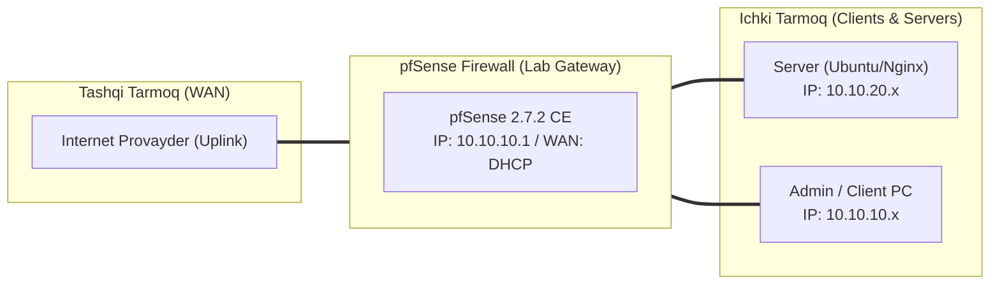

# 🛠️ [KUN-11] LAB QO'LLANMASI: OpenVPN Site-to-Site Tunneling va Client Specific Overrides (CSO)

**Mavzu:** OpenVPN Site-to-Site Tunneling va Client Specific Overrides (CSO)  
**Bosqich:** 2-Hafta: Marshrutlash, Multi-WAN va VPN  
**Nazariy Ma'ruza:** [Lecture darsini o'qish](lecture.md)

---

## 🎯 1. Real Korxona Muammosi (Business Problem Statement)

> **Real Muammo:** Bosh ofis (Headquarters) va Samarqanddagi filiali (Branch Office) o'rtasida doimiy xavfsiz aloqa zarur. Filial xodimlari bosh ofisdagi serverlarga to'g'ridan-to'g'ri murojaat qilishi, shuningdek kelajakda boshqa filiallar qo'shilsa ularning IP diapazonlari to'qnashmasligi lozim.

Ushbu laboratoriya mashg'ulotida siz ushbu real muammoni to'liq hal qilasiz, tizimni xalqaro standartlar asosida xavfsiz va barqaror qilib sozlaysiz.

---

## 🗺️ 2. Laboratoriya Topologiyasi va IP Sxemasi



### 📋 Laboratoriya IP Jadvali

| Interfeys / Qurilma | Turi | IP Manzil / Subnet | Izoh |
|---|---|---|---|
| `WAN` | Tashqi | Provayder IP (DHCP / Static) | Internetga chiqish |
| `LAN` (MGMT) | Ichki | `10.10.10.1/24` | Boshqaruv va admin tarmog'i |
| `DMZ / SERVERS` | Segment | `10.10.20.1/24` | Korporativ serverlar |
| `Mijoz Mashinasi` | Test Client | `10.10.10.50` (DHCP) | Sinov o'tkazuvchi kompyuter |

---

## 🖥️ 3. Talabalar uchun Laboratoriya Muhiti (Ikkala Variant)

Talaba o'zida mavjud imkoniyatga qarab **Variant A** yoki **Variant B** dan birini tanlaydi:

### 🔹 VARIANT A: Real Jismoniy pfSense (Hardware Appliance / Mini-PC)
* **Hardware:** Ikkita alohida jismoniy pfSense qurilmasi (biri Bosh ofisda, ikkinchisi Filialda).
* Bosh ofisda oq (Public) IP bo'lishi kifoya, filial esa NAT yoki hatto dinamik IP ortida bo'lsa ham tunnel ishlayveradi.

### 🔹 VARIANT B: Virtual Server pfSense (Proxmox VE / VMware Workstation)
* **Proxmox / VMware:** Ikkita pfSense VM yaratiladi: `pfSense-HQ` (LAN: 10.10.0.0/16) va `pfSense-Branch` (LAN: 10.20.0.0/16).
* Ularning WAN lari umumiy virtual switchga ulanadi.

---

## ⚙️ 4. Bosqichma-bosqich Amaliy Sozlash Qo'llanmasi (Step-by-Step)

1. **Qadam:** Bosh ofisda (HQ): `VPN` -> `OpenVPN` -> `Servers`. Server Mode: `Peer to Peer (SSL/TLS)`, Protocol: `UDP on IPv4`, IPv4 Tunnel Network: `10.250.0.0/24`.
2. **Qadam:** IPv4 Local Network: `10.10.0.0/16`, IPv4 Remote Network: bo'sh qoldiriladi (CSO orqali beriladi).
3. **Qadam:** Filial uchun Client Certificate yaratish: Common Name: `branch-samarkand`.
4. **Qadam:** `VPN` -> `OpenVPN` -> `Client Specific Overrides`: Yangi CSO qo'shish. Common Name: `branch-samarkand`, IPv4 Remote Network/s: `10.20.0.0/16`.
5. **Qadam:** Filialda (Branch): `VPN` -> `OpenVPN` -> `Clients`. Server host: HQ WAN IP, TLS Authentication, CA va `branch-samarkand` sertifikatlarini yuklash.
6. **Qadam:** IPv4 Tunnel Network: `10.250.0.0/24`, IPv4 Remote Network: `10.10.0.0/16`.
7. **Qadam:** Ikkala tomonda `Firewall` -> `Rules` -> `OpenVPN` bo'limida barcha trafikka ruxsat beruvchi qoida kiritish.


---

## 🧪 5. Verifikatsiya va Tekshirish (Testing & CLI)

Har bir amaliyot tugagach, quyidagi buyruqlar yordamida natijani qat'iy tekshiring:

**Ikkala pfSense da ham tunnel 'up' holatdaligini ko'rish:**
```bash
Status -> OpenVPN
```

**Bosh ofis DMZ serveriga ping yetib borishini tekshirish:**
```bash
Filial LAN kompyuteridan: ping 10.10.20.80
```

**Filialdagi printer yoki kompyuterga ping borishini tekshirish:**
```bash
Bosh ofis kompyuteridan: ping 10.20.0.50
```

**Paketlar VPN tunnel 10.250.0.1 orqali o'tayotganini tasdiqlash:**
```bash
tracert 10.10.20.80
```


---

## 🚨 6. Eng Ko'p Uchraydigan Xatolar va Troubleshooting

* ⚠️ **Muammo: Tunnel ko'tarildi, lekin HQ dan Branch ga ping bormayapti (Branch dan HQ ga esa boradi). Yechim: CSO da `iroute 10.20.0.0 255.255.0.0` yozilmagan yoki CN xato yozilgan bo'ladi.**
* ⚠️ **Muammo: IP to'qnashuvi. Yechim: Ikkala tomonda ham LAN subnetlari bir xil (masalan ikkalasi ham 192.168.1.0/24) bo'lmasligi shart; har bir filial o'ziga xos subnetga ega bo'lishi kerak.**


---

## 🏆 7. Mustaqil Amaliy Topshiriq (Student Challenge / Homework)

> 📝 **Vazifa:** Ikkinchi filial uchun (`branch-bukhara`, LAN: `10.30.0.0/16`) yangi sertifikat va CSO sozlang va uchala nuqta o'rtasida to'liq marshrutlashni ta'minlang.
