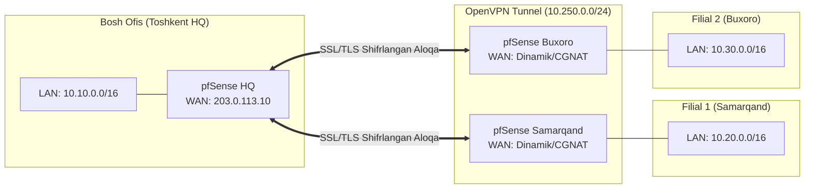

# 📚 [KUN-11] LECTURE: OpenVPN Site-to-Site Tunneling va Client Specific Overrides (CSO)

**Kategoriya:** 2-Hafta: Marshrutlash, Multi-WAN va VPN  
**Maqsad:** Markaziy Bosh ofis (Headquarters - HQ) bilan viloyatlardagi filiallarni (Branches) yagona shifrlangan tarmoqqa birlashtirish, Client Specific Overrides (CSO) orqali har bir filialga statik subnet yo'naltirish (`iroute`) va marshrutlash mantig'ini chuqur o'rganish.

---

## 🧭 Mundarija
1. [Site-to-Site VPN Arxitekturasi: Peer-to-Peer](#1-site-to-site-arxitekturasi)
2. [Shared Key vs SSL/TLS (PKI) Taqqoslovi](#2-shared-key-vs-ssltls)
3. [Client Specific Overrides (CSO) va `iroute` Mexanizmi](#3-cso-va-iroute)
4. [Hub-and-Spoke vs Mesh Marshrutlash](#4-hub-and-spoke-vs-mesh)
5. [Multi-WAN Ustida Site-to-Site Ishonchliligi](#5-multi-wan-va-site-to-site)
6. [Xulosa](#6-xulosa)

---

## 1. Site-to-Site VPN Arxitekturasi

Site-to-Site VPN ikki yoki undan ortiq butun tarmoq infratuzilmasini o'zaro bog'laydi. Filialdagi oddiy foydalanuvchilar o'z kompyuterlariga hech qanday VPN dastur o'rnatmaydilar — barcha shifrlash va yo'naltirish ishlarini chekka routerlar (pfSense HQ va pfSense Branch) o'z zimmasiga oladi.



---

## 2. Shared Key vs SSL/TLS (PKI)

* **Shared Key (Eskirgan usul):** Ikkala routerga bitta umumiy maxfiy kalit fayl yuklanadi. Kamchiliklari: Faqat ikkita nuqta (Point-to-Point) o'rtasida ishlaydi, uchinchi filialni ulab bo'lmaydi va Perfect Forward Secrecy (PFS) ta'minlanmaydi.
* **SSL/TLS (Enterprise standart):** HQ da bitta OpenVPN Server turadi va unga 100 ta filial ulanishi mumkin. Har bir filial o'z sertifikatiga ega bo'ladi.

---

## 3. Client Specific Overrides (CSO) va `iroute` Mexanizmi

Oddiy OpenVPN da mijoz ulanganda unga tunneldan IP beriladi. Ammo server o'sha mijoz routerining orqasida qaysi tarmoq (`10.20.0.0/16`) yotganini qayerdan biladi?
Aynan shu yerda **CSO (Client Specific Overrides)** ishga tushadi:
1. Filial ulanayotganda o'zining Sertifikat Nomini (**Common Name - CN**, masalan `branch-samarkand`) taqdim etadi.
2. pfSense HQ ushbu CN ga mos keluvchi CSO qoidasini topadi.
3. OpenVPN ichki routing jadvaliga quyidagi direktiva kiritiladi:
   ```text
   iroute 10.20.0.0 255.255.0.0
   ```
4. Natijada pfSense yadrosi `10.20.0.0/16` ga boruvchi har qanday paketni aynan `branch-samarkand` mijozining tunneliga buradi.

---

## 4. Hub-and-Spoke vs Mesh

* **Hub-and-Spoke:** Barcha filiallar faqat Bosh ofis (HQ) bilan tunnel quradi. Samarqand Buxoro bilan gaplashmoqchi bo'lsa, paket Samarqand -> Toshkent HQ -> Buxoro yo'nalishida tranzit o'tadi. Sozlash oson va xavfsizlik nazorati markazlashgan.
* **Full Mesh:** Har bir filial boshqa barcha filiallar bilan to'g'ridan-to'g'ri bog'lanadi. Katta tarmoqlarda sozlash o'ta murakkab.

---

## 5. Multi-WAN Ustida Site-to-Site Ishonchliligi

Bosh ofisda Dual-WAN bo'lsa:
* Filial OpenVPN mijoz konfiguratsiyasida Bosh ofisning ikkala provayder IP si ko'rsatiladi.
* Agar Bosh ofisning asosiy provayderi uzilsa, filial 10 soniyada Bosh ofisning ikkinchi IP siga qayta ulanadi va tarmoqlararo aloqa tiklanadi.
