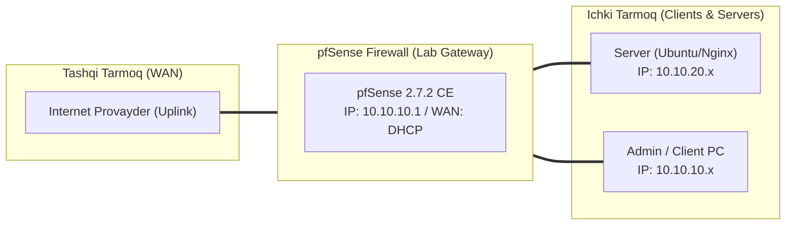

# 🛠️ [KUN-12] LAB QO'LLANMASI: WireGuard High-Performance VPN: Zamonaviy Kriptografiya va Benchmarking

**Mavzu:** WireGuard High-Performance VPN: Zamonaviy Kriptografiya va Benchmarking  
**Bosqich:** 2-Hafta: Marshrutlash, Multi-WAN va VPN  
**Nazariy Ma'ruza:** [Lecture darsini o'qish](lecture.md)

---

## 🎯 1. Real Korxona Muammosi (Business Problem Statement)

> **Real Muammo:** OpenVPN yuqori yuklamada va 1Gbps+ tezlikdagi optik kanallarda protsessorni 100% ga yuklab, tezlikni 150-200 Mbps dan oshira olmayapti. Mobil foydalanuvchilar esa Wi-Fi dan LTE ga o'tganda aloqa uzilib, qayta ulanish uzoq vaqt olmoqda.

Ushbu laboratoriya mashg'ulotida siz ushbu real muammoni to'liq hal qilasiz, tizimni xalqaro standartlar asosida xavfsiz va barqaror qilib sozlaysiz.

---

## 🗺️ 2. Laboratoriya Topologiyasi va IP Sxemasi



### 📋 Laboratoriya IP Jadvali

| Interfeys / Qurilma | Turi | IP Manzil / Subnet | Izoh |
|---|---|---|---|
| `WAN` | Tashqi | Provayder IP (DHCP / Static) | Internetga chiqish |
| `LAN` (MGMT) | Ichki | `10.10.10.1/24` | Boshqaruv va admin tarmog'i |
| `DMZ / SERVERS` | Segment | `10.10.20.1/24` | Korporativ serverlar |
| `Mijoz Mashinasi` | Test Client | `10.10.10.50` (DHCP) | Sinov o'tkazuvchi kompyuter |

---

## 🖥️ 3. Talabalar uchun Laboratoriya Muhiti (Ikkala Variant)

Talaba o'zida mavjud imkoniyatga qarab **Variant A** yoki **Variant B** dan birini tanlaydi:

### 🔹 VARIANT A: Real Jismoniy pfSense (Hardware Appliance / Mini-PC)
* **Hardware:** WireGuard zamonaviy SIMD (AVX2, AVX-512, ARM NEON) ko'rsatmalaridan to'liq foydalanadi, shuning uchun past quvvatli mini-PC larda ham 1Gbps+ tezlikni bemalol ta'minlaydi.
* UDP port 51820 ni tinglaydi.

### 🔹 VARIANT B: Virtual Server pfSense (Proxmox VE / VMware Workstation)
* **Proxmox / VMware:** pfSense 2.7.2 CE versiyasida WireGuard rasmiy paket sifatida kiritilgan.
* VM da CPU turini `host` qilib qo'yish shart.

---

## ⚙️ 4. Bosqichma-bosqich Amaliy Sozlash Qo'llanmasi (Step-by-Step)

1. **Qadam:** `System` -> `Package Manager` dan `WireGuard` paketini o'rnatish.
2. **Qadam:** `VPN` -> `WireGuard` -> `Tunnels` ga kirish. 'Add Tunnel': Description: `WG_CORP`, Listen Port: `51820`, Interface Keys: 'Generate' tugmasini bosib Public/Private kalit juftligini yaratish.
3. **Qadam:** `Interfaces` -> `Assignments` bo'limida yangi paydo bo'lgan `tun_wg0` interfeysini qabul qilish va nomini `WIREGUARD` deb nomlash. IPv4: `10.200.0.1/24`.
4. **Qadam:** `VPN` -> `WireGuard` -> `Peers` bo'limiga o'tish. 'Add Peer': Tunnel: `tun_wg0`, Description: `Engineer_Laptop`, Public Key: (mijoz kaliti), AllowedIPs: `10.200.0.2/32`.
5. **Qadam:** Mijoz noutbukida (Windows/macOS/Linux) WireGuard rasmiy ilovasini o'rnatish va konfiguratsiya kiritish:
6. **Qadam:** [Interface] PrivateKey = ..., Address = 10.200.0.2/24, DNS = 10.10.10.1; [Peer] PublicKey = (pfSense public key), Endpoint = <WAN_IP>:51820, AllowedIPs = 10.10.0.0/16.
7. **Qadam:** `Firewall` -> `Rules` -> `WAN`: UDP port 51820 ga ruxsat berish. `Firewall` -> `Rules` -> `WIREGUARD`: Ichki tarmoqlarga ruxsat berish.


---

## 🧪 5. Verifikatsiya va Tekshirish (Testing & CLI)

Har bir amaliyot tugagach, quyidagi buyruqlar yordamida natijani qat'iy tekshiring:

**WebGUI da peer bilan Handshake soniyalari va uzatilgan megabaytlar ko'rinishi kerak:**
```bash
Status -> WireGuard
```

**pfSense konsolida peerlar va oxirgi handshake holatini ko'rish:**
```bash
wg show
```

**VPN ulangan mijozdan o'tkazuvchanlik tezligini o'lchash:**
```bash
iperf3 -s (pfSense LAN dagi serverda) va iperf3 -c 10.10.20.80
```

```bash
OpenVPN va WireGuard o'rtasida ping va CPU yuklamasini taqqoslash
```


---

## 🚨 6. Eng Ko'p Uchraydigan Xatolar va Troubleshooting

* ⚠️ **Muammo: Handshake sodir bo'lmayapti (0 bayt qabul qilindi). Yechim: WAN dagi UDP 51820 ruxsat qoidasini tekshiring, mijozda pfSense Public kaliti, pfSense da esa mijoz Public kaliti to'g'ri ko'rsatilganini qayta tekshiring.**
* ⚠️ **Muammo: AllowedIPs xatosi. Yechim: Mijoz tomonda AllowedIPs ga faqat kerakli tarmoqlar kiritilishi lozim; agar 0.0.0.0/0 qo'yilsa butun internet trafigi tunnelga ketadi.**


---

## 🏆 7. Mustaqil Amaliy Topshiriq (Student Challenge / Homework)

> 📝 **Vazifa:** Ikkita pfSense o'rtasida WireGuard yordamida Site-to-Site tunnel quring va `iperf3` yordamida OpenVPN Site-to-Site dan necha barobar tezroq ekanligini jadval qilib solishtiring.
