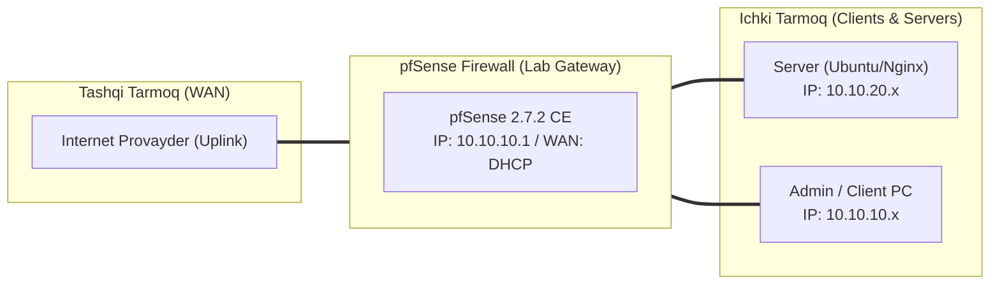

# 🛠️ [KUN-13] LAB QO'LLANMASI: Enterprise IPsec IKEv2 Site-to-Site Tunnel va Routed VTI

**Mavzu:** Enterprise IPsec IKEv2 Site-to-Site Tunnel va Routed VTI  
**Bosqich:** 2-Hafta: Marshrutlash, Multi-WAN va VPN  
**Nazariy Ma'ruza:** [Lecture darsini o'qish](lecture.md)

---

## 🎯 1. Real Korxona Muammosi (Business Problem Statement)

> **Real Muammo:** Kompaniya davlat tashkilotlari yoki yirik bank bilan xavfsiz B2B integratsiya qilishi kerak. Hamkor tomon faqat sanoat standarti bo'lgan IPsec IKEv2 ni talab qilmoqda va marshrutlarni boshqarish uchun dinamik marshrutlashni (VTI) shart qilib qo'ygan.

Ushbu laboratoriya mashg'ulotida siz ushbu real muammoni to'liq hal qilasiz, tizimni xalqaro standartlar asosida xavfsiz va barqaror qilib sozlaysiz.

---

## 🗺️ 2. Laboratoriya Topologiyasi va IP Sxemasi



### 📋 Laboratoriya IP Jadvali

| Interfeys / Qurilma | Turi | IP Manzil / Subnet | Izoh |
|---|---|---|---|
| `WAN` | Tashqi | Provayder IP (DHCP / Static) | Internetga chiqish |
| `LAN` (MGMT) | Ichki | `10.10.10.1/24` | Boshqaruv va admin tarmog'i |
| `DMZ / SERVERS` | Segment | `10.10.20.1/24` | Korporativ serverlar |
| `Mijoz Mashinasi` | Test Client | `10.10.10.50` (DHCP) | Sinov o'tkazuvchi kompyuter |

---

## 🖥️ 3. Talabalar uchun Laboratoriya Muhiti (Ikkala Variant)

Talaba o'zida mavjud imkoniyatga qarab **Variant A** yoki **Variant B** dan birini tanlaydi:

### 🔹 VARIANT A: Real Jismoniy pfSense (Hardware Appliance / Mini-PC)
* **Hardware:** IPsec AES-GCM shifrlash usuli Intel QuickAssist yoki AES-NI apparat tezlatkichlarida deyarli 0% CPU yuklama bilan ishlaydi.
* UDP port 500 (IKE) va UDP port 4500 (NAT-T), shuningdek IP Protocol 50 (ESP) ochiq bo'lishi lozim.

### 🔹 VARIANT B: Virtual Server pfSense (Proxmox VE / VMware Workstation)
* **Proxmox / VMware:** Ikkita pfSense VM yoki pfSense bilan Cisco/StrongSwan router o'rtasida sinovdan o'tkaziladi.

---

## ⚙️ 4. Bosqichma-bosqich Amaliy Sozlash Qo'llanmasi (Step-by-Step)

1. **Qadam:** `VPN` -> `IPsec` -> `Tunnels` ga kirish. 'Add P1' (Phase 1 yaratish).
2. **Qadam:** Key Exchange: `IKEv2`, Interface: `WAN`, Remote Gateway: `Hamkor_WAN_IP`, Pre-Shared Key: murakkab 32+ belgili kalit kiritish.
3. **Qadam:** Phase 1 Takliflari: Encryption: `AES256-GCM` (128 bit ICV), Hash: `SHA256`, DH Group: `14 (2048-bit)` yoki `19 (NIST P-256)`. DPD: yoqilgan.
4. **Qadam:** 'Add P2' (Phase 2 yaratish). Mode: `Routed (VTI)`. Local Network: `10.254.254.1/30`, Remote Network: `10.254.254.2/30`.
5. **Qadam:** Phase 2 Takliflari: Encryption: `AES256-GCM`, PFS Key Group: `14`.
6. **Qadam:** `Interfaces` -> `Assignments` bo'limida yangi `ipsecX` VTI interfeysini qabul qilish va unga IP biriktirish.
7. **Qadam:** `System` -> `Routing` -> `Static Routes` bo'limida hamkor tarmoqni (`172.20.0.0/16`) VTI shlyuzi orqali yo'naltirish.


---

## 🧪 5. Verifikatsiya va Tekshirish (Testing & CLI)

Har bir amaliyot tugagach, quyidagi buyruqlar yordamida natijani qat'iy tekshiring:

**Overview va SADs/SPDs jadvallarida tunnel ESTABLISHED ekanini ko'rish:**
```bash
Status -> IPsec
```

**pfSense konsolida IKE SA va Child SA holatini tekshirish:**
```bash
strongswan konsol buyrug'i: ipsec statusall
```

**VTI tunnel orqali hamkor shlyuziga ping yuborish:**
```bash
ping -S 10.10.10.1 172.20.0.1
```

**Tashqi interfeysda faqat ESP shifrlangan paketlar aylanayotganini ko'rish:**
```bash
tcpdump -i vtnet0 -n esp
```


---

## 🚨 6. Eng Ko'p Uchraydigan Xatolar va Troubleshooting

* ⚠️ **Muammo: Phase 1 o'tadi, lekin Phase 2 'NO_PROPOSAL_CHOSEN' xatosi bilan to'xtaydi. Yechim: Ikkala tomonda shifrlash algoritmlari (AES-GCM, DH Group, PFS) va Subnet parametrlari bir xil ekanini tekshiring.**
* ⚠️ **Muammo: NAT ortidagi holat. Yechim: UDP 4500 (NAT-Traversal) avtomatik yoqilgan bo'lishi va P1 da 'NAT-T: Auto' turishi kerak.**


---

## 🏆 7. Mustaqil Amaliy Topshiriq (Student Challenge / Homework)

> 📝 **Vazifa:** VTI interfeysi ustidan FRR paketi orqali BGP sessiyasini yoqing va hamkor tarmoq bilan dinamik marshrut almashinuvini ishga tushiring.
