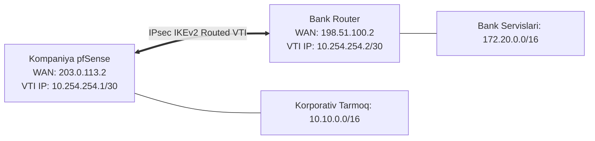

# 🛠️ [KUN-13] LAB: Enterprise IPsec IKEv2 Routed VTI Tunnelini Sozlash

**Mavzu:** Korxona va Hamkor bank o'rtasida Routed VTI tunnelini qurish  
**Nazariya:** [Lecture darsini o'qish](lecture.md)

---

## 🎯 1. Real Korxona Muammosi

> **Biznes Muammo:** Kompaniya to'lov tizimiga ulanish uchun yirik tijorat banki bilan B2B integratsiya shartnomasini imzoladi. Bank xavfsizlik talablariga ko'ra, aloqa faqat sanoat standarti bo'lgan **IPsec IKEv2** orqali va marshrutlar moslashuvchan bo'lishi uchun **Routed VTI** orqali tashkil etilishi shart. Bank tomoni o'z parametrlari (AES-256-GCM, DH Group 14, Pre-Shared Key) ni taqdim etdi.

---

## 🗺️ 2. Topologiya va IP Rejasi



---

## ⚙️ 3. Qadam-baqadam Sozlash

### 1-Qadam: Phase 1 (IKE SA) Sozlash
1. `VPN -> IPsec -> Tunnels` ga kiring, **Add P1** bosing:
   * Key Exchange version: `IKEv2`
   * Internet Protocol: `IPv4`, Interface: `WAN`
   * Remote Gateway: `198.51.100.2` (Bank IP si)
   * Authentication Method: `Mutual PSK`
   * Pre-Shared Key: `VerySecretEnterpriseBankKey2026!#`
   * Phase 1 Proposal:
     * Encryption: `AES256-GCM`, Key Length: `128 bits`
     * Hash: `SHA256`
     * DH Group: `14 (2048 bit)`
   * Dead Peer Detection: `Enable DPD` (10s delay, 5 retries).
2. Saqlang.

### 2-Qadam: Phase 2 VTI (Child SA) Sozlash
1. Yaratilgan P1 ostidagi **Add P2** tugmasini bosing:
   * Mode: `Routed (VTI)`
   * Local Network: `10.254.254.1/30`
   * Remote Network: `10.254.254.2/30`
   * Phase 2 Proposal:
     * Protocol: `ESP`
     * Encryption: `AES256-GCM` (128 bits)
     * PFS Key Group: `14 (2048 bit)`
2. Saqlang va **Apply Changes** qiling.

### 3-Qadam: VTI Interfeysini Qabul Qilish va Marshrut Qo'shish
1. `Interfaces -> Assignments` bo'limiga o'ting.
2. `ipsec1` interfeysini tanlab, **Add** bosing.
3. Yangi interfeysga kiring:
   * Enable: Yoqing
   * Description: `VTI_BANK`
   * IPv4 Configuration: `None` (chunki IP P2 da berilgan).
4. `System -> Routing -> Gateways` bo'limida avtomatik `VTI_BANK_GW` (`10.254.254.2`) paydo bo'lganini tasdiqlang.
5. `System -> Routing -> Static Routes` ga kiring, **Add** bosing:
   * Destination Network: `172.20.0.0/16` (Bank tarmog'i)
   * Gateway: `VTI_BANK_GW`

### 4-Qadam: Firewall Qoidalarini Sozlash
1. `Firewall -> Rules -> WAN`: UDP 500, UDP 4500 va IP Protocol 50 (ESP) ga ruxsat bering.
2. `Firewall -> Rules -> IPsec`: Bank trafigiga ruxsat bering.

---

## 🧪 4. Verifikatsiya va CLI Diagnostika

1. **WebGUI da holatni ko'rish:**
   * `Status -> IPsec` sahifasiga kiring.
   * `Overview` da IKE SA va Child SA holati yashil **ESTABLISHED** bo'lishi kerak.
2. **FreeBSD Konsolida strongSwan diagnostikasi:**
```bash
ipsec statusall
```
3. **Marshrut orqali ping yuborish:**
```bash
ping -S 10.10.10.1 172.20.0.10
```
4. **VTI interfeysida trafikni kuzatish:**
```bash
tcpdump -i ipsec1 -n
```
