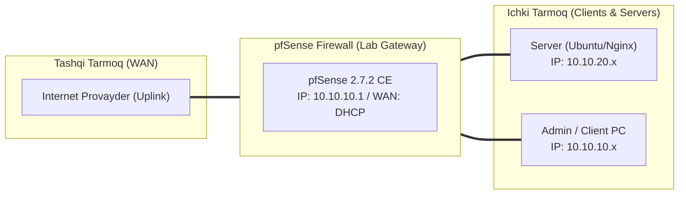

# 🛠️ [KUN-14] LAB QO'LLANMASI: Mobile IPsec IKEv2 (Native Windows, macOS va iOS ilovasiz ulanishi)

**Mavzu:** Mobile IPsec IKEv2 (Native Windows, macOS va iOS ilovasiz ulanishi)  
**Bosqich:** 2-Hafta: Marshrutlash, Multi-WAN va VPN  
**Nazariy Ma'ruza:** [Lecture darsini o'qish](lecture.md)

---

## 🎯 1. Real Korxona Muammosi (Business Problem Statement)

> **Real Muammo:** Kompaniya xodimlarining noutbuklari (Windows 11, macOS) qat'iy korporativ nazoratda bo'lib, ularga uchinchi tomon dasturlarini (OpenVPN yoki WireGuard kabi) o'rnatish IT Security tomonidan taqiqlangan. Xodimlar faqat operatsion tizimning o'zida mavjud ichki VPN vositasi orqali ulanishi shart.

Ushbu laboratoriya mashg'ulotida siz ushbu real muammoni to'liq hal qilasiz, tizimni xalqaro standartlar asosida xavfsiz va barqaror qilib sozlaysiz.

---

## 🗺️ 2. Laboratoriya Topologiyasi va IP Sxemasi



### 📋 Laboratoriya IP Jadvali

| Interfeys / Qurilma | Turi | IP Manzil / Subnet | Izoh |
|---|---|---|---|
| `WAN` | Tashqi | Provayder IP (DHCP / Static) | Internetga chiqish |
| `LAN` (MGMT) | Ichki | `10.10.10.1/24` | Boshqaruv va admin tarmog'i |
| `DMZ / SERVERS` | Segment | `10.10.20.1/24` | Korporativ serverlar |
| `Mijoz Mashinasi` | Test Client | `10.10.10.50` (DHCP) | Sinov o'tkazuvchi kompyuter |

---

## 🖥️ 3. Talabalar uchun Laboratoriya Muhiti (Ikkala Variant)

Talaba o'zida mavjud imkoniyatga qarab **Variant A** yoki **Variant B** dan birini tanlaydi:

### 🔹 VARIANT A: Real Jismoniy pfSense (Hardware Appliance / Mini-PC)
* **Hardware:** pfSense WAN interfeysi ommaviy DNS ga bog'langan FQDN domeniga ega bo'lishi lozim (masalan `vpn.firma.uz`).
* UDP 500 va UDP 4500 portlari ochiq bo'lishi shart.

### 🔹 VARIANT B: Virtual Server pfSense (Proxmox VE / VMware Workstation)
* **Proxmox / VMware:** Laboratoriyada sinash uchun Windows 10/11 VM mijozi kerak bo'ladi.
* pfSense CA Root sertifikati Windows ning 'Trusted Root Certification Authorities' do'koniga import qilinishi shart.

---

## ⚙️ 4. Bosqichma-bosqich Amaliy Sozlash Qo'llanmasi (Step-by-Step)

1. **Qadam:** `System` -> `Cert. Manager`: Server sertifikati yaratish. Common Name: `vpn.firma.uz`, SAN: DNS: `vpn.firma.uz`, IP: `<WAN_IP>`, Certificate Type: `Server Certificate`.
2. **Qadam:** `VPN` -> `IPsec` -> `Mobile Clients`: 'Enable IPsec Mobile Client Support' katakchasini yoqish.
3. **Qadam:** User Authentication: `Local Database`, Virtual Address Pool: `10.205.0.0/24`, DNS Servers: `10.10.10.1`.
4. **Qadam:** `Tunnels` bo'limida yangi Phase 1 qo'shish: Key Exchange: `IKEv2`, Authentication Method: `EAP-MSCHAPv2`, My Identifier: `FQDN: vpn.firma.uz`, Server Certificate: `vpn.firma.uz`.
5. **Qadam:** Phase 2 qo'shish: Mode: `Tunnel IPv4`, Local Network: `0.0.0.0/0` (Full tunnel) yoki `10.10.0.0/16` (Split tunnel).
6. **Qadam:** `System` -> `User Manager` da xodim login va parolini yaratish.
7. **Qadam:** Windows mijozida `Set-VpnConnection` PowerShell buyrug'i orqali IKEv2 profilini yaratish va xavfsiz AES-256 shifrlash parametrlarini o'rnatish.


---

## 🧪 5. Verifikatsiya va Tekshirish (Testing & CLI)

Har bir amaliyot tugagach, quyidagi buyruqlar yordamida natijani qat'iy tekshiring:

```bash
Windows tizim sozlamalaridan (Settings -> Network -> VPN) 'Connect' tugmasini bosib ulanish
```

**Mobil mijozga 10.205.0.x IP berilganini ko'rish:**
```bash
Status -> IPsec -> Leases
```

**Ofis serveriga ulanishni tekshirish:**
```bash
Mijozdan: ping 10.10.20.80
```

**Mijozda IPsec virtual adapter parametrlari paydo bo'lganini tasdiqlash:**
```bash
ipconfig /all
```


---

## 🚨 6. Eng Ko'p Uchraydigan Xatolar va Troubleshooting

* ⚠️ **Muammo: Windows 11 da 'Error 13801: IKE authentication credentials are unacceptable'. Yechim: pfSense CA sertifikati Windows 'Local Computer > Trusted Root Certification Authorities' ga o'rnatilmagan yoki server FQDN nomi sertifikat SAN ga mos emas.**
* ⚠️ **Muammo: 'Error 809'. Yechim: Windows ro'yxatida (Registry) `AssumeUDPEncapsulationContextOnSendRule` qiymatini 2 qilib qo'yish kerak (NAT ortidagi IKEv2 uchun).**


---

## 🏆 7. Mustaqil Amaliy Topshiriq (Student Challenge / Homework)

> 📝 **Vazifa:** Ushbu IKEv2 sozlamasini o'z smartfoningizga (iOS yoki Android da strongSwan ilovasi) ulab ko'ring va xavfsiz ichki tarmoqqa mobil telefon orqali kiring.
