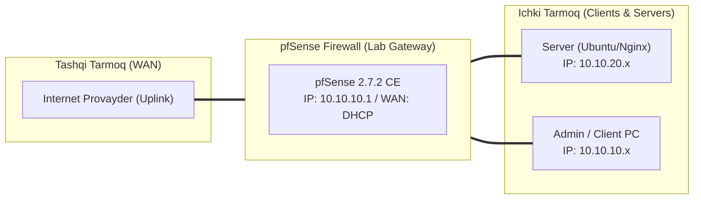

# 🛠️ [KUN-15] LAB QO'LLANMASI: Zero-Trust va Overlay Network: Tailscale Subnet Router

**Mavzu:** Zero-Trust va Overlay Network: Tailscale Subnet Router  
**Bosqich:** 2-Hafta: Marshrutlash, Multi-WAN va VPN  
**Nazariy Ma'ruza:** [Lecture darsini o'qish](lecture.md)

---

## 🎯 1. Real Korxona Muammosi (Business Problem Statement)

> **Real Muammo:** Kompaniyaning uzoq tumanlardagi do'konlari va omborlarida oq (Public) IP manzil yo'q, barchasi mobil 4G modemlar va qat'iy CGNAT (Carrier-Grade NAT) ortida joylashgan. An'anaviy VPN tünellarini ko'tarish imkonsiz, lekin markaziy tizim ushbu omborlardagi serverlarga kirishi zarur.

Ushbu laboratoriya mashg'ulotida siz ushbu real muammoni to'liq hal qilasiz, tizimni xalqaro standartlar asosida xavfsiz va barqaror qilib sozlaysiz.

---

## 🗺️ 2. Laboratoriya Topologiyasi va IP Sxemasi



### 📋 Laboratoriya IP Jadvali

| Interfeys / Qurilma | Turi | IP Manzil / Subnet | Izoh |
|---|---|---|---|
| `WAN` | Tashqi | Provayder IP (DHCP / Static) | Internetga chiqish |
| `LAN` (MGMT) | Ichki | `10.10.10.1/24` | Boshqaruv va admin tarmog'i |
| `DMZ / SERVERS` | Segment | `10.10.20.1/24` | Korporativ serverlar |
| `Mijoz Mashinasi` | Test Client | `10.10.10.50` (DHCP) | Sinov o'tkazuvchi kompyuter |

---

## 🖥️ 3. Talabalar uchun Laboratoriya Muhiti (Ikkala Variant)

Talaba o'zida mavjud imkoniyatga qarab **Variant A** yoki **Variant B** dan birini tanlaydi:

### 🔹 VARIANT A: Real Jismoniy pfSense (Hardware Appliance / Mini-PC)
* **Hardware:** Hech qanday oq IP talab qilinmaydi! pfSense oddiy mobil 4G modem yoki uy Wi-Fi siga ulangan bo'lsa ham ishlayveradi.
* Faqat chiquvchi UDP portlar cheklanmagan bo'lishi kifoya.

### 🔹 VARIANT B: Virtual Server pfSense (Proxmox VE / VMware Workstation)
* **Proxmox / VMware:** pfSense VM internetga chiqishi ta'minlangan bo'lsa yetarli.
* pfSense FreeBSD paketlari orqali Tailscale ni o'rnatadi.

---

## ⚙️ 4. Bosqichma-bosqich Amaliy Sozlash Qo'llanmasi (Step-by-Step)

1. **Qadam:** `System` -> `Package Manager` dan `tailscale` paketini topib o'rnatish.
2. **Qadam:** `VPN` -> `Tailscale` sozlamalariga kirish va 'Enable Tailscale' ni yoqish.
3. **Qadam:** `tailscale login` yoki WebGUI dagi havola orqali Tailscale akkauntingizga (Google/GitHub/Microsoft) kirib, pfSense ni avtorizatsiya qilish.
4. **Qadam:** Subnet Marshrutlarini e'lon qilish: pfSense konsolida yoki WebGUI parametrlarida `--advertise-routes=10.10.10.0/24,10.10.20.0/24` buyrug'ini kiritish.
5. **Qadam:** Tailscale Admin Console (login.tailscale.com) ga kirish, pfSense qurilmasini topish, `Edit route settings` bo'limida e'lon qilingan subnetlarni tasdiqlash (Approve).
6. **Qadam:** `Key expiry` parametrini 'Disable' qilish (server uzilib qolmasligi uchun).
7. **Qadam:** Mijoz kompyuterida Tailscale ni yoqish va to'g'ridan-to'g'ri `10.10.20.80` IP siga murojaat qilish.


---

## 🧪 5. Verifikatsiya va Tekshirish (Testing & CLI)

Har bir amaliyot tugagach, quyidagi buyruqlar yordamida natijani qat'iy tekshiring:

**pfSense konsolida mesh tarmoqdagi barcha boshqa kompyuterlarni ko'rish:**
```bash
tailscale status
```

**To'g'ridan-to'g'ri peer-to-peer tunnelini tekshirish:**
```bash
tailscale ping <mijoz_100.x.x.x_IP>
```

**CGNAT ortidagi pfSense ichki serveriga port ochmasdan kirish:**
```bash
Mijoz noutbukidan (uy internetida): ping 10.10.20.80
```

**NAT teshish imkoniyatlari va eng yaqin DERP serverlarini ko'rish:**
```bash
tailscale netcheck
```


---

## 🚨 6. Eng Ko'p Uchraydigan Xatolar va Troubleshooting

* ⚠️ **Muammo: Subnet ping qilinmayapti. Yechim: Tailscale boshqaruv panelida 'Subnet routes' yonida yashil 'Approved' belgisi turganini va pfSense da IP Forwarding (`sysctl net.inet.ip.forwarding=1`) yoqilganini tekshiring.**
* ⚠️ **Muammo: Relayed ulanish (tezlik past). Yechim: Mahalliy router UDP paketlarini qattiq bloklasa, ulanish DERP orqali ketadi; buning oldini olish uchun UPnP yoki UDP 41641 portiga ruxsat bering.**


---

## 🏆 7. Mustaqil Amaliy Topshiriq (Student Challenge / Homework)

> 📝 **Vazifa:** pfSense ni Tailscale 'Exit Node' sifatida sozlang va mobil telefoningizdan internetga kirganingizda, tashqi IP manzilingiz ofis pfSense IP si sifatida ko'rinishiga erishing.
