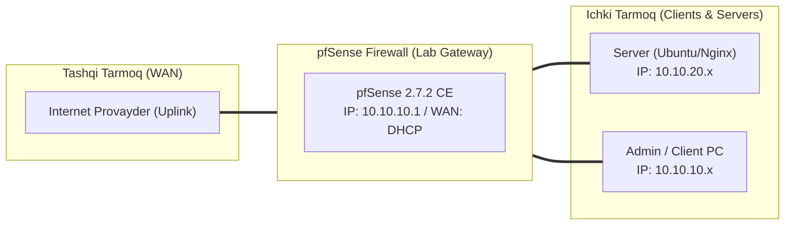

# 🛠️ [KUN-16] LAB QO'LLANMASI: pfBlockerNG-devel: DNSBL, GeoIP Country Blocking va Threat Feeds

**Mavzu:** pfBlockerNG-devel: DNSBL, GeoIP Country Blocking va Threat Feeds  
**Bosqich:** 3-Hafta: Kiberxavfsizlik, UTM, QoS va HA  
**Nazariy Ma'ruza:** [Lecture darsini o'qish](lecture.md)

---

## 🎯 1. Real Korxona Muammosi (Business Problem Statement)

> **Real Muammo:** Korxonada xodimlar reklamalar, fishing havolalari va kriptovalyuta mayning saytlariga aldanib kirmoqda. Shu bilan birga server xavfsizlik devoriga har kuni Xitoy, Rossiya va boshqa xorijiy davlatlardan minglab avtomatlashtirilgan xakerlik skanerlari kelib tushmoqda.

Ushbu laboratoriya mashg'ulotida siz ushbu real muammoni to'liq hal qilasiz, tizimni xalqaro standartlar asosida xavfsiz va barqaror qilib sozlaysiz.

---

## 🗺️ 2. Laboratoriya Topologiyasi va IP Sxemasi



### 📋 Laboratoriya IP Jadvali

| Interfeys / Qurilma | Turi | IP Manzil / Subnet | Izoh |
|---|---|---|---|
| `WAN` | Tashqi | Provayder IP (DHCP / Static) | Internetga chiqish |
| `LAN` (MGMT) | Ichki | `10.10.10.1/24` | Boshqaruv va admin tarmog'i |
| `DMZ / SERVERS` | Segment | `10.10.20.1/24` | Korporativ serverlar |
| `Mijoz Mashinasi` | Test Client | `10.10.10.50` (DHCP) | Sinov o'tkazuvchi kompyuter |

---

## 🖥️ 3. Talabalar uchun Laboratoriya Muhiti (Ikkala Variant)

Talaba o'zida mavjud imkoniyatga qarab **Variant A** yoki **Variant B** dan birini tanlaydi:

### 🔹 VARIANT A: Real Jismoniy pfSense (Hardware Appliance / Mini-PC)
* **Hardware:** pfBlockerNG katta hajmdagi IP va domen ro'yxatlarini xotiraga (RAM) yuklaydi. Kamida 4GB RAM tavsiya etiladi.
* MaxMind bepul litsenziya kaliti (License Key) olinishi shart.

### 🔹 VARIANT B: Virtual Server pfSense (Proxmox VE / VMware Workstation)
* **Proxmox / VMware:** pfSense VM xotirasini (RAM) 4GB ga oshiring.
* System > Advanced > Firewall & NAT bo'limida 'Firewall Maximum Table Entries' ni `1000000` ga ko'taring (katta IP ro'yxatlar sig'ishi uchun).

---

## ⚙️ 4. Bosqichma-bosqich Amaliy Sozlash Qo'llanmasi (Step-by-Step)

1. **Qadam:** `System` -> `Package Manager` dan `pfBlockerNG-devel` paketini o'rnatish.
2. **Qadam:** O'rnatish ustasi (Setup Wizard) ni ishga tushirish yoki `Firewall` -> `pfBlockerNG` ga kirish.
3. **Qadam:** `IP` bo'limida MaxMind Account ID va License Key ni kiritish.
4. **Qadam:** `GeoIP` yorlig'iga o'tish: `Top Spammers` yoki xorijiy davlatlarni tanlash (masalan CN, RU, IR, KP). Action: `Deny Inbound` (tashqaridan kirishni taqiqlash).
5. **Qadam:** `DNSBL` yorlig'iga o'tish: DNSBL Mode: `Unbound Python Mode` ni yoqish.
6. **Qadam:** `DNSBL Feeds` bo'limida mashhur ro'yxatlarni (StevenBlack Adware/Malware, Adaway, Phishing feeds) qo'shish.
7. **Qadam:** `Update` yorlig'iga o'tib, 'Reload' -> 'All' tugmasini bosish va yangilanish jarayonini (Cron sync) kuzatish.


---

## 🧪 5. Verifikatsiya va Tekshirish (Testing & CLI)

Har bir amaliyot tugagach, quyidagi buyruqlar yordamida natijani qat'iy tekshiring:

```bash
Mijoz brauzeridan: reklama ko'p saytlarga (masalan speedtest.net) kirib reklamalar butkul yo'qolganini ko'rish
```

**Javob sifatida 0.0.0.0 yoki DNSBL VIP qaytishini tekshirish:**
```bash
nslookup doubleclick.net 10.10.10.1
```

**pf holat jadvalida bloklangan GeoIP larni ko'rish:**
```bash
pfctl -t pfB_Top_v4 -T show | head -n 20
```

**Bloklangan fishing domenlarining jonli hisobotini ko'rish:**
```bash
Status -> System Logs -> pfBlockerNG
```


---

## 🚨 6. Eng Ko'p Uchraydigan Xatolar va Troubleshooting

* ⚠️ **Muammo: 'Cannot allocate memory' yoki qoidalar yuklanmadi xatosi. Yechim: System > Advanced > Firewall & NAT > 'Firewall Maximum Table Entries' qiymatini 400000 dan 1000000 yoki 2000000 ga oshiring.**
* ⚠️ **Muammo: Kerakli sayt (masalan xorijiy bank) bloklanib qoldi. Yechim: Firewall > pfBlockerNG > DNSBL > 'DNSBL Whitelist' ga sayt domenini qo'shib, qayta Reload qiling.**


---

## 🏆 7. Mustaqil Amaliy Topshiriq (Student Challenge / Homework)

> 📝 **Vazifa:** DoIP (Dynamic IP / TLD) tahlilini yoqing va `.top`, `.xyz`, `.click` kabi xakerlar eng ko'p ishlatadigan arzon TLD domen zonalarini to'liq bloklab sinab ko'ring.
