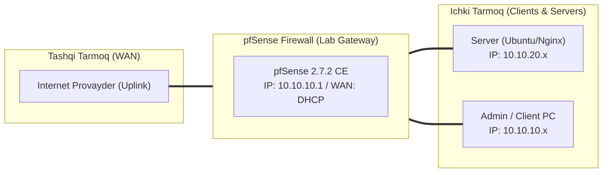

# 🛠️ [KUN-17] LAB QO'LLANMASI: IDS/IPS chuqur tahlili: Suricata Inline Mode (Netmap) vs Legacy Mode

**Mavzu:** IDS/IPS chuqur tahlili: Suricata Inline Mode (Netmap) vs Legacy Mode  
**Bosqich:** 3-Hafta: Kiberxavfsizlik, UTM, QoS va HA  
**Nazariy Ma'ruza:** [Lecture darsini o'qish](lecture.md)

---

## 🎯 1. Real Korxona Muammosi (Business Problem Statement)

> **Real Muammo:** Firewall portlarni tekshiradi, lekin ochiq 80/443 portlari ichidan kirib kelayotgan SQL Injection, Cross-Site Scripting (XSS), Log4j yoki masofaviy kod bajarish (RCE) kabi chuqur ilova darajasidagi (L7) hujumlarni ko'ra olmaydi. Tarmoqqa aqlli paket analizatori zarur.

Ushbu laboratoriya mashg'ulotida siz ushbu real muammoni to'liq hal qilasiz, tizimni xalqaro standartlar asosida xavfsiz va barqaror qilib sozlaysiz.

---

## 🗺️ 2. Laboratoriya Topologiyasi va IP Sxemasi



### 📋 Laboratoriya IP Jadvali

| Interfeys / Qurilma | Turi | IP Manzil / Subnet | Izoh |
|---|---|---|---|
| `WAN` | Tashqi | Provayder IP (DHCP / Static) | Internetga chiqish |
| `LAN` (MGMT) | Ichki | `10.10.10.1/24` | Boshqaruv va admin tarmog'i |
| `DMZ / SERVERS` | Segment | `10.10.20.1/24` | Korporativ serverlar |
| `Mijoz Mashinasi` | Test Client | `10.10.10.50` (DHCP) | Sinov o'tkazuvchi kompyuter |

---

## 🖥️ 3. Talabalar uchun Laboratoriya Muhiti (Ikkala Variant)

Talaba o'zida mavjud imkoniyatga qarab **Variant A** yoki **Variant B** dan birini tanlaydi:

### 🔹 VARIANT A: Real Jismoniy pfSense (Hardware Appliance / Mini-PC)
* **Hardware:** Inline Mode faqat `netmap` drayverini qo'llab-quvvatlaydigan tarmoq kartalarida (Intel `igb`, `em`, `ixgbe`, `igc`) ishlaydi.
* Realtek kartalarida Inline mode xato berishi mumkin; Realtek uchun Legacy Mode tavsiya etiladi.

### 🔹 VARIANT B: Virtual Server pfSense (Proxmox VE / VMware Workstation)
* **Proxmox / VMware:** Proxmox da VirtIO NIC larda netmap barqaror ishlaydi.
* VM ga kamida 4 vCPU va 4GB RAM ajrating.

---

## ⚙️ 4. Bosqichma-bosqich Amaliy Sozlash Qo'llanmasi (Step-by-Step)

1. **Qadam:** `System` -> `Package Manager` dan `suricata` paketini o'rnatish.
2. **Qadam:** `Services` -> `Suricata` -> `Global Settings`: 'Install ETOpen Rules' katakchasini yoqish, avtomatik yangilanishni kunlik belgilash.
3. **Qadam:** `Updates` yorlig'iga o'tib, 'Update Rules' tugmasini bosish va qoidalarni yuklab olish.
4. **Qadam:** `Interfaces` yorlig'ida 'Add Interface': Interface: `WAN` (yoki DMZ/LAN).
5. **Qadam:** IPS Mode tanlash: `Inline Mode` (agar tarmoq kartasi Intel/VirtIO bo'lsa) yoki `Legacy Mode` (Block Dropped/Host: BOTH).
6. **Qadam:** `WAN Categories` bo'limida muhim qoidalarni yoqish: `emerging-attack_response`, `emerging-exploit`, `emerging-malware`, `emerging-current_events`.
7. **Qadam:** Suricata servisini ishga tushirish (Start).


---

## 🧪 5. Verifikatsiya va Tekshirish (Testing & CLI)

Har bir amaliyot tugagach, quyidagi buyruqlar yordamida natijani qat'iy tekshiring:

```bash
Mijoz kompyuterdan IDS test hujumini simulyatsiya qilish: curl http://testmyids.com
```

**Tizimda 'GPL ATTACK_RESPONSE id check returned root' xabari paydo bo'lishini ko'rish:**
```bash
Services -> Suricata -> Interfaces -> WAN Alerts
```

```bash
Inline rejimda testmyids.com sahifasi yuklanmasdan darhol uzilib qolishini tekshirish
```

```bash
Suricata logs: tail -f /var/log/suricata/suricata_vtnet0/alerts.log
```


---

## 🚨 6. Eng Ko'p Uchraydigan Xatolar va Troubleshooting

* ⚠️ **Muammo: Inline Mode yoqilgach internet butkul to'xtadi. Yechim: Tarmoq kartangiz netmap ni qo'llamaydi. Qaytadan 'Legacy Mode' ga o'ting yoki drayverni tekshiring.**
* ⚠️ **Muammo: Legit dastur (masalan Zoom yoki Torrent) bloklanib qoldi. Yechim: Alerts bo'limida qoidaning GID:SID raqamini topib, yonidagi 'Plus' (Add to suppress list) tugmasini bosing.**


---

## 🏆 7. Mustaqil Amaliy Topshiriq (Student Challenge / Homework)

> 📝 **Vazifa:** LAN interfeysida Suricata ni yoqib, ichki tarmoqdan nmap port skanerlash hujumi (`nmap -sS -A 10.10.10.1`) uyushtirilganda Suricata qanday ogohlantirish berishini tahlil qiling.
