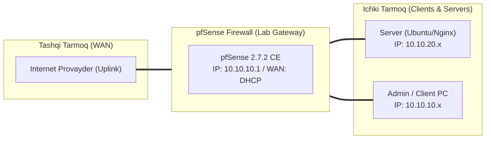

# 🛠️ [KUN-18] LAB QO'LLANMASI: Traffic Shaping va QoS: FQ-CoDel, Limiter va Bufferbloat Eradication

**Mavzu:** Traffic Shaping va QoS: FQ-CoDel, Limiter va Bufferbloat Eradication  
**Bosqich:** 3-Hafta: Kiberxavfsizlik, UTM, QoS va HA  
**Nazariy Ma'ruza:** [Lecture darsini o'qish](lecture.md)

---

## 🎯 1. Real Korxona Muammosi (Business Problem Statement)

> **Real Muammo:** Ofisda kimdir katta torrent fayl yoki Windows yangilanishini tortishni boshlasa, boshqa xodimlarning Zoom va Google Meet qo'ng'iroqlari qotib qolmoqda, ovoz uzilib, ping 20ms dan 800ms ga sakrab ketmoqda (Bufferbloat falokati).

Ushbu laboratoriya mashg'ulotida siz ushbu real muammoni to'liq hal qilasiz, tizimni xalqaro standartlar asosida xavfsiz va barqaror qilib sozlaysiz.

---

## 🗺️ 2. Laboratoriya Topologiyasi va IP Sxemasi



### 📋 Laboratoriya IP Jadvali

| Interfeys / Qurilma | Turi | IP Manzil / Subnet | Izoh |
|---|---|---|---|
| `WAN` | Tashqi | Provayder IP (DHCP / Static) | Internetga chiqish |
| `LAN` (MGMT) | Ichki | `10.10.10.1/24` | Boshqaruv va admin tarmog'i |
| `DMZ / SERVERS` | Segment | `10.10.20.1/24` | Korporativ serverlar |
| `Mijoz Mashinasi` | Test Client | `10.10.10.50` (DHCP) | Sinov o'tkazuvchi kompyuter |

---

## 🖥️ 3. Talabalar uchun Laboratoriya Muhiti (Ikkala Variant)

Talaba o'zida mavjud imkoniyatga qarab **Variant A** yoki **Variant B** dan birini tanlaydi:

### 🔹 VARIANT A: Real Jismoniy pfSense (Hardware Appliance / Mini-PC)
* **Hardware:** Dummynet limiterlari FreeBSD yadrosida ishlaydi va protsessorga deyarli yuklama bermaydi.
* Provayder bilan tuzilgan shartnomadagi aniq tezlikni (masalan 100 Mbps Download, 50 Mbps Upload) bilish zarur.

### 🔹 VARIANT B: Virtual Server pfSense (Proxmox VE / VMware Workstation)
* **Proxmox / VMware:** Virtual muhitda ham FQ-CoDel to'liq ishlaydi.
* Test qilish uchun internet tezligini sun'iy ravishda cheklab ko'rish juda qulay.

---

## ⚙️ 4. Bosqichma-bosqich Amaliy Sozlash Qo'llanmasi (Step-by-Step)

1. **Qadam:** `Firewall` -> `Traffic Shaper` -> `Limiters` yorlig'iga o'tish.
2. **Qadam:** 1-Limiter yaratish (Yuklab olish): Name: `Inbound_Limit`, Bandwidth: `95 Mbit/s` (100Mbit kanal uchun 95%). AQM: `FQ_CODEL`.
3. **Qadam:** Uning ostida yangi Queue qo'shish: Name: `Inbound_Queue`, AQM: `FQ_CODEL`.
4. **Qadam:** 2-Limiter yaratish (Yuklash): Name: `Outbound_Limit`, Bandwidth: `45 Mbit/s` (50Mbit kanal uchun 45%). AQM: `FQ_CODEL`.
5. **Qadam:** Uning ostida Queue qo'shish: Name: `Outbound_Queue`, AQM: `FQ_CODEL`.
6. **Qadam:** `Firewall` -> `Rules` -> `LAN`: Default Internetga ruxsat qoidasini tahrirlash -> `Advanced Options` -> `In / Out pipe` bo'limida: Out: `Inbound_Queue`, In: `Outbound_Queue` ni tanlash.


---

## 🧪 5. Verifikatsiya va Tekshirish (Testing & CLI)

Har bir amaliyot tugagach, quyidagi buyruqlar yordamida natijani qat'iy tekshiring:

**Natija 'A' yoki 'A+' chiqishi kerak:**
```bash
Waveform Bufferbloat Test (waveform.com/tools/bufferbloat) saytiga kirib test o'tkazish
```

**Kechikish 5-10ms dan oshmasligini ko'rish:**
```bash
Katta fayl yuklanayotgan paytda boshqa terminaldan: ping 8.8.8.8
```

**FreeBSD konsolida FQ-CoDel oqimlari va dinamik navbatlarni kuzatish:**
```bash
ipfw pipe show
```

```bash
Speedtest o'tkazib tezlik qat'iy belgilangan chegarada ushlab turilganini tasdiqlash
```


---

## 🚨 6. Eng Ko'p Uchraydigan Xatolar va Troubleshooting

* ⚠️ **Muammo: Bufferbloat bahosi hali ham 'C' yoki 'D'. Yechim: Limiter tezligini yana 5% ga tushiring; agar provayderingiz 100Mbps va'da qilib, amalda 80Mbps bersa, limiter 75Mbps ga qo'yilishi shart.**
* ⚠️ **Muammo: In / Out pipe teskari ulanib qoldi. Yechim: pfSense da 'In' bu mijozdan routerga (Upload), 'Out' esa routerdan mijozga (Download) ekanini unutmang.**


---

## 🏆 7. Mustaqil Amaliy Topshiriq (Student Challenge / Homework)

> 📝 **Vazifa:** Mehmonlar tarmog'i (GUEST VLAN) uchun maxsus Limiter yarating va ularning har biriga individual 5 Mbps tezlik limiti ajrating (har bir IP alohida oqim bo'lsin: Mask: Source Address).
