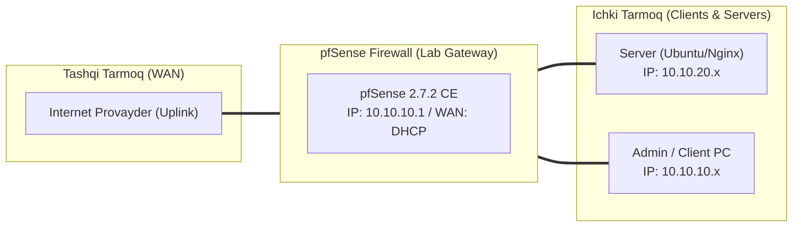

# 🛠️ [KUN-19] LAB QO'LLANMASI: High Availability (CARP) Klasteri — 1-Qism: L2 Sync, Promiscuous Mode va Virtual IPs

**Mavzu:** High Availability (CARP) Klasteri — 1-Qism: L2 Sync, Promiscuous Mode va Virtual IPs  
**Bosqich:** 3-Hafta: Kiberxavfsizlik, UTM, QoS va HA  
**Nazariy Ma'ruza:** [Lecture darsini o'qish](lecture.md)

---

## 🎯 1. Real Korxona Muammosi (Business Problem Statement)

> **Real Muammo:** Kompaniya 24/7 ishlaydi. Agar yagona pfSense serverining quvvat bloki kuysa yoki operativ xotirasi ishdan chiqsa, butun ofis va zavod tarmog'i soatlab to'xtab qoladi (Single Point of Failure). Biznesga ikkita parallel ishlovchi klaster zarur.

Ushbu laboratoriya mashg'ulotida siz ushbu real muammoni to'liq hal qilasiz, tizimni xalqaro standartlar asosida xavfsiz va barqaror qilib sozlaysiz.

---

## 🗺️ 2. Laboratoriya Topologiyasi va IP Sxemasi



### 📋 Laboratoriya IP Jadvali

| Interfeys / Qurilma | Turi | IP Manzil / Subnet | Izoh |
|---|---|---|---|
| `WAN` | Tashqi | Provayder IP (DHCP / Static) | Internetga chiqish |
| `LAN` (MGMT) | Ichki | `10.10.10.1/24` | Boshqaruv va admin tarmog'i |
| `DMZ / SERVERS` | Segment | `10.10.20.1/24` | Korporativ serverlar |
| `Mijoz Mashinasi` | Test Client | `10.10.10.50` (DHCP) | Sinov o'tkazuvchi kompyuter |

---

## 🖥️ 3. Talabalar uchun Laboratoriya Muhiti (Ikkala Variant)

Talaba o'zida mavjud imkoniyatga qarab **Variant A** yoki **Variant B** dan birini tanlaydi:

### 🔹 VARIANT A: Real Jismoniy pfSense (Hardware Appliance / Mini-PC)
* **Hardware:** 2 ta bir xil yoki o'xshash x86 mini-PC server.
* Har bir serverda kamida 3 ta port bo'lishi shart: WAN, LAN va SYNC (PFSYNC).
* Ikkala serverning SYNC portlari o'zaro to'g'ridan-to'g'ri patch-cord (crossover yoki zamonaviy auto-MDIX) orqali ulanadi.

### 🔹 VARIANT B: Virtual Server pfSense (Proxmox VE / VMware Workstation)
* **Proxmox VE:**
  * Proxmox Linux Bridge da standart holatda MAC spoofing cheklanmagan, lekin Proxmox Firewall o'chirilgan bo'lishi shart.
* **VMware Workstation / ESXi:**
  * Virtual Switch sozlamalarida: `Promiscuous Mode: Accept`, `MAC Address Changes: Accept`, `Forged Transmits: Accept` qilib qo'yish MAJBURIY!

---

## ⚙️ 4. Bosqichma-bosqich Amaliy Sozlash Qo'llanmasi (Step-by-Step)

1. **Qadam:** Ikkita VM/Server tayyorlash: `FW-01` (Master) va `FW-02` (Backup).
2. **Qadam:** IP Rejasi (LAN): FW-01 Real IP: `10.10.10.2`, FW-02 Real IP: `10.10.10.3`, CARP VIP: `10.10.10.1`.
3. **Qadam:** IP Rejasi (SYNC): FW-01 SYNC: `192.168.99.1/24`, FW-02 SYNC: `192.168.99.2/24`.
4. **Qadam:** `Firewall` -> `Virtual IPs` (FW-01 da): 'Add' -> Type: `CARP`, Interface: `LAN`, Address: `10.10.10.1/24`, VHID: `1`, Password: `SecretCarpPassword`, Advskew: `0`.
5. **Qadam:** FW-02 da xuddi shu VIP ni yaratish, faqat Advskew: `100` deb belgilash.
6. **Qadam:** `Firewall` -> `Rules` -> `SYNC` interfeysida barcha trafikka ruxsat berish (yoki faqat carp va pfsync protokollariga).


---

## 🧪 5. Verifikatsiya va Tekshirish (Testing & CLI)

Har bir amaliyot tugagach, quyidagi buyruqlar yordamida natijani qat'iy tekshiring:

**FW-01 da interfeys 'MASTER', FW-02 da esa 'BACKUP' holatida turganini ko'rish:**
```bash
Status -> CARP
```

**Konsolda vhid 1 advskew 0 holatini ko'rish:**
```bash
ifconfig carp0
```

**CARP Virtual shlyuziga uzluksiz ping borishini tekshirish:**
```bash
Mijoz kompyuteridan ping 10.10.10.1
```

**Mijozda 10.10.10.1 ning MAC manzili 00:00:5e:00:01:01 ekanini tasdiqlash:**
```bash
arp -a
```


---

## 🚨 6. Eng Ko'p Uchraydigan Xatolar va Troubleshooting

* ⚠️ **Muammo: Ikkala router ham o'zini 'MASTER' deb e'lon qilmoqda (Split-Brain holati). Yechim: L2 broadcast/multicast (IP Protocol 112 CARP) paketlari ikkinchi routerga yetib bormayapti. VMware da Promiscuous Mode yoqilganini, switchda esa port izolyatsiyasi yo'qligini tekshiring.**
* ⚠️ **Muammo: CARP status 'DISABLED'. Yechim: Konsolda `sysctl net.inet.carp.allow=1` ekanini tekshiring.**


---

## 🏆 7. Mustaqil Amaliy Topshiriq (Student Challenge / Homework)

> 📝 **Vazifa:** WAN interfeysi uchun ham tashqi Public IP lar asosida CARP VIP (masalan FW1: .2, FW2: .3, CARP VIP: .1) ni sozlang va ikkala interfeys parallel failover bo'lishini tekshiring.
