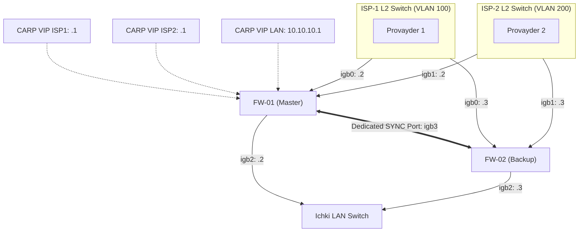

# 📚 [KUN-19] LECTURE: High Availability (CARP) Klasteri — 1-Qism: L2 Sync, Promiscuous Mode, Virtual IPs va Multi-WAN HA

**Kategoriya:** 3-Hafta: Kiberxavfsizlik, UTM, QoS va HA  
**Maqsad:** Korxonada yagona xavfsizlik devori ishdan chiqish xavfini (Single Point of Failure - SPOF) yo'qotish, ikkita pfSense routerini (Master va Backup) klasterga birlashtirish, CARP protokoli, Virtual IP lar va Multi-WAN sharoitida klaster qurish arxitekturasini chuqur o'rganish.

---

## 🧭 Mundarija
1. [Nega CARP? HSRP va VRRP bilan Farqlari](#1-nega-carp)
2. [CARP Virtual IP va Virtual MAC Mexanizmi](#2-virtual-ip-va-mac)
3. [advbase va advskew: Kim Master va Kim Backup?](#3-advbase-va-advskew)
4. [Virtualizatsiyada Eng Katta Tuzoq: Promiscuous Mode va MAC Spoofing](#4-promiscuous-va-mac-spoofing)
5. [Dedicated PFSYNC L2 Havolasi](#5-dedicated-pfsync-havolasi)
6. [CARP Klasterida Multi-WAN Arxitekturasi](#6-carp-va-multi-wan)
7. [Xulosa](#7-xulosa)

---

## 1. Nega CARP? HSRP va VRRP bilan Farqlari

* **Cisco HSRP:** Cisco mulki bo'lgan yopiq protokol.
* **VRRP (RFC 5798):** Standart protokol, ammo uzoq yillar Cisco patentlari tufayli erkin operatsion tizimlarda xavfsiz qo'llanilishi cheklangan.
* **CARP (Common Address Redundancy Protocol):** OpenBSD loyihasi tomonidan kriptografik xavfsiz va patentlardan xoli qilib yaratilgan. U IP Protocol 112 da ishlaydi va har bir e'lon paketini SHA-1 / HMAC parol bilan tasdiqlaydi.

---

## 2. CARP Virtual IP va Virtual MAC Mexanizmi

Klasterdagi ikkita router alohida jismoniy IP larga ega bo'ladi, lekin tarmoqdagi barcha kompyuterlar yagona virtual shlyuz IP manziliga murojaat qiladi:
* **FW-01 (Master):** LAN Real IP: `10.10.10.2`
* **FW-02 (Backup):** LAN Real IP: `10.10.10.3`
* **CARP VIP (Virtual Gateway):** `10.10.10.1`

Har bir CARP Virtual IP o'zining Virtual MAC manzilini hisoblab chiqaradi:
$$	ext{MAC} = 	ext{00:00:5e:00:01:\{	ext{VHID}\}}$$
Masalan, VHID = 1 bo'lsa, tarmoq kartasi `00:00:5e:00:01:01` MAC manzilini oladi.

---

## 3. advbase va advskew

Master va Backup holatini boshqaruvchi ikkita parametr mavjud:
* `advbase`: E'lonlar oralig'i (standart: 1 soniya).
* `advskew`: Kechikish koeffitsiyenti (0 dan 254 gacha).
  * **Master Router:** `advskew = 0` (Har 1 soniyada darhol paket jo'natadi).
  * **Backup Router:** `advskew = 100` (Kutadi. Agar 1 soniya + 100/256 soniya davomida Masterdan xabar kelmasa, o'zini MASTER deb e'lon qiladi!).

---

## 4. Virtualizatsiyada Eng Katta Tuzoq: Promiscuous Mode va MAC Spoofing

> [!CAUTION]
> Agar siz pfSense ni Proxmox, VMware ESXi yoki VMware Workstation da klaster qilsangiz, 90% holatda CARP birinchi urinishda ishlamaydi!

**Nega?** Chunki gipervizorning virtual switchlari xavfsizlik vajidan virtual mashinaga unga tegishli bo'lmagan MAC manzilni (`00:00:5e:00:01:XX`) ishlatishga ruxsat bermaydi:
* **VMware ESXi / Workstation da:** Virtual Switch sozlamalarida quyidagi 3 ta parametrni **Accept** qilish SHART:
  1. `Promiscuous Mode: Accept`
  2. `MAC Address Changes: Accept`
  3. `Forged Transmits: Accept`
* **Proxmox VE da:** Linux Bridge o'zi o'tkazadi, lekin Proxmox Firewall moduli o'chirilgan bo'lishi lozim.

---

## 5. Dedicated PFSYNC L2 Havolasi

Ikkita router o'rtasida holat almashinuvi uchun alohida jismoniy port (SYNC) ajratilishi shart:
* Bu port umumiy switchga ulanmaydi! Ikkala server o'rtasida to'g'ridan-to'g'ri kabel orqali bog'lanadi.
* Nega? Chunki `pfsync` paketlari shifrlanmagan bo'ladi va xavfsizlik devorining butun holat jadvalini tashiydi. Uni umumiy tarmoqqa chiqarish xavfsizlikka ziddir.

---

## 6. CARP Klasterida Multi-WAN Arxitekturasi

Agar ikkala routerda ham Dual-WAN (2 ta provayder) bo'lsa, qanday ulanadi?

Har bir WAN kanali uchun alohida tashqi L2 switch qo'yiladi va har bir WAN segmentida alohida CARP VIP olinadi!
