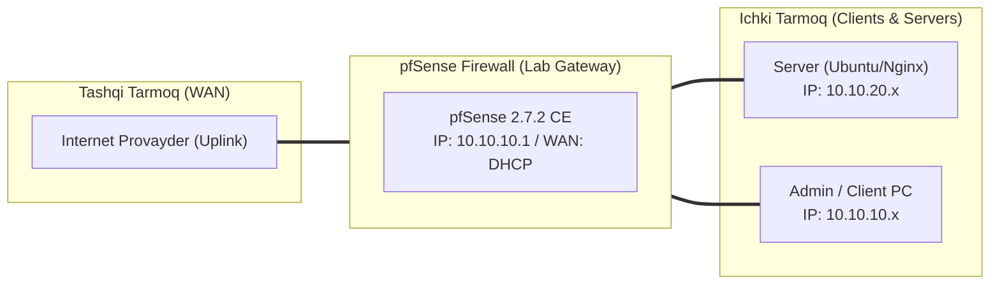

# 🛠️ [KUN-20] LAB QO'LLANMASI: High Availability (CARP) — 2-Qism: pfsync va XML-RPC Zero-Downtime Failover

**Mavzu:** High Availability (CARP) — 2-Qism: pfsync va XML-RPC Zero-Downtime Failover  
**Bosqich:** 3-Hafta: Kiberxavfsizlik, UTM, QoS va HA  
**Nazariy Ma'ruza:** [Lecture darsini o'qish](lecture.md)

---

## 🎯 1. Real Korxona Muammosi (Business Problem Statement)

> **Real Muammo:** Routerlar almashganda tarmoqdagi barcha aktiv ulanishlar (Zoom qo'ng'iroqlari, yuklab olinayotgan katta fayllar, SSH sessiyalar) uzilib ketmoqda, chunki zaxira routerda 'State Table' (ochiq sessiyalar xotirasi) mavjud emas. Shuningdek, qoidalarni ikkala routerga ikki marta qo'lda yozish charchatmoqda.

Ushbu laboratoriya mashg'ulotida siz ushbu real muammoni to'liq hal qilasiz, tizimni xalqaro standartlar asosida xavfsiz va barqaror qilib sozlaysiz.

---

## 🗺️ 2. Laboratoriya Topologiyasi va IP Sxemasi



### 📋 Laboratoriya IP Jadvali

| Interfeys / Qurilma | Turi | IP Manzil / Subnet | Izoh |
|---|---|---|---|
| `WAN` | Tashqi | Provayder IP (DHCP / Static) | Internetga chiqish |
| `LAN` (MGMT) | Ichki | `10.10.10.1/24` | Boshqaruv va admin tarmog'i |
| `DMZ / SERVERS` | Segment | `10.10.20.1/24` | Korporativ serverlar |
| `Mijoz Mashinasi` | Test Client | `10.10.10.50` (DHCP) | Sinov o'tkazuvchi kompyuter |

---

## 🖥️ 3. Talabalar uchun Laboratoriya Muhiti (Ikkala Variant)

Talaba o'zida mavjud imkoniyatga qarab **Variant A** yoki **Variant B** dan birini tanlaydi:

### 🔹 VARIANT A: Real Jismoniy pfSense (Hardware Appliance / Mini-PC)
* **Hardware:** Ikkala serverning xususiyatlari, interfeys nomlari (`igb0`, `igb1`, `igb2`) mutlaqo bir xil bo'lishi tavsiya etiladi.
* Agar interfeys nomlari har xil bo'lsa (masalan birida `igb0`, ikkinchisida `re0`), XML-RPC interfeys sinxronizatsiyasida muammo chiqishi mumkin.

### 🔹 VARIANT B: Virtual Server pfSense (Proxmox VE / VMware Workstation)
* **Proxmox / VMware:** Ikkala VM ga bir xil tarmoq adapterlari (masalan ikkalasida ham `vtnet0-2` yoki `vmx0-2`) biriktirilgan bo'lishi shart.

---

## ⚙️ 4. Bosqichma-bosqich Amaliy Sozlash Qo'llanmasi (Step-by-Step)

1. **Qadam:** FW-01 (Master) da: `System` -> `High Avail. Sync` bo'limiga kirish.
2. **Qadam:** `State Synchronization Settings (pfsync)`: 'Synchronize States' katakchasini yoqish, Synchronize Interface: `SYNC`, Remote Backup IP: `192.168.99.2`.
3. **Qadam:** `XMLRPC Sync`: 'Synchronize Config to IP': `192.168.99.2`, Remote System Username: `admin`, Remote Password: (FW-02 paroli).
4. **Qadam:** Sinxronlanadigan bandlarni tanlash: Firewall Rules, Aliases, NAT, Virtual IPs, DHCP Server va boshqalar.
5. **Qadam:** FW-02 (Backup) da: Faqat pfsync ni yoqish (Synchronize Interface: `SYNC`, Remote IP: `192.168.99.1`), lekin XMLRPC Sync ni BO'SH qoldirish (zaxira asosiyga yozmasligi uchun).
6. **Qadam:** FW-01 da yangi sinov Firewall Alias yaratish va FW-02 ga o'tib, u avtomatik ko'chib o'tganini tekshirish.


---

## 🧪 5. Verifikatsiya va Tekshirish (Testing & CLI)

Har bir amaliyot tugagach, quyidagi buyruqlar yordamida natijani qat'iy tekshiring:

**Ikkala routerda ham sessiyalar soni va ro'yxati 100% bir xilligini ko'rish:**
```bash
pfSense konsolida: pfctl -ss
```

```bash
Mijozdan uzluksiz ping yoki SSH ulanishini yoqib qo'yish: ping -t 10.10.10.1
```

**elektrini o'chirish:**
```bash
FW-01 (Master) serverini 'Power Off' qilish
```

```bash
FW-02 darhol MASTER ga aylanib, bitta ham ping yo'qolmasdan (0 soniya downtime) aloqa davom etayotganini kuzatish
```

```bash
SSH yoki Zoom sessiyasi uzilmasdan saqlanib qolganini tasdiqlash
```


---

## 🚨 6. Eng Ko'p Uchraydigan Xatolar va Troubleshooting

* ⚠️ **Muammo: XML-RPC 'Authentication failed' xatosi. Yechim: Ikkala routerda ham admin paroli to'g'ri kiritilganini va SYNC interfeysida HTTPS (port 443/8443) ruxsat berilganini tekshiring.**
* ⚠️ **Muammo: Sessiyalar sinxron emas. Yechim: `pfsync` interfeysi sifatida xato interfeys (masalan LAN) tanlanmaganini tasdiqlang.**


---

## 🏆 7. Mustaqil Amaliy Topshiriq (Student Challenge / Homework)

> 📝 **Vazifa:** Master server qayta yoqilganda (Power On) CARP boshqaruvini qanday qilib muammosiz qaytarib olishini tekshiring va jarayonni Wireshark da CARP e'lonlari orqali yozib oling.
