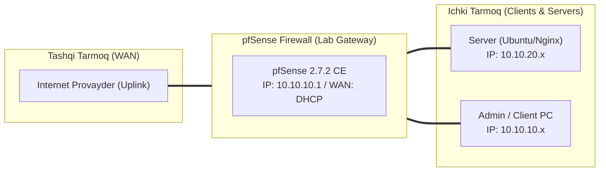

# 🛠️ [KUN-21] LAB QO'LLANMASI: HAProxy Reverse Proxy: SSL Offloading, Load Balancing va Health Checks

**Mavzu:** HAProxy Reverse Proxy: SSL Offloading, Load Balancing va Health Checks  
**Bosqich:** 3-Hafta: Kiberxavfsizlik, UTM, QoS va HA  
**Nazariy Ma'ruza:** [Lecture darsini o'qish](lecture.md)

---

## 🎯 1. Real Korxona Muammosi (Business Problem Statement)

> **Real Muammo:** Korxonada 3 ta bir xil web-server (Backend) mavjud. Har biriga alohida tashqi IP berishning imkoni yo'q. Agar serverlardan biri qulab tushsa, mijozlarga xatolik bormasdan, yuklama qolgan ikkita ishchi serverga avtomatik taqsimlanishi kerak.

Ushbu laboratoriya mashg'ulotida siz ushbu real muammoni to'liq hal qilasiz, tizimni xalqaro standartlar asosida xavfsiz va barqaror qilib sozlaysiz.

---

## 🗺️ 2. Laboratoriya Topologiyasi va IP Sxemasi



### 📋 Laboratoriya IP Jadvali

| Interfeys / Qurilma | Turi | IP Manzil / Subnet | Izoh |
|---|---|---|---|
| `WAN` | Tashqi | Provayder IP (DHCP / Static) | Internetga chiqish |
| `LAN` (MGMT) | Ichki | `10.10.10.1/24` | Boshqaruv va admin tarmog'i |
| `DMZ / SERVERS` | Segment | `10.10.20.1/24` | Korporativ serverlar |
| `Mijoz Mashinasi` | Test Client | `10.10.10.50` (DHCP) | Sinov o'tkazuvchi kompyuter |

---

## 🖥️ 3. Talabalar uchun Laboratoriya Muhiti (Ikkala Variant)

Talaba o'zida mavjud imkoniyatga qarab **Variant A** yoki **Variant B** dan birini tanlaydi:

### 🔹 VARIANT A: Real Jismoniy pfSense (Hardware Appliance / Mini-PC)
* **Hardware:** HAProxy ko'p tarmoqli yuqori yuklamalarda RAM va tezkor CPU talab qiladi.
* Tashqi WAN da 80 (HTTP) va 443 (HTTPS) portlari boshqa xizmatlar (masalan pfSense WebGUI) tomonidan band qilinmagan bo'lishi shart!

### 🔹 VARIANT B: Virtual Server pfSense (Proxmox VE / VMware Workstation)
* **Proxmox / VMware:** DMZ segmentida (`10.10.20.0/24`) 2 ta yoki 3 ta yengil Nginx/Apache VM yoki Docker konteyner ko'taring.

---

## ⚙️ 4. Bosqichma-bosqich Amaliy Sozlash Qo'llanmasi (Step-by-Step)

1. **Qadam:** pfSense WebGUI portini `8443` ga o'tkazilganligini tasdiqlash (80 va 443 HAProxy uchun bo'sh bo'lishi kerak).
2. **Qadam:** `System` -> `Package Manager` dan `haproxy` paketini o'rnatish.
3. **Qadam:** `Services` -> `HAProxy` -> `Settings`: 'Enable HAProxy' ni yoqish.
4. **Qadam:** `Backend` yorlig'iga o'tish: Name: `Web_Cluster_Backend`, Balance: `roundrobin`, Health check: `HTTP`.
5. **Qadam:** Serverlar ro'yxatiga qo'shish: `SRV01` (10.10.20.11:80), `SRV02` (10.10.20.12:80).
6. **Qadam:** `Frontend` yorlig'iga o'tish: Name: `HTTPS_Frontend`, Listen IP: `WAN address`, Port: `443`, Type: `SSL / HTTPS (offloading)`. Default backend: `Web_Cluster_Backend`.
7. **Qadam:** `Firewall` -> `Rules` -> `WAN`: Port 443 ga ruxsat berish.


---

## 🧪 5. Verifikatsiya va Tekshirish (Testing & CLI)

Har bir amaliyot tugagach, quyidagi buyruqlar yordamida natijani qat'iy tekshiring:

**Stats sahifasida ikkala backend server ham yashil 'UP' holatdaligini ko'rish:**
```bash
Status -> HAProxy
```

**Bir necha marta yuborilganda javob SRV01 va SRV02 dan navbatma-navbat kelishini ko'rish:**
```bash
Brauzerdan yoki terminaldan: curl -k https://<WAN_IP>
```

**`systemctl stop nginx`:**
```bash
SRV01 serverida Nginx xizmatini to'xtatish
```

```bash
2 soniyadan so'ng HAProxy Stats da SRV01 qizil 'DOWN' bo'lib, barcha so'rovlar hech qanday uzilishsiz SRV02 ga o'tib ketganini tekshirish
```


---

## 🚨 6. Eng Ko'p Uchraydigan Xatolar va Troubleshooting

* ⚠️ **Muammo: HAProxy xizmati ishga tushmayapti (Status da qizil). Yechim: 80 yoki 443 portini pfSense WebGUI band qilib turgan bo'lishi mumkin. System > Advanced bo'limida WebGUI portini o'zgartiring.**
* ⚠️ **Muammo: Backend serverlar 'SOCKERR' yoki 'L4CON' xatosi bermoqda. Yechim: pfSense dan DMZ serverlariga ping va TCP port 80 aloqasi borligini Diagnostics > Ping orqali tekshiring.**


---

## 🏆 7. Mustaqil Amaliy Topshiriq (Student Challenge / Homework)

> 📝 **Vazifa:** HAProxy da Cookie-based Session Stickiness (Insert Cookie) sozlang va bitta foydalanuvchi brauzeri doim birinchi tushgan backend serverga bog'lanib qolishini ta'minlang.
