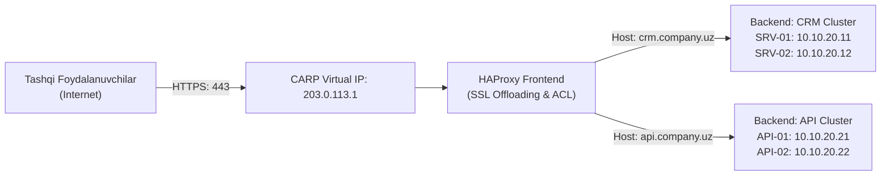

# 📚 [KUN-21] LECTURE: Enterprise HAProxy Reverse Proxy, SSL Offloading va CARP Integratsiyasi

**Kategoriya:** 3-Hafta: Kiberxavfsizlik, UTM, QoS va HA  
**Maqsad:** Korxonaning web-servislari, API serverlari va portallarini tashqi dunyoga xavfsiz taqdim etish, millionlab so'rovlarni bir nechta backend serverlarga aqlli taqsimlash (Load Balancing), SSL sertifikatlarni markazlashgan holda boshqarish (SSL Offloading) va HAProxy ni CARP klasteri bilan integratsiya qilish.

---

## 🧭 Mundarija
1. [Reverse Proxy Nima va U Nega Kerak?](#1-reverse-proxy-nima)
2. [HAProxy Arxitekturasi: Frontend, Backend va ACLs](#2-haproxy-arxitekturasi)
3. [SSL/TLS Offloading va HTTP/2 Unumdorligi](#3-ssl-offloading)
4. [Yuklamani Taqsimlash Algoritmlari (Load Balancing Algorithms)](#4-algoritmlar)
5. [Salomatlik Tekshiruvlari (Health Checks)](#5-health-checks)
6. [HAProxy va CARP Klasteri Integratsiyasi](#6-haproxy-va-carp)
7. [Xulosa](#7-xulosa)

---

## 1. Reverse Proxy Nima va U Nega Kerak?

An'anaviy port forward qilinganda, bitta tashqi 443 portini faqat bitta ichki serverga yo'naltirish mumkin. Agar kompaniyada 10 ta web-sayt bo'lsa (`crm.firma.uz`, `api.firma.uz`, `portal.firma.uz`), har biriga alohida oq IP sotib olish kerak bo'ladi.
**HAProxy Reverse Proxy:**
* Barcha tashqi so'rovlarni yagona 80/443 portida qabul qiladi.
* HTTP sarlavhasidagi domenni (`Host: crm.firma.uz`) o'qiydi.
* So'rovni tegishli ichki serverga xavfsiz uzatadi.
* Backend serverlarning haqiqiy IP manzillarini tashqi dunyodan yashiradi (Xavfsizlik pardasi).

---

## 2. HAProxy Arxitekturasi: Frontend, Backend va ACLs

* **Frontend:** Tashqi dunyodan kelayotgan ulanishlarni tinglaydigan qism (IP, Port, SSL sertifikati).
* **ACL (Access Control Lists):** Aqlli qoidalar:
  * Masalan: `acl is_crm hdr(host) -i crm.company.uz`
  * Masalan: `acl is_api path_beg /api/`
* **Backend:** Serverlar guruhi. ACL mos kelsa, so'rov mos backendga yo'naltiriladi (`use_backend CRM_Cluster if is_crm`).

---

## 3. SSL/TLS Offloading

Og'ir kriptografik hisob-kitoblarni (RSA/ECC kalit almashinuvi, shifrlash) HAProxy o'z zimmasiga oladi. Backend serverlar esa yengil HTTP da ishlaydi. Bu backend serverlar protsessorini 40% gacha bo'shatadi va SSL sertifikatlarni faqat bitta joyda (pfSense da) yangilash kifoya qiladi.

---

## 4. Yuklamani Taqsimlash Algoritmlari

* **Round Robin:** So'rovlarni serverlarga navbatma-navbat beradi (serverlar quvvati bir xil bo'lsa).
* **Least Connections:** Eng kam aktiv sessiyaga ega bo'lgan bo'sh serverga jo'natadi (og'ir SQL so'rovlar uchun ideal).
* **Source IP Hash:** Bitta foydalanuvchini doim bitta serverga bog'lab qo'yadi.

---

## 5. Salomatlik Tekshiruvlari (Health Checks)

HAProxy har 2 soniyada har bir backend serverga HTTP so'rov jo'natadi:
* Agar server `200 OK` qaytarsa, u sog'lom.
* Agar server qulab tushsa yoki `500 Server Error` qaytarsa, HAProxy uni 1 soniya ichida umumiy ro'yxatdan chiqaradi. Mijozlar xatolikni ko'rmaydi, barcha trafik ishchi serverlarga o'tadi.

---

## 6. HAProxy va CARP Klasteri Integratsiyasi

> [!IMPORTANT]
> **Production Qoidasi:** HAProxy Frontend ni hech qachon pfSense ning jismoniy WAN IP siga biriktirmang! Uni **CARP Virtual IP** siga biriktiring. Shunda Master firewall o'chganda, VIP ikkinchi firewallga o'tadi va ikkinchi firewalldagi HAProxy xizmati saytlarni uzluksiz taqdim etishda davom etadi!
