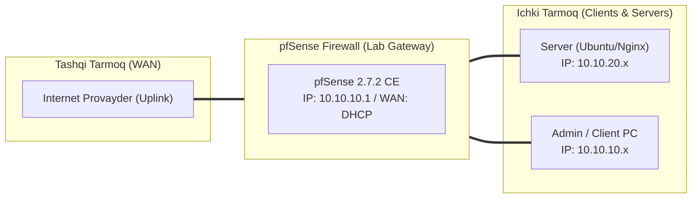

# 🛠️ [KUN-22] LAB QO'LLANMASI: ACME (Let's Encrypt) Avtomatizatsiyasi va Cloudflare DNS API

**Mavzu:** ACME (Let's Encrypt) Avtomatizatsiyasi va Cloudflare DNS API  
**Bosqich:** 3-Hafta: Kiberxavfsizlik, UTM, QoS va HA  
**Nazariy Ma'ruza:** [Lecture darsini o'qish](lecture.md)

---

## 🎯 1. Real Korxona Muammosi (Business Problem Statement)

> **Real Muammo:** Kompaniyada o'nlab web-saytlar va VPN portallari mavjud. Har 3 oyda muddati tugaydigan bepul Let's Encrypt SSL sertifikatlarini qo'lda yangilash unutilib qolmoqda, natijada foydalanuvchilar brauzerida xavfli 'Xavfsiz emas' qizil ogohlantirishi chiqib biznes obro'siga putur yetmoqda.

Ushbu laboratoriya mashg'ulotida siz ushbu real muammoni to'liq hal qilasiz, tizimni xalqaro standartlar asosida xavfsiz va barqaror qilib sozlaysiz.

---

## 🗺️ 2. Laboratoriya Topologiyasi va IP Sxemasi



### 📋 Laboratoriya IP Jadvali

| Interfeys / Qurilma | Turi | IP Manzil / Subnet | Izoh |
|---|---|---|---|
| `WAN` | Tashqi | Provayder IP (DHCP / Static) | Internetga chiqish |
| `LAN` (MGMT) | Ichki | `10.10.10.1/24` | Boshqaruv va admin tarmog'i |
| `DMZ / SERVERS` | Segment | `10.10.20.1/24` | Korporativ serverlar |
| `Mijoz Mashinasi` | Test Client | `10.10.10.50` (DHCP) | Sinov o'tkazuvchi kompyuter |

---

## 🖥️ 3. Talabalar uchun Laboratoriya Muhiti (Ikkala Variant)

Talaba o'zida mavjud imkoniyatga qarab **Variant A** yoki **Variant B** dan birini tanlaydi:

### 🔹 VARIANT A: Real Jismoniy pfSense (Hardware Appliance / Mini-PC)
* **Hardware:** pfSense internetga ulangan bo'lishi va Cloudflare API ga murojaat qila olishi kerak.
* Haqiqiy domen nomi va uning DNS lari Cloudflare ga ulangan bo'lishi shart.

### 🔹 VARIANT B: Virtual Server pfSense (Proxmox VE / VMware Workstation)
* **Proxmox / VMware:** Virtual laboratoriyada ham o'zingizning shaxsiy domeningiz orqali haqiqiy jahon tan olgan SSL sertifikatini chiqarishingiz mumkin.

---

## ⚙️ 4. Bosqichma-bosqich Amaliy Sozlash Qo'llanmasi (Step-by-Step)

1. **Qadam:** `System` -> `Package Manager` dan `acme` paketini o'rnatish.
2. **Qadam:** `Services` -> `Acme` -> `Account keys` ga kirish. 'Add' tugmasini bosib, nom berish (masalan `LetsEncrypt_Prod`), e-mail kiritish, ACME Server: `Let's Encrypt Production` tanlash va 'Create new account key' bosish.
3. **Qadam:** 'Register ACME account key' tugmasini bosib, hisobni ro'yxatdan o'tkazish.
4. **Qadam:** `Certificates` yorlig'iga o'tib, 'Add' tugmasini bosish. Name: `Wildcard_Corp_Cert`.
5. **Qadam:** Domain SAN list: Domain name: `*.firma.uz`, Challenge-Type: `DNS-Cloudflare`.
6. **Qadam:** Cloudflare API Token maydoniga Cloudflare boshqaruv panelidan olingan 'Zone:DNS:Edit' tokenini kiritish.
7. **Qadam:** 'Issue/Renew' tugmasini bosib, 60 soniya ichida Let's Encrypt dan Wildcard SSL sertifikatini avtomat olish.
8. **Qadam:** `System` -> `Advanced` -> `Admin Access` ga kirib, WebGUI SSL sertifikati sifatida yangi olingan Wildcard sertifikatini tanlash.


---

## 🧪 5. Verifikatsiya va Tekshirish (Testing & CLI)

Har bir amaliyot tugagach, quyidagi buyruqlar yordamida natijani qat'iy tekshiring:

```bash
pfSense WebGUI ga domeningiz orqali kirish (https://fw.firma.uz:8443) va brauzerda yashil qulf belgisini ko'rish
```

**Sertifikat zanjiri va muddati 90 kun ekanini tasdiqlash:**
```bash
openssl s_client -connect 10.10.10.1:8443
```

```bash
System -> Cert. Manager da yangi Let's Encrypt sertifikati paydo bo'lganini ko'rish
```

```bash
Cron ro'yxatida har 24 soatda sertifikat yangilanishini tekshiruvchi avtomat vazifa paydo bo'lganini tasdiqlash
```


---

## 🚨 6. Eng Ko'p Uchraydigan Xatolar va Troubleshooting

* ⚠️ **Muammo: 'Cloudflare API error: Invalid token'. Yechim: Cloudflare da yaratilgan tokenda 'Zone - DNS - Edit' huquqi aynan shu domenga berilganini tekshiring.**
* ⚠️ **Muammo: DNS-01 challenge vaqti tugadi (Timeout). Yechim: ACME sozlamalarida 'DNS Sleep' vaqtini 120 soniyaga oshiring (DNS yangilanishi tarqalishi uchun).**


---

## 🏆 7. Mustaqil Amaliy Topshiriq (Student Challenge / Homework)

> 📝 **Vazifa:** HAProxy frontendiga ushbu Wildcard sertifikatini biriktiring va ichki web-serverlaringizga tashqaridan HTTPS orqali xavfsiz kirishni ta'minlang.
