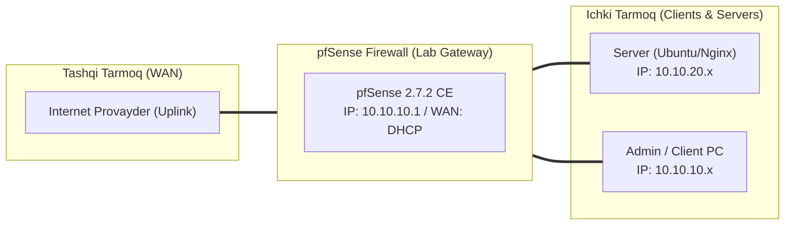

# 🛠️ [KUN-23] LAB QO'LLANMASI: Squid Proxy, Kesh Arxitekturasi va ClamAV Antivirus Filtratsiyasi

**Mavzu:** Squid Proxy, Kesh Arxitekturasi va ClamAV Antivirus Filtratsiyasi  
**Bosqich:** 3-Hafta: Kiberxavfsizlik, UTM, QoS va HA  
**Nazariy Ma'ruza:** [Lecture darsini o'qish](lecture.md)

---

## 🎯 1. Real Korxona Muammosi (Business Problem Statement)

> **Real Muammo:** Xodimlar internetdan turli xil dasturlar, drayverlar va arxivlar yuklab olmoqda. Ularning orasida troyan va zararli viruslar bo'lishi ehtimoli yuqori. Korxona tarmog'iga kirayotgan har bir yuklamani oqimda (on-the-fly) viruslarga tekshirish zarur.

Ushbu laboratoriya mashg'ulotida siz ushbu real muammoni to'liq hal qilasiz, tizimni xalqaro standartlar asosida xavfsiz va barqaror qilib sozlaysiz.

---

## 🗺️ 2. Laboratoriya Topologiyasi va IP Sxemasi



### 📋 Laboratoriya IP Jadvali

| Interfeys / Qurilma | Turi | IP Manzil / Subnet | Izoh |
|---|---|---|---|
| `WAN` | Tashqi | Provayder IP (DHCP / Static) | Internetga chiqish |
| `LAN` (MGMT) | Ichki | `10.10.10.1/24` | Boshqaruv va admin tarmog'i |
| `DMZ / SERVERS` | Segment | `10.10.20.1/24` | Korporativ serverlar |
| `Mijoz Mashinasi` | Test Client | `10.10.10.50` (DHCP) | Sinov o'tkazuvchi kompyuter |

---

## 🖥️ 3. Talabalar uchun Laboratoriya Muhiti (Ikkala Variant)

Talaba o'zida mavjud imkoniyatga qarab **Variant A** yoki **Variant B** dan birini tanlaydi:

### 🔹 VARIANT A: Real Jismoniy pfSense (Hardware Appliance / Mini-PC)
* **Hardware:** ClamAV antivirus bazasi xotiraga (RAM) yuklanadi va kamida 2-3GB bo'sh RAM talab qiladi.
* Kesh uchun tezkor SSD disk tavsiya etiladi.

### 🔹 VARIANT B: Virtual Server pfSense (Proxmox VE / VMware Workstation)
* **Proxmox / VMware:** pfSense VM xotirasini kamida 6GB ga oshiring.

---

## ⚙️ 4. Bosqichma-bosqich Amaliy Sozlash Qo'llanmasi (Step-by-Step)

1. **Qadam:** `System` -> `Package Manager` dan `squid` paketini o'rnatish.
2. **Qadam:** `Services` -> `Squid Proxy Server` -> `Local Cache` ga kirib, kesh hajmini (masalan 2048 MB) belgilash.
3. **Qadam:** `Antivirus` yorlig'iga o'tib, 'Enable ClamAV' katakchasini yoqish va antivirus bazasini yangilash.
4. **Qadam:** `General` yorlig'ida: Proxy Interface: `LAN`, TCP Port: `3128`. 'Allow Users on Interface' katakchasini yoqish.
5. **Qadam:** Mijoz kompyuterida brauzer sozlamalariga kirib, Proxy Server: `10.10.10.1`, Port: `3128` deb belgilash.
6. **Qadam:** EICAR rasmiy sinov virus faylini yuklab olishga urinib ko'rish: `http://www.eicar.org/download/eicar.com`.
7. **Qadam:** Squid va ClamAV virusni oqimda to'xtatib, brauzerda maxsus 'Virus Aniqlanganligi sababli yuklab olish taqiqlandi' sahifasini ko'rsatishi.


---

## 🧪 5. Verifikatsiya va Tekshirish (Testing & CLI)

Har bir amaliyot tugagach, quyidagi buyruqlar yordamida natijani qat'iy tekshiring:

**pfSense konsolida mijoz so'rovlarining keshdan yoki to'g'ridan-to'g'ri o'tayotganini ko'rish:**
```bash
tail -f /var/log/squid/access.log
```

**Antivirus bloklash sahifasi qaytishini ko'rish:**
```bash
curl -x http://10.10.10.1:3128 http://www.eicar.org/download/eicar.com
```

**Squid va ClamAV xizmatlari yashil 'Running' ekanini tekshirish:**
```bash
Status -> Services
```

**/var/log/clamav/freshclam.log:**
```bash
freshclam loglarini ko'rish
```


---

## 🚨 6. Eng Ko'p Uchraydigan Xatolar va Troubleshooting

* ⚠️ **Muammo: ClamAV yuklanayotganda pfSense qotib qoldi yoki xotira yetmadi. Yechim: pfSense VM RAM hajmini 6GB ga ko'taring, ClamAV antivirus bazasi xotirada 1.5GB joy oladi.**
* ⚠️ **Muammo: HTTPS saytlar ochilmayapti. Yechim: HTTPS uchun SSL Filtering yoqilgan bo'lsa, pfSense ichki CA sertifikati mijoz qurilmasiga o'rnatilishi shart.**


---

## 🏆 7. Mustaqil Amaliy Topshiriq (Student Challenge / Homework)

> 📝 **Vazifa:** SquidGuard kengaytmasini o'rnating va xodimlar uchun ijtimoiy tarmoqlar (Facebook, TikTok) domenlarini ish vaqtida cheklovchi URL filtering qoidasini yarating.
