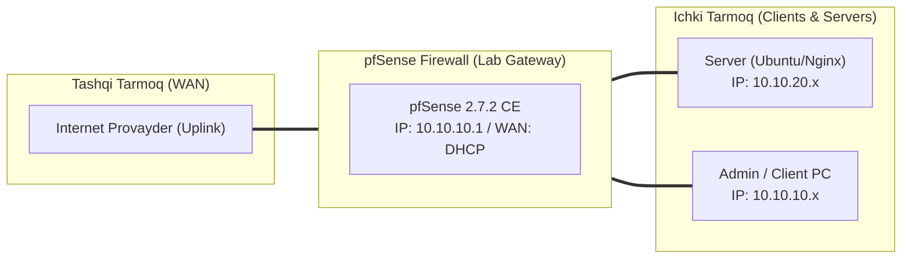

# 🛠️ [KUN-24] LAB QO'LLANMASI: Centralized Logging: Syslog Export va Graylog / ELK Arxitekturasi

**Mavzu:** Centralized Logging: Syslog Export va Graylog / ELK Arxitekturasi  
**Bosqich:** 4-Hafta: Monitoring, Hardening va Real Cloud Deploy  
**Nazariy Ma'ruza:** [Lecture darsini o'qish](lecture.md)

---

## 🎯 1. Real Korxona Muammosi (Business Problem Statement)

> **Real Muammo:** Xavfsizlik hodisasi yoki kiberhujum sodir bo'lganda, pfSense ning ichki loglari aylanib (log rotation) o'chib ketmoqda. Xavfsizlik bo'limi 1 oy oldin kim qaysi IP ga ulanganini yoki qaysi qoida buzilganini tekshira olmayapti.

Ushbu laboratoriya mashg'ulotida siz ushbu real muammoni to'liq hal qilasiz, tizimni xalqaro standartlar asosida xavfsiz va barqaror qilib sozlaysiz.

---

## 🗺️ 2. Laboratoriya Topologiyasi va IP Sxemasi



### 📋 Laboratoriya IP Jadvali

| Interfeys / Qurilma | Turi | IP Manzil / Subnet | Izoh |
|---|---|---|---|
| `WAN` | Tashqi | Provayder IP (DHCP / Static) | Internetga chiqish |
| `LAN` (MGMT) | Ichki | `10.10.10.1/24` | Boshqaruv va admin tarmog'i |
| `DMZ / SERVERS` | Segment | `10.10.20.1/24` | Korporativ serverlar |
| `Mijoz Mashinasi` | Test Client | `10.10.10.50` (DHCP) | Sinov o'tkazuvchi kompyuter |

---

## 🖥️ 3. Talabalar uchun Laboratoriya Muhiti (Ikkala Variant)

Talaba o'zida mavjud imkoniyatga qarab **Variant A** yoki **Variant B** dan birini tanlaydi:

### 🔹 VARIANT A: Real Jismoniy pfSense (Hardware Appliance / Mini-PC)
* **Hardware:** pfSense loglarni ichki SSD ga ko'p yozmasligi (SSD resursini tejash) uchun tashqi Syslog serverga oqizish eng to'g'ri yechimdir.

### 🔹 VARIANT B: Virtual Server pfSense (Proxmox VE / VMware Workstation)
* **Proxmox / VMware:** Alohida Ubuntu VM da Graylog yoki oddiy Rsyslog server o'rnatiladi.

---

## ⚙️ 4. Bosqichma-bosqich Amaliy Sozlash Qo'llanmasi (Step-by-Step)

1. **Qadam:** Tarmoqda markaziy Syslog server (Ubuntu: IP `10.10.20.100`, Port: UDP 514) tayyorlash.
2. **Qadam:** `Status` -> `System Logs` -> `Settings` yorlig'iga o'tish.
3. **Qadam:** `Remote Logging Options` bo'limida: 'Send log messages to remote syslog server' katakchasini yoqish.
4. **Qadam:** Remote log servers: `10.10.20.100:514` deb kiritish.
5. **Qadam:** Qaysi loglarni yuborishni tanlash: `Firewall Events`, `DNS Events`, `DHCP Events`, `VPN Events`.
6. **Qadam:** Syslog serverda (Ubuntu da) `rsyslog` yoki `graylog` qabul qiluvchi sozlamasini tekshirish.
7. **Qadam:** pfSense firewall da biror portni bloklash va bir soniyada Syslog server konsolida bloklangan paket logi paydo bo'lishini ko'rish.


---

## 🧪 5. Verifikatsiya va Tekshirish (Testing & CLI)

Har bir amaliyot tugagach, quyidagi buyruqlar yordamida natijani qat'iy tekshiring:

**LAN interfeysida pfSense Syslog paketlarini yuborayotganini tekshirish:**
```bash
tcpdump -i vtnet1 -n udp port 514
```

```bash
Syslog serverda: tail -f /var/log/pfsense.log yoki Graylog WebGUI da jonli xabarlar oqimini ko'rish
```

```bash
Bloklangan paketlar: filterlog qatorida 'block,in,4,...' formatida ma'lumotlar to'g'ri kelayotganini tasdiqlash
```

```bash
Qidiruv: Graylog panelida 'action:block AND dst_port:22' deb qidirib xakerlik urinishlarini topish
```


---

## 🚨 6. Eng Ko'p Uchraydigan Xatolar va Troubleshooting

* ⚠️ **Muammo: Syslog serverga loglar bormayapti. Yechim: Syslog serverdagi UFW yoki Linux firewall da UDP 514 porti ochilganini tekshiring.**
* ⚠️ **Muammo: Loglar formati tushunarsiz bir qator bo'lib tushyapti. Yechim: Graylog/Logstash da pfSense filterlog uchun maxsus Grok Pattern dan foydalaning.**


---

## 🏆 7. Mustaqil Amaliy Topshiriq (Student Challenge / Homework)

> 📝 **Vazifa:** Grafana Loki yoki Graylog da maxsus Dashboard yarating va kun davomida eng ko'p bloklangan TOP-5 IP manzillar statistikasini grafikda ko'rsating.
