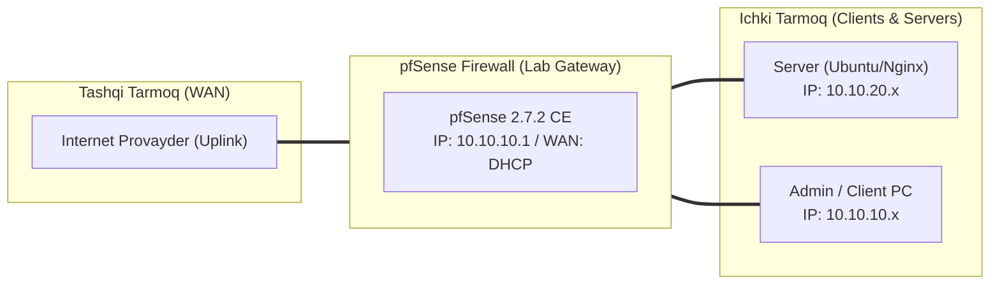

# 🛠️ [KUN-25] LAB QO'LLANMASI: Telemetriya va Monitoring: Telegraf + InfluxDB + Grafana NOC Dashboard

**Mavzu:** Telemetriya va Monitoring: Telegraf + InfluxDB + Grafana NOC Dashboard  
**Bosqich:** 4-Hafta: Monitoring, Hardening va Real Cloud Deploy  
**Nazariy Ma'ruza:** [Lecture darsini o'qish](lecture.md)

---

## 🎯 1. Real Korxona Muammosi (Business Problem Statement)

> **Real Muammo:** Tarmoq ma'murlari tarmoq kartalari qanchalik yuklanayotganini, qaysi interfeysda paketlar yo'qolayotganini (drops), CPU harorati va xotira holatini real vaqtda ko'rib turuvchi qulay va chiroyli vizual monitoring paneliga ega emas.

Ushbu laboratoriya mashg'ulotida siz ushbu real muammoni to'liq hal qilasiz, tizimni xalqaro standartlar asosida xavfsiz va barqaror qilib sozlaysiz.

---

## 🗺️ 2. Laboratoriya Topologiyasi va IP Sxemasi



### 📋 Laboratoriya IP Jadvali

| Interfeys / Qurilma | Turi | IP Manzil / Subnet | Izoh |
|---|---|---|---|
| `WAN` | Tashqi | Provayder IP (DHCP / Static) | Internetga chiqish |
| `LAN` (MGMT) | Ichki | `10.10.10.1/24` | Boshqaruv va admin tarmog'i |
| `DMZ / SERVERS` | Segment | `10.10.20.1/24` | Korporativ serverlar |
| `Mijoz Mashinasi` | Test Client | `10.10.10.50` (DHCP) | Sinov o'tkazuvchi kompyuter |

---

## 🖥️ 3. Talabalar uchun Laboratoriya Muhiti (Ikkala Variant)

Talaba o'zida mavjud imkoniyatga qarab **Variant A** yoki **Variant B** dan birini tanlaydi:

### 🔹 VARIANT A: Real Jismoniy pfSense (Hardware Appliance / Mini-PC)
* **Hardware:** Mini-PC apparat harorati drayverlarini (`coretemp` yoki `amdtemp`) yoqish orqali protsessor temperaturasini Grafana ga chiqarish mumkin.

### 🔹 VARIANT B: Virtual Server pfSense (Proxmox VE / VMware Workstation)
* **Proxmox / VMware:** pfSense ichida Telegraf paketi ishlaydi, InfluxDB va Grafana esa alohida Docker konteynerda ko'tariladi.

---

## ⚙️ 4. Bosqichma-bosqich Amaliy Sozlash Qo'llanmasi (Step-by-Step)

1. **Qadam:** Monitoring serverida Docker orqali InfluxDB (Port 8086) va Grafana (Port 3000) ni ishga tushirish.
2. **Qadam:** pfSense da: `System` -> `Package Manager` dan `telegraf` paketini o'rnatish.
3. **Qadam:** `Services` -> `Telegraf` sozlamalariga kirish. 'Enable Telegraf' ni yoqish.
4. **Qadam:** Telegraf Output: `InfluxDB (v1 yoki v2)`, InfluxDB Server: `http://10.10.20.100:8086`, Database: `pfsense_metrics`.
5. **Qadam:** Monitoring qilinadigan parametrlarni belgilash: CPU, Memory, System, Net (Interfeyslar), Pf (Packet filter states).
6. **Qadam:** Grafana ga kirish (http://10.10.20.100:3000), InfluxDB ma'lumotlar manzilini (Data Source) ulash.
7. **Qadam:** Rasmiy pfSense Dashboard (Dashboard ID: `14449` yoki `10967`) shablonini import qilish.


---

## 🧪 5. Verifikatsiya va Tekshirish (Testing & CLI)

Har bir amaliyot tugagach, quyidagi buyruqlar yordamida natijani qat'iy tekshiring:

**Telegraf xizmati aktiv 'Running' holatdaligini ko'rish:**
```bash
Status -> Services
```

```bash
Grafana panelida real vaqtda LAN va WAN trafigi grafiklari jonli o'sayotganini ko'rish
```

```bash
pfSense da katta fayl yuklab, Grafana grafikasida WAN interfeysi o'tkazuvchanligi aniq mos kelishini tekshirish
```

```bash
CPU va ZFS xotirasi taqsimotini vizual kuzatish
```


---

## 🚨 6. Eng Ko'p Uchraydigan Xatolar va Troubleshooting

* ⚠️ **Muammo: Telegraf InfluxDB ga bog'lana olmayapti (Connection refused). Yechim: InfluxDB porti 8086 ochiqligini va pfSense DMZ/LAN firewall qoidasida ushbu portga ruxsat borligini tekshiring.**
* ⚠️ **Muammo: Interfeys nomlari ko'rinmayapti. Yechim: Telegraf sozlamalarida 'Interface list' maydonini bo'sh qoldiring (barcha interfeyslarni avtomat olishi uchun).**


---

## 🏆 7. Mustaqil Amaliy Topshiriq (Student Challenge / Homework)

> 📝 **Vazifa:** Grafana da 'Alerting' qoidasi tuzing: Agar WAN trafigi 80 Mbps dan oshsa yoki CPU 90% ga yetsa, Telegram guruhiga avtomat xabar jo'natishni sozlang.
