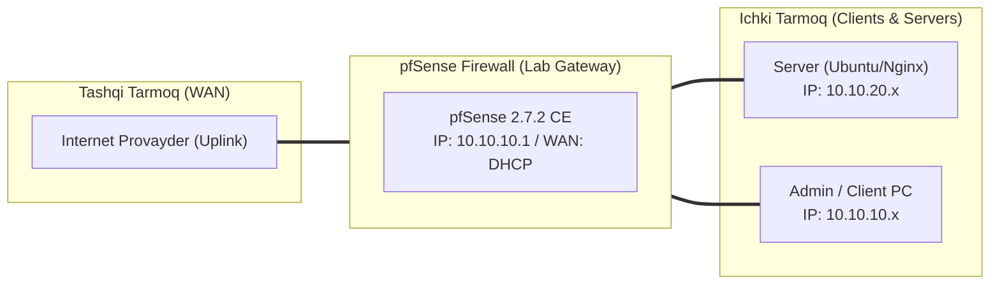

# 🛠️ [KUN-26] LAB QO'LLANMASI: Korxona Autentifikatsiyasi: Active Directory / LDAP va RADIUS Integratsiyasi

**Mavzu:** Korxona Autentifikatsiyasi: Active Directory / LDAP va RADIUS Integratsiyasi  
**Bosqich:** 4-Hafta: Monitoring, Hardening va Real Cloud Deploy  
**Nazariy Ma'ruza:** [Lecture darsini o'qish](lecture.md)

---

## 🎯 1. Real Korxona Muammosi (Business Problem Statement)

> **Real Muammo:** Korxonada 200 nafar xodim ishlaydi. Yangi xodim kelganda yoki ishdan ketganda uning parollarini pfSense, OpenVPN va WebGUI da qo'lda yaratish/o'chirish xavfsizlik xatolariga olib kelmoqda. Barcha autentifikatsiya markaziy Windows Server AD ga bog'lanishi shart.

Ushbu laboratoriya mashg'ulotida siz ushbu real muammoni to'liq hal qilasiz, tizimni xalqaro standartlar asosida xavfsiz va barqaror qilib sozlaysiz.

---

## 🗺️ 2. Laboratoriya Topologiyasi va IP Sxemasi



### 📋 Laboratoriya IP Jadvali

| Interfeys / Qurilma | Turi | IP Manzil / Subnet | Izoh |
|---|---|---|---|
| `WAN` | Tashqi | Provayder IP (DHCP / Static) | Internetga chiqish |
| `LAN` (MGMT) | Ichki | `10.10.10.1/24` | Boshqaruv va admin tarmog'i |
| `DMZ / SERVERS` | Segment | `10.10.20.1/24` | Korporativ serverlar |
| `Mijoz Mashinasi` | Test Client | `10.10.10.50` (DHCP) | Sinov o'tkazuvchi kompyuter |

---

## 🖥️ 3. Talabalar uchun Laboratoriya Muhiti (Ikkala Variant)

Talaba o'zida mavjud imkoniyatga qarab **Variant A** yoki **Variant B** dan birini tanlaydi:

### 🔹 VARIANT A: Real Jismoniy pfSense (Hardware Appliance / Mini-PC)
* **Hardware:** pfSense LAN porti orqali ichki korporativ domen kontrolleriga (Domain Controller) to'g'ridan-to'g'ri aloqaga ega bo'lishi lozim.

### 🔹 VARIANT B: Virtual Server pfSense (Proxmox VE / VMware Workstation)
* **Proxmox / VMware:** Laboratoriyada Windows Server 2022 (AD DS) VM ko'tariladi.

---

## ⚙️ 4. Bosqichma-bosqich Amaliy Sozlash Qo'llanmasi (Step-by-Step)

1. **Qadam:** `System` -> `User Manager` -> `Authentication Servers` yorlig'iga o'tish.
2. **Qadam:** 'Add' tugmasini bosish: Descriptive name: `Corp_Active_Directory`, Type: `LDAP`.
3. **Qadam:** Hostname or IP: `10.10.20.10` (AD Domain Controller), Port: `389` (yoki 636 LDAPS), Transport: `TCP - Standard`.
4. **Qadam:** Base DN: `DC=corp,DC=local`, Authentication containers: `CN=Users,DC=corp,DC=local`.
5. **Qadam:** Bind credentials: User DN: `CN=ldap_bind,CN=Users,DC=corp,DC=local`, Bind Password: (parol).
6. **Qadam:** `Diagnostics` -> `Authentication` ga kirib, AD dagi biror korporativ foydalanuvchi logini va parolini kiritib tekshirish ('Authentication Successful' chiqishi kerak).
7. **Qadam:** `System` -> `User Manager` -> `Groups` bo'limida AD guruh nomi bilan bir xil bo'lgan `pfAdmins` guruhini yaratish va unga WebGUI Superuser huquqlarini berish.


---

## 🧪 5. Verifikatsiya va Tekshirish (Testing & CLI)

Har bir amaliyot tugagach, quyidagi buyruqlar yordamida natijani qat'iy tekshiring:

**AD foydalanuvchisi va uning a'zo bo'lgan barcha guruhlari to'g'ri qaytayotganini ko'rish:**
```bash
Diagnostics -> Authentication
```

```bash
pfSense WebGUI dan chiqib (Logout), Active Directory dagi login/parol bilan kirish
```

```bash
OpenVPN server autentifikatsiyasini AD/LDAP ga o'tkazish va VPN ga domen paroli bilan ulanishni tekshirish
```

```bash
Windows AD da foydalanuvchini bloklab qo'yganda, u pfSense va VPN ga kira olmay qolishini tasdiqlash
```


---

## 🚨 6. Eng Ko'p Uchraydigan Xatolar va Troubleshooting

* ⚠️ **Muammo: 'Could not connect to LDAP server'. Yechim: pfSense dan Domain Controller ga ping va TCP 389/636 port aloqasini tekshiring.**
* ⚠️ **Muammo: Autentifikatsiya o'tdi, lekin WebGUI ga kirganda 'No page assigned' xatosi. Yechim: AD foydalanuvchisi a'zo bo'lgan guruh pfSense Groups bo'limida yaratilmagan yoki huquqlari belgilanmagan.**


---

## 🏆 7. Mustaqil Amaliy Topshiriq (Student Challenge / Homework)

> 📝 **Vazifa:** FreeRADIUS paketini pfSense ga o'rnating va 802.1X korporativ Wi-Fi xavfsizligi uchun RADIUS autentifikatsiyasini sinovdan o'tkazing.
