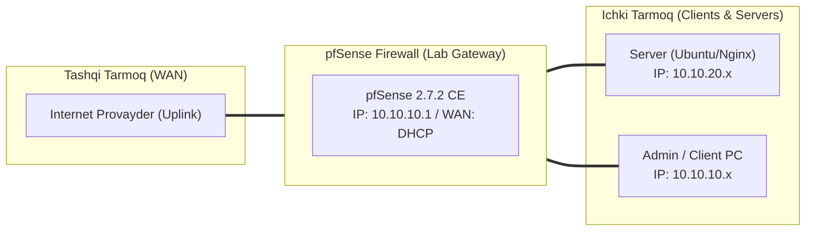

# 🛠️ [KUN-27] LAB QO'LLANMASI: Avtomatlashtirish, AutoConfigBackup (ACB) va 5-Daqiqalik Disaster Recovery Mashqi

**Mavzu:** Avtomatlashtirish, AutoConfigBackup (ACB) va 5-Daqiqalik Disaster Recovery Mashqi  
**Bosqich:** 4-Hafta: Monitoring, Hardening va Real Cloud Deploy  
**Nazariy Ma'ruza:** [Lecture darsini o'qish](lecture.md)

---

## 🎯 1. Real Korxona Muammosi (Business Problem Statement)

> **Real Muammo:** Server xonasida yong'in yoki apparatning to'liq kuyishi sodir bo'ldi. Yangi olingan bo'sh kompyuterga pfSense ni o'rnatib, barcha qoidalar, sertifikatlar, VLAN va VPN sozlamalarini 5 daqiqa ichida noldan tiklab berish talab etiladi.

Ushbu laboratoriya mashg'ulotida siz ushbu real muammoni to'liq hal qilasiz, tizimni xalqaro standartlar asosida xavfsiz va barqaror qilib sozlaysiz.

---

## 🗺️ 2. Laboratoriya Topologiyasi va IP Sxemasi



### 📋 Laboratoriya IP Jadvali

| Interfeys / Qurilma | Turi | IP Manzil / Subnet | Izoh |
|---|---|---|---|
| `WAN` | Tashqi | Provayder IP (DHCP / Static) | Internetga chiqish |
| `LAN` (MGMT) | Ichki | `10.10.10.1/24` | Boshqaruv va admin tarmog'i |
| `DMZ / SERVERS` | Segment | `10.10.20.1/24` | Korporativ serverlar |
| `Mijoz Mashinasi` | Test Client | `10.10.10.50` (DHCP) | Sinov o'tkazuvchi kompyuter |

---

## 🖥️ 3. Talabalar uchun Laboratoriya Muhiti (Ikkala Variant)

Talaba o'zida mavjud imkoniyatga qarab **Variant A** yoki **Variant B** dan birini tanlaydi:

### 🔹 VARIANT A: Real Jismoniy pfSense (Hardware Appliance / Mini-PC)
* **Hardware:** Zaxira USB fleshkaga `config.xml` faylini nusxalab qo'yish kifoya; o'rnatish paytida pfSense USB dan konfiguratsiyani avtomat o'qib oladi (ECL - External Configuration Locator).

### 🔹 VARIANT B: Virtual Server pfSense (Proxmox VE / VMware Workstation)
* **Proxmox / VMware:** Yangi bo'sh VM yaratib, unga zaxira fayli orqali tizimni to'liq jonlantirish sinovi o'tkaziladi.

---

## ⚙️ 4. Bosqichma-bosqich Amaliy Sozlash Qo'llanmasi (Step-by-Step)

1. **Qadam:** `Services` -> `Auto Config Backup` -> `Settings` ga kirish.
2. **Qadam:** 'Enable ACB' katakchasini yoqish, Encryption Password (shifrlash paroli) kiritish va 'Save' tugmasini bosish.
3. **Qadam:** `Restore` yorlig'iga o'tib, bulutda har bir o'zgarish bo'yicha saqlangan zaxira nuqtalarini ko'rish.
4. **Qadam:** Qo'lda to'liq zaxira olish: `Diagnostics` -> `Backup & Restore` ga kirib, `Download configuration as XML` tugmasini bosish va `config-latest.xml` faylini yuklab olish.
5. **Qadam:** Falokat Mashqi (Disaster Recovery Drill): Proxmox yoki VMware da yangi toza pfSense VM o'rnatish (yoki fizik uskunani tozalash).
6. **Qadam:** Konsolda interfeyslarni aniqlagach, toza WebGUI ga kirib `Diagnostics` -> `Backup & Restore` -> `Restore configuration` orqali saqlangan XML faylni yuklash.
7. **Qadam:** Tizim qayta yuklangach (Reboot), barcha VLAN, DHCP, Firewall va VPN lar 100% tiklanganini tekshirish.


---

## 🧪 5. Verifikatsiya va Tekshirish (Testing & CLI)

Har bir amaliyot tugagach, quyidagi buyruqlar yordamida natijani qat'iy tekshiring:

```bash
Zaxiradan tiklangan yangi serverda barcha qoidalar va sertifikatlar o'z joyida ekanini ko'rish
```

```bash
Mijoz kompyuteridan ping va internet aloqasi darhol qayta tiklanganini tasdiqlash
```

```bash
Tiklash jarayoni 5 daqiqadan kam vaqt olganini taymer bilan o'lchash
```

**ZFS zaxira nuqtalarini ko'rish:**
```bash
zfs list snapshots
```


---

## 🚨 6. Eng Ko'p Uchraydigan Xatolar va Troubleshooting

* ⚠️ **Muammo: Yangi serverda tarmoq kartalari boshqacha nomlangan (masalan vtnet o'rniga igb). Yechim: pfSense yuklanish paytida konsolda 'Interface Mismatch' deb so'raydi; qaysi port yangi kartaga to'g'ri kelishini konsol menyusidan belgilash kifoya.**
* ⚠️ **Muammo: Shifrlangan ACB paroli esdan chiqdi. Yechim: ACB parolini korxona parol menejerida (Bitwarden/KeePass) xavfsiz saqlash shart.**


---

## 🏆 7. Mustaqil Amaliy Topshiriq (Student Challenge / Homework)

> 📝 **Vazifa:** Bash yoki PowerShell skripti yozing, u har kecha pfSense dan `curl` orqali avtomat `config.xml` ni tortib olib, korxona xavfsiz NAS serveriga saqlasin.
