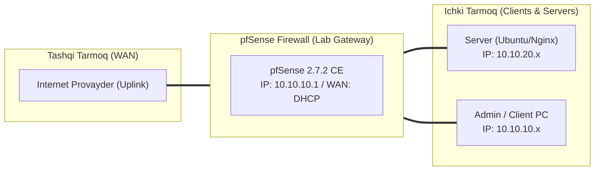

# 🛠️ [KUN-28] LAB QO'LLANMASI: Cloud Muhitlar Arxitekturasi: AWS VPC, GCP va Linode Tarmoq Asoslari

**Mavzu:** Cloud Muhitlar Arxitekturasi: AWS VPC, GCP va Linode Tarmoq Asoslari  
**Bosqich:** 4-Hafta: Monitoring, Hardening va Real Cloud Deploy  
**Nazariy Ma'ruza:** [Lecture darsini o'qish](lecture.md)

---

## 🎯 1. Real Korxona Muammosi (Business Problem Statement)

> **Real Muammo:** Kompaniya o'z serverlarini jismoniy ofisdan AWS/GCP bulutiga ko'chirmoqda. Ammo bulut muhitida an'anaviy Layer 2 broadcast, multicast va CARP protokollari ishlamaydi. Cloud xavfsizligini ta'minlash uchun pfSense ni bulut arxitekturasiga moslashtirish lozim.

Ushbu laboratoriya mashg'ulotida siz ushbu real muammoni to'liq hal qilasiz, tizimni xalqaro standartlar asosida xavfsiz va barqaror qilib sozlaysiz.

---

## 🗺️ 2. Laboratoriya Topologiyasi va IP Sxemasi



### 📋 Laboratoriya IP Jadvali

| Interfeys / Qurilma | Turi | IP Manzil / Subnet | Izoh |
|---|---|---|---|
| `WAN` | Tashqi | Provayder IP (DHCP / Static) | Internetga chiqish |
| `LAN` (MGMT) | Ichki | `10.10.10.1/24` | Boshqaruv va admin tarmog'i |
| `DMZ / SERVERS` | Segment | `10.10.20.1/24` | Korporativ serverlar |
| `Mijoz Mashinasi` | Test Client | `10.10.10.50` (DHCP) | Sinov o'tkazuvchi kompyuter |

---

## 🖥️ 3. Talabalar uchun Laboratoriya Muhiti (Ikkala Variant)

Talaba o'zida mavjud imkoniyatga qarab **Variant A** yoki **Variant B** dan birini tanlaydi:

### 🔹 VARIANT A: Real Jismoniy pfSense (Hardware Appliance / Mini-PC)
* **Hardware:** Ushbu dars mahalliy serverlarni kelajakda bulutga bog'lash uchun poydevor hisoblanadi.

### 🔹 VARIANT B: Virtual Server pfSense (Proxmox VE / VMware Workstation)
* **Cloud:** AWS Console, GCP Cloud Console yoki Linode Cloud Manager orqali VPC va tarmoq sxemasi loyihalanadi.

---

## ⚙️ 4. Bosqichma-bosqich Amaliy Sozlash Qo'llanmasi (Step-by-Step)

1. **Qadam:** AWS boshqaruv konsoliga (yoki GCP / Linode) kirish.
2. **Qadam:** Yangi VPC yaratish: IPv4 CIDR: `172.31.0.0/16`.
3. **Qadam:** 2 ta Subnet ochish: `Public-Subnet` (`172.31.1.0/24`) va `Private-Subnet` (`172.31.2.0/24`).
4. **Qadam:** Internet Gateway (IGW) yaratish va uni VPC ga biriktirish (Attach to VPC).
5. **Qadam:** Public Route Table yaratish: `0.0.0.0/0` marshrutini IGW ga yo'naltirish.
6. **Qadam:** Private Route Table yaratish: `0.0.0.0/0` marshrutini kelajakda pfSense bo'ladigan tarmoq interfeysi (ENI) ga yo'naltirish uchun tayyorlab qo'yish.
7. **Qadam:** Security Groups (SG) yaratish: pfSense-WAN-SG (faqat ma'lum portlar ochiq) va Private-SG (faqat pfSense dan kirish ruxsat).


---

## 🧪 5. Verifikatsiya va Tekshirish (Testing & CLI)

Har bir amaliyot tugagach, quyidagi buyruqlar yordamida natijani qat'iy tekshiring:

```bash
AWS VPC Dashboard da barcha subnetlar va yo'nalishlar xaritasi (Resource Map) to'g'ri bog'langanini ko'rish
```

```bash
Tarmoq xavfsizlik guruhlari (Security Groups) qoidalarini tekshirish
```

```bash
IP planlash: AWS da har bir subnetdagi birinchi 4 ta va oxirgi 1 ta IP manzil zaxiralanganini (AWS reserved IPs) inobatga olishni tasdiqlash
```


---

## 🚨 6. Eng Ko'p Uchraydigan Xatolar va Troubleshooting

* ⚠️ **Muammo: Internet Gateway VPC ga ulanmayapti. Yechim: VPC da avvaldan boshqa IGW yo'qligini tekshiring (bitta VPC ga faqat 1 ta IGW ulanadi).**
* ⚠️ **Muammo: Subnet to'qnashuvi. Yechim: Bulutdagi CIDR (172.31.0.0/16) mahalliy ofisingizdagi subnetlar (10.10.0.0/16) bilan mutlaqo bir xil bo'lmasligi shart (VPN ulanishi uchun).**


---

## 🏆 7. Mustaqil Amaliy Topshiriq (Student Challenge / Homework)

> 📝 **Vazifa:** GCP (Google Cloud Platform) yoki Linode da ham xuddi shunday 2-zonali (Public va Private) tarmoq sxemasini tuzib, AWS bilan farqlarini jadval ko'rinishida yozing.
