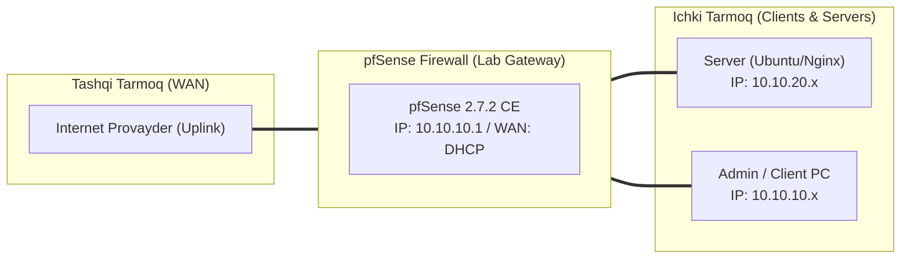

# 🛠️ [KUN-29] LAB QO'LLANMASI: pfSense Cloud Deployment: AWS / GCP / Linode da Real Instansiya Ko'tarish

**Mavzu:** pfSense Cloud Deployment: AWS / GCP / Linode da Real Instansiya Ko'tarish  
**Bosqich:** 4-Hafta: Monitoring, Hardening va Real Cloud Deploy  
**Nazariy Ma'ruza:** [Lecture darsini o'qish](lecture.md)

---

## 🎯 1. Real Korxona Muammosi (Business Problem Statement)

> **Real Muammo:** Bulutda joylashgan o'nlab ma'lumotlar bazalari va dasturiy serverlar tashqi xakerlik hujumlariga ochiq qolgan. Ularni AWS Security Groups dan tashqari, korxona darajasidagi professional pfSense UTM xavfsizlik devori orqasida himoyalash talab qilinadi.

Ushbu laboratoriya mashg'ulotida siz ushbu real muammoni to'liq hal qilasiz, tizimni xalqaro standartlar asosida xavfsiz va barqaror qilib sozlaysiz.

---

## 🗺️ 2. Laboratoriya Topologiyasi va IP Sxemasi



### 📋 Laboratoriya IP Jadvali

| Interfeys / Qurilma | Turi | IP Manzil / Subnet | Izoh |
|---|---|---|---|
| `WAN` | Tashqi | Provayder IP (DHCP / Static) | Internetga chiqish |
| `LAN` (MGMT) | Ichki | `10.10.10.1/24` | Boshqaruv va admin tarmog'i |
| `DMZ / SERVERS` | Segment | `10.10.20.1/24` | Korporativ serverlar |
| `Mijoz Mashinasi` | Test Client | `10.10.10.50` (DHCP) | Sinov o'tkazuvchi kompyuter |

---

## 🖥️ 3. Talabalar uchun Laboratoriya Muhiti (Ikkala Variant)

Talaba o'zida mavjud imkoniyatga qarab **Variant A** yoki **Variant B** dan birini tanlaydi:

### 🔹 VARIANT A: Real Jismoniy pfSense (Hardware Appliance / Mini-PC)
* **Cloud Platform:** AWS bepul hisobi (Free Tier) yoki Linode/DigitalOcean/Hetzner serveri.

### 🔹 VARIANT B: Virtual Server pfSense (Proxmox VE / VMware Workstation)
* **Cloud:** AWS EC2 t3.small yoki Linode 2GB instansiyasi.

---

## ⚙️ 4. Bosqichma-bosqich Amaliy Sozlash Qo'llanmasi (Step-by-Step)

1. **Qadam:** AWS EC2 Console ga kirish -> 'Launch Instance'.
2. **Qadam:** AWS Marketplace dan `pfSense Plus Firewall/VPN/Router` tasvirini tanlash (yoki Linode da FreeBSD yuklash).
3. **Qadam:** Instance Type: `t3.small` (kamida 2 vCPU, 2GB RAM).
4. **Qadam:** Network Settings: Oldingi darsda yaratilgan VPC ni tanlash, Subnet: `Public-Subnet` (`172.31.1.0/24`).
5. **Qadam:** Ikkinchi tarmoq interfeysini (ENI) qo'shish: Subnet: `Private-Subnet` (`172.31.2.0/24`).
6. **Qadam:** AWS da KRITIK QADAM: Har ikkala ENI sozlamalariga kirib, `Change source/dest. check` parametrini 'Stop' (Disable) qilib qo'yish.
7. **Qadam:** Elastic IP yaratish va uni pfSense ning Public interfeysiga biriktirish (Associate Elastic IP).
8. **Qadam:** Brauzer orqali `https://<Elastic_IP>` ga kirish va bulutdagi pfSense ni dastlabki sozlash.


---

## 🧪 5. Verifikatsiya va Tekshirish (Testing & CLI)

Har bir amaliyot tugagach, quyidagi buyruqlar yordamida natijani qat'iy tekshiring:

```bash
Bulutdagi pfSense WebGUI ga xavfsiz ulanishni tasdiqlash
```

```bash
Private Subnetda bitta yengil EC2 Linux server ko'tarish
```

```bash
Private EC2 serveridan internetga ping yuborish: paketlar pfSense orqali NAT bo'lib chiqayotganini ko'rish
```

```bash
pfSense Status -> Gateways da bulut shlyuzining Online ekanini tekshirish
```


---

## 🚨 6. Eng Ko'p Uchraydigan Xatolar va Troubleshooting

* ⚠️ **Muammo: Private serverlar internetga chiqa olmayapti. Yechim: AWS ENI da 'Source/Dest Check' o'chirilmagan yoki AWS Route Table da 0.0.0.0/0 shlyuzi pfSense interfeysiga yo'naltirilmagan bo'ladi.**
* ⚠️ **Muammo: WebGUI ochilmayapti. Yechim: AWS Security Group da port 443 yoki 8443 o'zingizning tashqi IP manzilingiz uchun ruxsat berilganini tekshiring.**


---

## 🏆 7. Mustaqil Amaliy Topshiriq (Student Challenge / Homework)

> 📝 **Vazifa:** Bulutdagi pfSense da pfBlockerNG-devel paketini yoqing va bulutdagi xususiy serverlaringizni xalqaro xakerlik skanerlaridan himoyalang.
