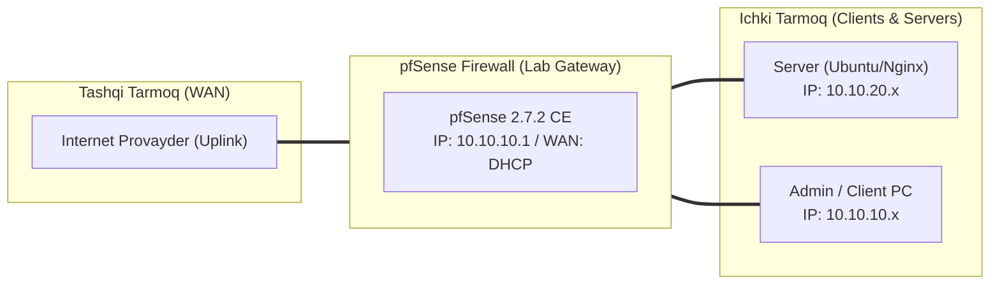

# 🛠️ [KUN-30] LAB QO'LLANMASI: Katta Final — Hybrid Cloud Production Project: On-Premise to Cloud IPsec/WireGuard

**Mavzu:** Katta Final — Hybrid Cloud Production Project: On-Premise to Cloud IPsec/WireGuard  
**Bosqich:** 4-Hafta: Monitoring, Hardening va Real Cloud Deploy  
**Nazariy Ma'ruza:** [Lecture darsini o'qish](lecture.md)

---

## 🎯 1. Real Korxona Muammosi (Business Problem Statement)

> **Real Muammo:** Kompaniyaning jismoniy ofisi/zavodi (On-Premise Proxmox / Hardware pfSense) bilan Cloud (AWS VPC pfSense) o'rtasida mustahkam, shifrlangan, uzluksiz Hybrid Cloud tuneli talab etiladi. Mahalliy xodimlar bulutdagi ma'lumotlar bazalariga xuddi qo'shni xonadagi serverdek xavfsiz ulanishi kerak.

Ushbu laboratoriya mashg'ulotida siz ushbu real muammoni to'liq hal qilasiz, tizimni xalqaro standartlar asosida xavfsiz va barqaror qilib sozlaysiz.

---

## 🗺️ 2. Laboratoriya Topologiyasi va IP Sxemasi



### 📋 Laboratoriya IP Jadvali

| Interfeys / Qurilma | Turi | IP Manzil / Subnet | Izoh |
|---|---|---|---|
| `WAN` | Tashqi | Provayder IP (DHCP / Static) | Internetga chiqish |
| `LAN` (MGMT) | Ichki | `10.10.10.1/24` | Boshqaruv va admin tarmog'i |
| `DMZ / SERVERS` | Segment | `10.10.20.1/24` | Korporativ serverlar |
| `Mijoz Mashinasi` | Test Client | `10.10.10.50` (DHCP) | Sinov o'tkazuvchi kompyuter |

---

## 🖥️ 3. Talabalar uchun Laboratoriya Muhiti (Ikkala Variant)

Talaba o'zida mavjud imkoniyatga qarab **Variant A** yoki **Variant B** dan birini tanlaydi:

### 🔹 VARIANT A: Real Jismoniy pfSense (Hardware Appliance / Mini-PC)
* **Hardware:** Mahalliy apparat pfSense (HQ) bevosita AWS/GCP bulutidagi ikkinchi pfSense instansiyasiga ulanadi.

### 🔹 VARIANT B: Virtual Server pfSense (Proxmox VE / VMware Workstation)
* **Proxmox / VMware ⇄ Cloud:** Mahalliy virtual pfSense bulutdagi pfSense bilan IPsec orqali bog'lanadi.

---

## ⚙️ 4. Bosqichma-bosqich Amaliy Sozlash Qo'llanmasi (Step-by-Step)

1. **Qadam:** Mahalliy pfSense (HQ: LAN `10.10.0.0/16`) va Bulut pfSense (Cloud: VPC `172.31.0.0/16`) parametrlarini tekshirish.
2. **Qadam:** Mahalliy pfSense da: `VPN` -> `IPsec` -> Phase 1 yaratish. Remote Gateway: `Bulut_Elastic_IP`, IKEv2, AES256-GCM, DH Group 14.
3. **Qadam:** Phase 2: Mode: `Routed (VTI)`, Local IP: `10.254.100.1/30`, Remote IP: `10.254.100.2/30`.
4. **Qadam:** Bulut pfSense da: Phase 1 yaratish. Remote Gateway: `Mahalliy_WAN_IP`, Phase 2 VTI: Local IP: `10.254.100.2/30`, Remote IP: `10.254.100.1/30`.
5. **Qadam:** Ikkala tomonda ham `Interfaces` -> `Assignments` orqali yangi VTI interfeyslarini qabul qilish va yoqish.
6. **Qadam:** Mahalliy pfSense da marshrut qo'shish: Destination: `172.31.0.0/16` -> Gateway: `VTI_Gateway`.
7. **Qadam:** Bulut pfSense da marshrut qo'shish: Destination: `10.10.0.0/16` -> Gateway: `VTI_Gateway`.
8. **Qadam:** Ikkala tomonda firewall qoidalarida IPsec va LAN trafigiga ruxsat berish.


---

## 🧪 5. Verifikatsiya va Tekshirish (Testing & CLI)

Har bir amaliyot tugagach, quyidagi buyruqlar yordamida natijani qat'iy tekshiring:

**Bulutdagi xususiy EC2 serverga to'g'ridan-to'g'ri ping borishini tekshirish:**
```bash
Mahalliy ofis kompyuteridan: ping 172.31.2.50
```

**Mahalliy DMZ dagi web-serverga ulanishni tekshirish:**
```bash
Bulutdagi serverdan: curl http://10.10.20.80
```

**Tunnel holati yashil 'ESTABLISHED' va baytlar uzatilayotganini ko'rish:**
```bash
Status -> IPsec
```

```bash
iperf3 benchmark orqali mahalliy tarmoqdan bulutga tunnel o'tkazuvchanligi va ping kechikishini o'lchash
```


---

## 🚨 6. Eng Ko'p Uchraydigan Xatolar va Troubleshooting

* ⚠️ **Muammo: Katta veb-sahifalar ochilmayapti yoki ulanish qotib qolmoqda. Yechim: MTU/MSS Clamping muammosi. Firewall > Rules > IPsec va System > Advanced bo'limida MSS Clamping qiymatini 1380 ga qo'ying.**
* ⚠️ **Muammo: Bulutdagi server javob qaytarmayapti. Yechim: AWS Security Group da mahalliy subnetdan (`10.10.0.0/16`) kiruvchi trafikka ruxsat berilganini tekshiring.**


---

## 🏆 7. Mustaqil Amaliy Topshiriq (Student Challenge / Homework)

> 📝 **Vazifa:** 30 kunlik barcha laboratoriya tajribalaringiz, skrinshotlar va konfiguratsiyalaringizni jamlab, shaxsiy GitHub / LinkedIn profilingizda 'Zero to Hero: pfSense Production Engineering' maqolangizni e'lon qiling!
