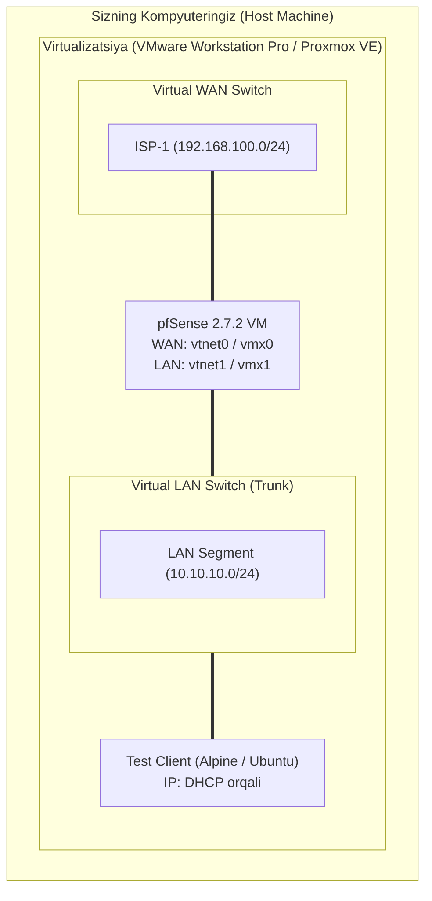

# [KUN-01]: pfSense va FreeBSD Arxitekturasi, Virtualizatsiya Laboratoriyasini Noldan Yaratish

**Mavzu:** pfSense ichki tuzilishi, FreeBSD tarmoq steki, VMware Workstation Pro va Proxmox VE da virtual tarmoqlarni qurish  
**Bosqich:** 1-Hafta: Baza va Virtualizatsiya  
**Amaliyot:** VMware / Proxmox xostida L2/L3 topologiyani tayyorlash va pfSense 2.7.2 CE ni ishga tushirish

---

## 📌 1. pfSense Nima va Nega U Shunchalik Ommabop?

pfSense — bu **FreeBSD** operatsion tizimi ustiga qurilgan, jahon miqyosida millionlab korxonalar, data-centerlar va uy laboratoriyalarida (Homelab) ishlatiladigan ochiq kodli xavfsizlik devori (Firewall) va marshrutizator (Router).

### Nega Linux (iptables/nftables) emas, aynan FreeBSD?
1. **`pf` (Packet Filter) Mexanizmi:** pfSense o'z nomini OpenBSD loyihasidan olingan va FreeBSD yadrosiga chuqur integratsiya qilingan `pf` paket filtridan olgan. `pf` qoidalarni yuqoridan pastga (top-down) qat'iy mantiq bilan tekshiradi, o'ta samarali holat jadvali (**State Table**) ga ega va sintaksisi o'qish uchun juda qulay.
2. **Yaxlit Yadro (Monolithic Network Stack):** FreeBSD operatsion tizimining tarmoq steki yuqori yuklamalarda, ayniqsa 10G/40G/100G paketlarni qayta ishlashda kamroq jitter va barqaror kechikish (latency) ko'rsatkichlari bilan mashhur.
3. **ZFS Fayl Tizimi:** pfSense to'satdan elektr ta'minoti uzilganda ma'lumotlar buzilmasligi uchun eng mustahkam fayl tizimi — OpenZFS ni qo'llab-quvvatlaydi.

---

## 🗺️ 2. 1-Kun Laboratoriya Sxemasi



---

## ⚙️ 3. Bosqichma-bosqich O'rnatish Qo'llanmasi

### 3.1. pfSense ISO Tasvirini Yuklab Olish
1. Rasmiy veb-saytga kiring: [netgate.com/pfsense-downloads](https://www.netgate.com/pfsense-downloads)
2. Parametrlarni tanlang:
   * **Architecture:** `AMD64 (64-bit)`
   * **Installer:** `DVD Image (ISO) Installer`
3. Yuklab olingan `.iso.gz` arxivini `7-Zip` yoki shunga o'xshash dastur yordamida `.iso` formatiga oching.

---

### 3.2. VMware Workstation Pro-da Sozlash

1. **Virtual Tarmoqlarni Sozlash (Virtual Network Editor):**
   * VMware oching: `Edit` -> `Virtual Network Editor...`
   * `Change Settings` (Administrator huquqi) tugmasini bosing.
   * `Add Network` orqali `VMnet1` (Host-only) yarating: Subnet IP: `192.168.100.0`, Mask: `255.255.255.0`.
     * ⚠️ **"Use local DHCP service" belgisini olib tashlang!**
   * `VMnet3` (Host-only) yarating: Subnet IP: `10.10.10.0`, Mask: `255.255.255.0`.
     * ⚠️ **"Use local DHCP service" belgisini olib tashlang!**
   * `Apply` va `OK`.

2. **pfSense VM Yaratish:**
   * `Create a New Virtual Machine` -> `Typical`
   * `I will install the operating system later`
   * **Guest OS:** `Other` -> Version: `FreeBSD 13 or 14 64-bit`
   * **Nom:** `pfSense-Master-01`
   * **Disk hajmi:** `20 GB` (Single file)
   * **Customize Hardware:**
     * RAM: `2048 MB`
     * CPU: `2 Cores`
     * Network Adapter 1: `Custom` -> `VMnet1` (Bu bizning WAN interfeysimiz bo'ladi)
     * Yangi adapter qo'shing (`Add...` -> `Network Adapter`): `Custom` -> `VMnet3` (Bu bizning LAN bo'ladi)
     * CD/DVD bo'limiga yuklab olingan `pfSense-CE-2.7.2...iso` faylini tanlang.

---

### 3.3. Proxmox VE-da Sozlash

1. **Linux Bridge yaratish (WebGUI orqali):**
   * `Node` -> `System` -> `Network` -> `Create` -> `Linux Bridge`:
     * Nomi: `vmbr1` (WAN uchun) -> `bridge-ports`: bo'sh qoldiring (agar alohida jismoniy port bo'lmasa).
     * Nomi: `vmbr10` (LAN/VLAN uchun) -> `bridge-ports`: bo'sh qoldiring, `VLAN aware`: **[X] check**.

2. **VM Yaratish:**
   * ID: masalan `100`, Nomi: `pfSense-FW01`
   * OS: pfSense ISO tanlang, Type: `Other`
   * System: Qemu Agent: yoqish mumkin, SCSI Controller: `VirtIO SCSI`
   * Disks: `VirtIO Block` yoki `SCSI`, hajmi `20 GB`, Cache: `Write back`
   * CPU: `2 Cores`, Type: `host`
   * Memory: `2048 MB`, Ballooning: **O'chirib qo'yish** (pfSense ZFS keshida xotira o'zgarishini yoqtirmaydi)
   * Network:
     * 1-tarmoq kartasi: Bridge `vmbr1`, Model: `VirtIO (paravirtualized)`
   * VM yaratilgach, `Hardware` -> `Add` -> `Network Device`:
     * 2-tarmoq kartasi: Bridge `vmbr10`, Model: `VirtIO (paravirtualized)`

> 💡 **Proxmox VirtIO Maslahati:**
> Proxmox'da `VirtIO` kartalari ajoyib ishlaydi, biroq pfSense o'rnatilgach WebGUI ichida:
> `System` -> `Advanced` -> `Networking` bo'limiga kirib:
> * **Hardware Checksum Offloading** -> [X] Disable
> * **Hardware TCP Segmentation Offloading (TSO)** -> [X] Disable
> * **Hardware Large Receive Offloading (LRO)** -> [X] Disable
> bayroqchalarini yoqib qo'yish shart! Aks holda paketlar yo'qolishi yoki sekinlashishi mumkin.

---

### 3.4. O'rnatish Jarayoni (Installation Steps)

1. VM ni ishga tushiring (Power On).
2. FreeBSD boot menyusi chiqadi — `Enter` bosing.
3. **Copyright Notice:** `Accept`
4. **Install:** `Install pfSense` tanlang.
5. **File System Selection:**
   * 🌟 **Auto (ZFS)** ni tanlang (Production uchun tavsiya).
   * Keyingi bosqichda: `Install` -> `Stripe - No Redundancy` (bitta disk uchun) yoki `Mirror` (ikkita disk bo'lsa).
   * Diskni belgilang (`da0` yoki `ada0` oldiga bo'sh joy (Space) bilan `*` qo'ying).
   * `OK` va `YES` (disk tozalanadi).
6. O'rnatish tugagach: `Reboot` bosing va ISO faylni ajratib oling (Eject).

---

## 📟 4. Dastlabki Konsol Sozlamalari (Console Configuration)

Tizim qayta yuklangach, konsolda quyidagi so'rovlar paydo bo'ladi:

```text
Should VLANs be configured now? [y/n]: n
```
*(Hozircha "n" deb javob beramiz, 5-kuni VLANlarni batafsil qilamiz)*

Keyingi qadam — interfeyslarni belgilash:
* **Enter the WAN interface name:** `vtnet0` (yoki VMware'da `vmx0`)
* **Enter the LAN interface name:** `vtnet1` (yoki VMware'da `vmx1`)
* **Do you want to proceed? [y/n]:** `y`

Tizim yuklanib, mashhur pfSense konsol menyusini ko'rasiz:

```text
*** Welcome to pfSense 2.7.2-RELEASE (amd64) on pfSense ***

 WAN (wan)       -> vtnet0     -> v4: 192.168.100.2/24
 LAN (lan)       -> vtnet1     -> v4: 10.10.10.1/24

 0) Logout (SSH only)                  9) pfTop
 1) Assign Interfaces                 10) Filter Logs
 2) Set interface(s) IP address       11) Restart webConfigurator
 3) Reset webConfigurator password    12) PHP shell
 4) Reset to factory defaults         13) Retrieve DHCP Leases
 5) Reboot system                     14) Enable Secure Shell (sshd)
 6) Halt system                       15) Restore recent configuration
 7) Ping host                         16) Restart PHP-FPM
 8) Shell
```

---

## 🔍 5. Verifikatsiya va Tekshiruv

1. Test kompyuteringizni (yoki VM ni) `VMnet3` (yoki Proxmox `vmbr10`) ga ulang.
2. IP manzil oling:
   ```bash
   # Linux test VM da:
   ip addr show
   # Sizga 10.10.10.x tarmog'idan IP kelishi kerak!
   ```
3. Shlyuzni tekshiring:
   ```bash
   ping 10.10.10.1
   ```
4. Brauzerni oching va pfSense boshqaruv paneliga kiring:
   * Manzil: `https://10.10.10.1`
   * Standart login: `admin`
   * Standart parol: `pfsense`

---

## 🛡️ 6. Bugungi Kun Xulosasi va 2-Kunga Tayyorgarlik

* ✅ Proxmox va VMware gipervizorlarida L2/L3 tarmoq muhiti tayyorlandi.
* ✅ FreeBSD ZFS fayl tizimida pfSense 2.7.2 o'rnatildi.
* ✅ WAN va LAN interfeyslari ajratildi, DHCP tekshirildi.

**Ertaga (2-Kun):** Biz pfSense tizimini chuqur himoyalaymiz (Hardening) — standart parollarni almashtirish, SSL sertifikati, SSH Public Key autentifikatsiyasi va WebGUI portlarini o'zgartirishni ko'rib chiqamiz!
