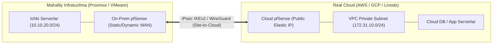

# [KUN-30]: Grand Finale — Real Cloud (AWS / GCP / Linode) Deploy va Hybrid Cloud IPsec Tunnel

**Mavzu:** pfSense-ni Real Bulutda (AWS / GCP / Linode) ishga tushirish, On-Premises (Proxmox / VMware) laboratoriyasi bilan xavfsiz Site-to-Cloud tünel qurish  
**Bosqich:** 4-Hafta: Production va Cloud  
**Amaliyot:** Bulut instansiyasi, Elastic IP, VPC Route Tables va Korxona Gibrid Tarmog'i

---

## 📌 1. Nima Uchun Cloud-da pfSense Kerak?

Ko'p odamlar bulutda (AWS, Azure, GCP) oddiy Security Group yoki Cloud NAT yetarli deb o'ylashadi. Biroq korxona darajasida quyidagi talablar paydo bo'ladi:
1. **Yagona Xavfsizlik Siyosati (Unified Policy):** Ofisdagi pfSense va bulutdagi pfSense bir xil qoidalar, bir xil Suricata IPS va bir xil pfBlockerNG filtrlarini qo'llaydi.
2. **Gibrid Tarmoq (Hybrid Cloud):** Mahalliy ofis yoki data-centerdagi serverlar bulutdagi serverlar bilan shifrlangan, doimiy va tejamkor IPsec / WireGuard orqali bevosita L3 ulanishi kerak.
3. **Multi-Cloud Marshrutlash:** AWS, GCP va Linode o'rtasida mustaqil tranzit shlyuz sifatida ishlash.

---

## 🗺️ 2. Gibrid Tarmoq Sxemasi (Hybrid Cloud Architecture)

---

## ⚙️ 3. Cloud Provayderlar Xususiyatlari

| Provayder | O'rnatish Usuli | Narx / Litsenziya | Tavsiya Qilingan Joylashuv |
|---|---|---|---|
| **AWS (Amazon Web Services)** | AWS Marketplace orqali "pfSense Plus" AMI tanlanadi | Soatbay (Pay-as-you-go) yoki BYOL | Eng keng tarqalgan, VPC Routing va 2 ta ENI qo'llab-quvvatlaydi |
| **Linode (Akamai)** | Custom Image / iPXE orqali FreeBSD yoki pfSense yuklanadi | Juda arzon (oyiga $5-$10 dan boshlanadi) | Byudjetli testlar va shaxsiy VPN shlyuzlar uchun ideal |
| **GCP (Google Cloud)** | Custom Disk Image orqali FreeBSD/pfSense | Compute Engine narxi | Murakkabroq, lekin global tarmoq uchun qulay |

---

## 🚀 4. 30-Kunning Yakuniy Natijalari

1. Real bulutda pfSense ishga tushiriladi va Static Public IP beriladi.
2. Proxmox/VMware-dagi laboratoriyangiz bilan Cloud o'rtasida **IPsec VTI** yoki **WireGuard** tünel ko'tariladi.
3. Mahalliy `10.10.20.x` tarmog'idagi server to'g'ridan-to'g'ri bulutdagi `172.31.10.x` serverga ping yuboradi (NAT yo'q, toza korporativ marshrutlash!).
4. Barcha 30 kunlik maqolalar, diagrammalar va laboratoriya natijalari umumlashtirilib, rezyumengiz yoki portfoliongizga qo'shiladigan **Master Case Study** ga aylanadi!
