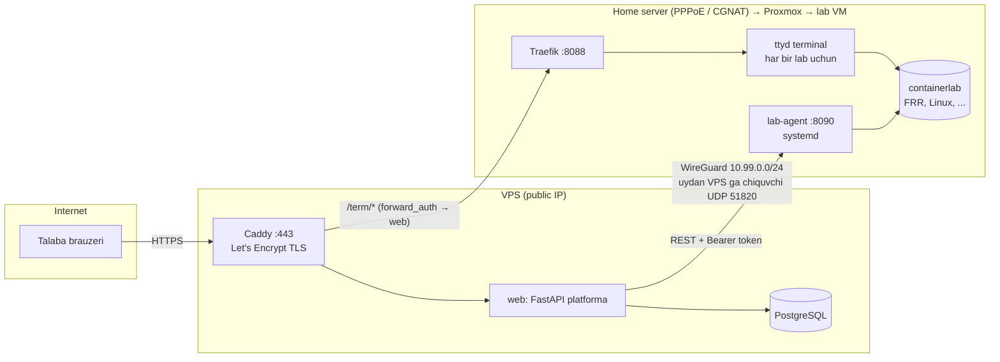
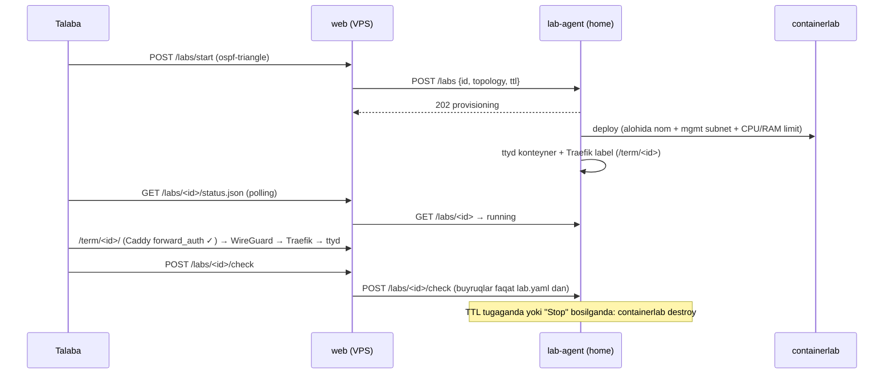

# 🌐 Men Tarmoq — Platforma arxitekturasi va o'rnatish qo'llanmasi

Ushbu hujjat platformani **VPS (public IP) + Home server (PPPoE internet)** infratuzilmasida
noldan ishga tushirishni bosqichma-bosqich tushuntiradi.

---

## 1. Arxitektura



| Komponent | Joylashuvi | Vazifasi |
|---|---|---|
| **web/** | VPS (Docker) | Kurslar, darslar (Markdown), testlar, progress, foydalanuvchilar, admin panel |
| **Caddy** | VPS (Docker) | HTTPS, `/term/*` uchun `forward_auth` (faqat lab egasi kira oladi) |
| **PostgreSQL** | VPS (Docker) | Foydalanuvchilar, progress, test natijalari, lab sessiyalar |
| **lab-agent/** | Home lab VM (systemd) | containerlab topologiyalarini ko'tarish/o'chirish, avto-tekshiruv, TTL |
| **Traefik** | Home lab VM (Docker) | `/term/<id>/` → tegishli ttyd konteyneriga dinamik yo'naltirish |
| **ttyd + lab-shell** | Home (har bir lab uchun konteyner) | Brauzerdagi terminal; faqat o'z lab tugunlariga `docker exec` |
| **WireGuard** | VPS ↔ Home | CGNAT ortidagi home serverni VPS ga ulaydi |

### Nega aynan shunday?

* **PPPoE + CGNAT:** uyga tashqaridan ulanib bo'lmaydi → home server VPS ga **o'zi** ulanadi (`PersistentKeepalive`).
* **Og'ir yuk uyda:** lablar ko'p RAM/CPU talab qiladi — home server buning uchun; kichik VPS faqat web va proxy.
* **Uy IP si yashirin:** internetga faqat VPS ko'rinadi.
* **Uy internet uzilsa:** platforma ishlashda davom etadi, faqat lablar vaqtincha "mavjud emas" bo'ladi.

### Lab hayot sikli



---

## 2. Talablar

| | VPS | Home lab VM |
|---|---|---|
| OS | Ubuntu 22.04/24.04 | Ubuntu 24.04 (Proxmox VM tavsiya) |
| CPU / RAM | 1 vCPU / 1–2 GB | 4+ vCPU / 8–32 GB (≈ 0.5–1 GB har bir lab tuguniga) |
| Disk | 20 GB | 60+ GB (Docker imajlar) |
| Tarmoq | Public IPv4, 80/443/tcp, 51820/udp | Faqat chiquvchi internet (PPPoE/CGNAT bo'lsa ham bo'ladi) |
| Domen | `tarmoq.example.uz` → VPS IP (A yozuv) | — |

> ⚠️ **Xavfsizlik:** lablarni Proxmox host ning o'zida emas, **alohida VM** ichida ishga tushiring.
> Talabalar lab konteynerlarida root huquqiga ega — VM ularni uy tarmog'ingiz va hypervisordan ajratadi.
> VM ni alohida VLAN/bridge ga qo'yib, uy LAN iga yo'lni firewall bilan yoping.

---

## 3. O'rnatish (≈ 30 daqiqa)

### 3.1. VPS

```bash
sudo git clone https://github.com/sarvartech/pfsense-30-days.git /opt/men-tarmoq
cd /opt/men-tarmoq
sudo ./deploy/scripts/setup-vps.sh        # VPS public key ni ko'rsatadi; home key ni so'raydi (hozircha Enter)
```

### 3.2. Home lab VM

```bash
sudo git clone https://github.com/sarvartech/pfsense-30-days.git /opt/men-tarmoq
cd /opt/men-tarmoq
sudo VPS_ENDPOINT=<VPS_IP>:51820 VPS_PUBKEY=<VPS_PUBLIC_KEY> ./deploy/scripts/setup-home.sh
```

Skript oxirida **Home public key** va **AGENT_TOKEN** chiqadi.

### 3.3. VPS ga qaytib — tunnelni yakunlash va platformani ishga tushirish

```bash
sudo HOME_PUBKEY=<HOME_PUBLIC_KEY> ./deploy/scripts/setup-vps.sh
sudo wg show                               # "latest handshake" bo'lishi kerak
ping -c2 10.99.0.2

sudo nano deploy/vps/.env                  # DOMAIN, ACME_EMAIL, ADMIN_EMAILS, LAB_AGENT_TOKEN=<AGENT_TOKEN>
cd deploy/vps && sudo docker compose up -d --build
```

Brauzerda `https://DOMAIN` ni oching → `ADMIN_EMAILS` dagi email bilan ro'yxatdan o'ting → **Admin** panelda
"Lab server: online" ko'rinishi kerak.

### 3.4. Tekshiruv ro'yxati

| Tekshiruv | Buyruq / joy | Kutilgan natija |
|---|---|---|
| Tunnel | VPS: `wg show` | latest handshake < 2 daqiqa |
| Agent | VPS: `curl -H "Authorization: Bearer $TOKEN" http://10.99.0.2:8090/health` | `{"ok":true,...}` |
| Traefik | VPS: `curl -I http://10.99.0.2:8088/term/x/` | `404` (Traefik javob beryapti) |
| Platforma | `https://DOMAIN/healthz` | `{"ok":true}` |
| Lab | Sayt → Laboratoriyalar → *Linux tarmoq asoslari* | Terminal 1–3 daqiqada ochiladi |

---

## 4. Kundalik boshqaruv

```bash
# Kontentni yangilash (yangi dars/kurs qo'shilganda)
cd /opt/men-tarmoq && git pull           # VPS da
# → Admin panel → "Kontentni qayta yuklash" (restart shart emas)
# Yangi lab qo'shilsa — home serverda ham git pull (agent labs/ ni diskdan o'qiydi)

# Loglar
docker compose -f deploy/vps/docker-compose.yml logs -f web     # VPS
journalctl -u men-tarmoq-agent -f                               # Home

# Zaxira nusxa (VPS)
docker compose -f deploy/vps/docker-compose.yml exec db pg_dump -U mentarmoq mentarmoq | gzip > backup-$(date +%F).sql.gz

# Osilib qolgan lablarni qo'lda tozalash (Home)
containerlab inspect --all
docker ps --filter label=men-tarmoq.lab
```

---

## 5. Kontent qo'shish

### 5.1. Yangi dars

1. `courses/<kurs>/lessons/NN-nom.md` yarating:

   ```markdown
   ---
   title: "OSPF multi-area"
   duration: 50
   lab: ospf-triangle          # ixtiyoriy — labs/ dagi nom
   quiz:
     - q: "ABR nima?"
       options: ["Area Border Router", "Autonomous Border Router", "..."]
       answer: 0               # 0 dan boshlanadigan indeks
       explain: "Bir nechta area ga ulangan router."
   ---

   # OSPF multi-area
   Matn, jadvallar, ```mermaid diagrammalar, kod bloklari...
   ```

2. `courses/<kurs>/course.yaml` da tegishli modulga qo'shing:
   `- {slug: ospf-areas, file: lessons/03-ospf-areas.md}`

Faylda yo'q darslar saytda **"tez orada"** sifatida ko'rinadi — shuning uchun avval reja (course.yaml), keyin matn yozish qulay.

### 5.2. Yangi kurs

`courses/<slug>/course.yaml` (namuna: `courses/routing/course.yaml`). `status: soon` — katalogda "Tez orada" belgisi.

### 5.3. Yangi laboratoriya

```
labs/<nom>/
├── topology.clab.yml   # containerlab topologiyasi (nodes, links, binds, exec)
├── lab.yaml            # sarlavha, tugunlar (shell), avto-tekshiruvlar
├── README.md           # talabaga ko'rsatiladigan topshiriqlar
└── ...                 # konfiguratsiya fayllari (daemons, r1.conf ...)
```

`lab.yaml` dagi tekshiruv: `node` ichida `cmd` bajariladi, natija `expect` (regex) ga mos kelsa ✓.
Agent bu buyruqlarni **faqat diskdagi lab.yaml dan** o'qiydi — tarmoq orqali buyruq qabul qilmaydi.

**Vendor imajlari (MikroTik CHR, Cisco IOL, Arista cEOS, Juniper vJunos):** litsenziya talablari sababli
repoda yo'q. [vrnetlab](https://github.com/hellt/vrnetlab) bilan o'zingiz build qilib, home serverga yuklang
va topologiyada `kind: mikrotik_ros` / `kind: cisco_iol` / `kind: ceos` ishlating.

**pfSense lablari:** pfSense konteynerda ishlamaydi — 30 kunlik kurs lablari Proxmox VM larida bajariladi
(qarang: `LAB_TOPOLOGY.md`). Kelajakda: Proxmox API orqali VM klonlash moduli.

---

## 6. Lokal ishlab chiqish

```bash
cd web
python3 -m venv .venv && . .venv/bin/activate
pip install -r requirements-dev.txt
ADMIN_EMAILS=siz@example.com uvicorn app.main:app --reload   # http://127.0.0.1:8000  (SQLite, lablarsiz)
pytest -q                                                   # web testlari
cd ../lab-agent && pip install -r requirements.txt pytest && pytest -q
```

---

## 7. Yo'l xaritasi (keyingi bosqichlar)

- [ ] "Tez orada" darslar matnini yozish (har bir kurs bo'yicha)
- [ ] MikroTik CHR va Cisco IOL lablari (vrnetlab)
- [ ] pfSense lablari uchun Proxmox API orqali VM klonlash
- [ ] Sertifikat (kurs tugatilganda PDF)
- [ ] Telegram bot orqali bildirishnomalar va login
- [ ] Bir nechta lab-server (home + qo'shimcha VPS) — navbat/scheduler
